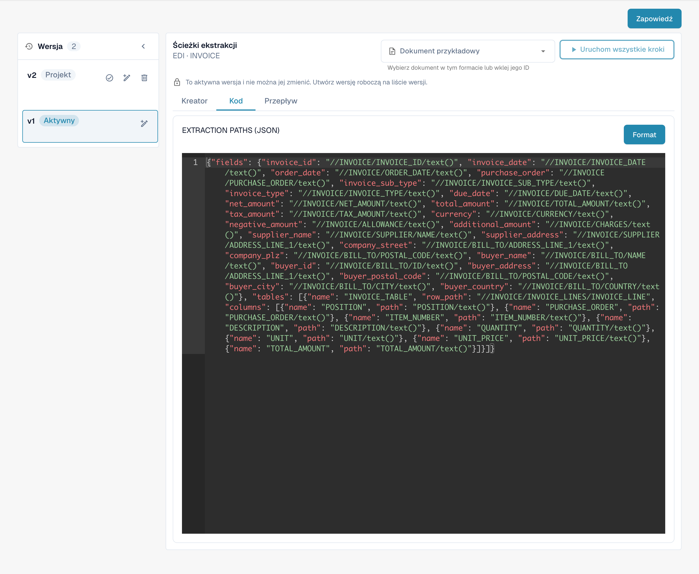

# Przewodnik po pliku ścieżek ekstrakcji EDI

## 1. Przegląd

**Plik ścieżek ekstrakcji** definiuje sposób ekstrakcji danych z **strukturalnego XML** do konkretnych pól dokumentów i tabel w interfejsie. Mapuje **identyfikatory pól** na **wyrażenia XPath**, które są oceniane, aby pobrać wartości z XML do odpowiadających pól dokumentów. Ten plik odgrywa kluczową rolę w zapewnieniu, że wyekstrahowane dane pojawią się poprawnie podczas walidacji pola i przetwarzania w dół.

## 2. Cel i Funkcja

* Mapuje każde pole dokumentu i kolumnę tabeli do określonego miejsca w strukturalnym XML za pomocą wyrażeń XPath.
* Zapewnia, że poprawne wartości są wprowadzane do pól takich jak `order_number`, `supplier_name` i `total_amount`.
* Obsługuje zarówno **pojedyncze pola** (za pomocą obiektu `fields`) jak i **tabelki** (za pomocą tablicy `tables` z ścieżkami wierszy i mapowaniem kolumn).
* Umożliwia precyzyjną kontrolę nad tym, jak dane są pobierane z XML, w tym wykorzystanie funkcji XPath, takich jak `sum()`.

Przykład mapowania pola:

Copy

```
"order_number": "//PURCHASE_ORDER/PURCHASE_ORDER/text()"
```

## 3. Dostęp i Podstawowa Edycja

#### **Dostęp do Pliku:**

1.  Przejdź do **Ustawienia** → **Typ Dokumentu** → _\[Twój Dokument (np. Zamówienie Zakupu)]_ → **E-Dok**.

    
2. W zakładce **E-Dok** wybierz swój format (np. **EDI**).
3.  Kliknij **Ścieżki Ekstrakcji**, aby wyświetlić lub edytować plik.

    

#### **Zarządzanie Wersjami Roboczymi:**

* **Utwórz Wersję Roboczą:** Kliknij ikonę ołówka ✏️.
* **Usuń Wersje Robocze:** Użyj ikony kosza 🗑️, aby usunąć nieużywane wersje robocze.
* **Aktywuj Zmiany:** Kliknij znacznik sprawdzania ✅, aby opublikować wersję.
  * **Uwaga**: Aktywowanie nowej wersji spowoduje **automatyczne dezaktywowanie** poprzedniej.

## 4. Edytor i Składnia

Plik ścieżek ekstrakcji jest napisany w formacie **JSON** i zawiera dwie główne składowe:

* **fields**: Słownik, w którym każdy klucz to identyfikator pola, a każda wartość to wyrażenie XPath definiujące sposób ekstrakcji danych.
* **tables**: Lista definicji tabel, która obejmuje:
  * `name`: ID tabeli.
  * `row_path`: XPath identyfikujący każdy wiersz tabeli.
  * `columns`: Lista mapowań kolumn (`name`, `path`).

Możesz również używać funkcji XPath (np. `sum()`) i wyrażeń do obliczania wartości dynamicznie z powtarzających się elementów.

Copy

```json
"total_net_amount": "sum(//PURCHASE_ORDER/ORDER_LINES/ORDER_LINE/SUB_TOTAL)"
```

## 5. Funkcja Podglądu (Oceń Ekstrakcję)

**Funkcja Podglądu** pozwala symulować zachowanie ścieżek ekstrakcji z rzeczywistym przesłanym dokumentem.

**Użycie:**

* Prześlij plik EDI za pomocą standardowego procesu przesyłania.
* Skopiuj **ID Dokumentu**.
* Przejdź do interfejsu **Ścieżki Ekstrakcji**.
* Otwórz **Funkcję Podglądu**.\
  \
  &#x20;
* Wprowadź ID Dokumentu i kliknij **Test**.
* Wynik pokaże, jak każde pole i tabela jest wypełniona na podstawie skonfigurowanych ścieżek.

Ta funkcja jest istotna do weryfikacji, czy Twoje wyrażenia XPath są poprawnie zdefiniowane i pobierają oczekiwane wartości przed aktywacją wersji roboczej.


## 6. Przewodnik Wideo

Przewodnik wideo dla tego typu pliku jest dostępny na [stronie z filmami.](https://docs.docbits.com/administration-and-setup/settings/global-settings/document-types/edi/edi/edi-videos) Użyj go, aby śledzić konfigurację, edycję i podgląd.

## Faktycznie używane reguły i aktywacja

Jeśli elektroniczna nota kredytowa jest wyświetlana jako Invoice, skorzystaj z [przewodnika rozwiązywania problemów z klasyfikacją](../credit-note-recognized-as-invoice.md). Opisuje on faktycznie używane źródło niestandardowe lub domyślne, kody typów, Extraction Paths i bezpieczną aktywację.


<figure><figcaption><p>Istniejący format EDI z czterema skonfigurowanymi atrybutami.</p></figcaption></figure>

<figure><figcaption><p>Aktywny atrybut EXTRACTIONPATHS: konfiguracja JSON zawierająca wyrażenia XPath do ekstrakcji.</p></figcaption></figure>


Widoki przedstawiają istniejącą konfigurację i wersję. Ustawienia różnią się w zależności od typu dokumentu i formatu. Sprawdź zmiany w wersji roboczej przed aktywacją.

Ilustracje przedstawiają polskie karty etapów oraz aktywną wersję konfiguracji w trybie tylko do odczytu. W pokazanej wersji interfejsu przycisk podglądu ma błędny podpis „Zapowiedź”; odpowiada on funkcji podglądu, oznaczonej w karcie jako „Podgląd”. Techniczne nagłówki edytora, identyfikatory atrybutów i kod konfiguracji pozostają w oryginalnej postaci.
