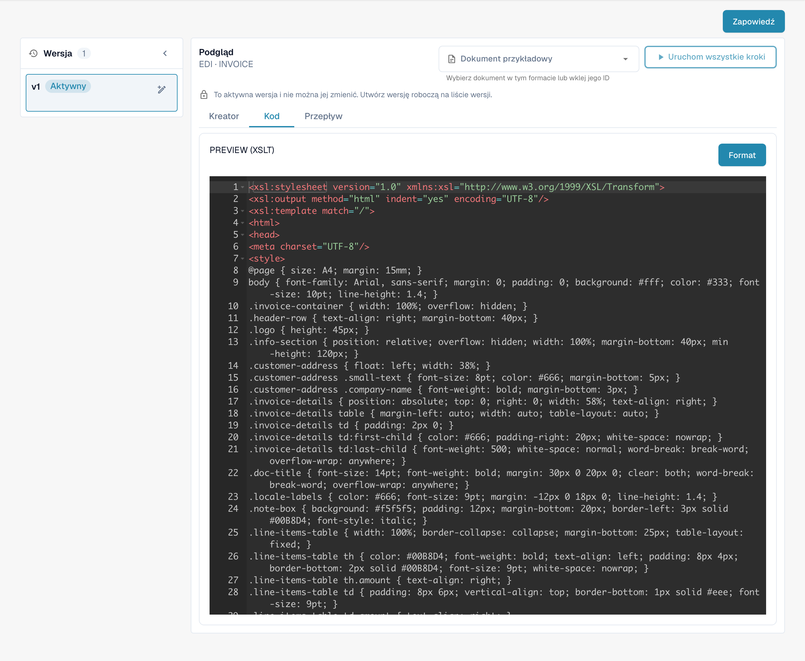

# Przewodnik pliku podglądu EDI

## 1. Przegląd

Plik **Podglądu** definiuje, w jaki sposób strukturalne dane XML są renderowane w czytelny dla człowieka format przypominający PDF. Łączy **HTML i CSS** dla prezentacji wizualnej i używa **XSLT** `**select**` **statements** do dynamicznego wstawiania danych z niestandardowego XML. Ten podgląd jest wyświetlany podczas **walidacji pola** i jest również dołączany podczas eksportowania dokumentów do **IDM**.

## 2. Cel i Funkcja

* Konwertuje czytelne dla maszyny niestandardowe XML na wizualnie sformatowany podgląd (PDF).
* Umożliwia przeglądanie i walidację wydobytych danych w sposób przyjazny dla człowieka.
* Zapewnia spójne renderowanie kluczowych pól dokumentu, takich jak nagłówki, tabele, sumy, itp.
* Zbudowany przy użyciu **HTML + CSS** do układu i projektowania oraz **XSLT** do wiązania danych z układem.

## 3. Dostęp i Podstawowa Edycja

#### **Dostęp do Pliku:**

1.  Przejdź do **Ustawienia** → **Typ Dokumentu** → _\[Twój Dokument (np. Zamówienie Zakupu)]_ → **E-Dok**.

    
2. W zakładce **E-Dok** wybierz swój format (np. **EDI**).
3.  Kliknij **Podgląd**, aby wyświetlić lub edytować plik.

    

#### **Zarządzanie Wersjami Roboczymi:**

* **Utwórz Wersję Roboczą:** Kliknij ikonę ✏️ ołówka.
* **Usuń Wersje Robocze:** Użyj ikony 🗑️ kosza, aby usunąć nieużywane wersje robocze.
* **Aktywuj Zmiany:** Kliknij ikonę ✅ zaznaczenia, aby opublikować wersję.
  * **Uwaga**: Aktywowanie nowej wersji spowoduje **automatyczne dezaktywowanie** poprzedniej.

## 4. Edytor HTML/XSLT/CSS

Plik **Podglądu** jest edytowany w dedykowanym edytorze obsługującym HTML, XSLT i CSS.

* **HTML** definiuje strukturę dokumentu wyjściowego (np. tabele, divy, układ).
* **CSS** kontroluje stylowanie (np. czcionki, odstępy, kolory, wyrównanie).
*   **XSLT** `**select**` **statements** są używane do dynamicznego wypełniania pól z niestandardowego XML, takich jak:

    Copy

    ```
    <xsl:value-of select="/PURCHASE_ORDER/PURCHASE_ORDER_NUMBER/text()" />
    ```
* Możesz również używać **logiki XSLT** (`<xsl:if>`, `<xsl:for-each>`, itp.) do obsługi warunkowego wyświetlania lub iterowania po pozycjach linii.

## 5. Funkcja Podglądu (Renderowanie Wyjścia)

Funkcja Podglądu pozwala testować i weryfikować, w jaki sposób dokument EDI jest renderowany z bieżącym plikiem podglądu.

#### **Użycie:**

* Prześlij plik EDI za pomocą standardowego procesu przesyłania.
* Skopiuj **ID Dokumentu** przesłanego pliku.
* Przejdź do interfejsu **Podglądu**.
* Otwórz **Funkcję Podglądu**.\
  \
  &#x20;
* Wprowadź ID Dokumentu i kliknij **Test**.
* Renderowany podgląd w stylu PDF zostanie wyświetlony przy użyciu konfiguracji HTML/CSS/XSLT.

Ta funkcja jest kluczowa do debugowania wiązań danych, doskonalenia układu i zapewnienia, że dokument jest zarówno dokładny, jak i wizualnie czytelny dla użytkowników i systemów potokowych, takich jak **IDM**.


## 6. Przewodnik Wideo

Przewodnik wideo dla tego typu pliku jest dostępny na [stronie z Filmami.](https://docs.docbits.com/administration-and-setup/settings/global-settings/document-types/edi/edi/edi-videos) Użyj go, aby śledzić konfigurację, edycję i podgląd.


<figure><figcaption><p>Istniejący format EDI z czterema skonfigurowanymi atrybutami.</p></figcaption></figure>

<figure><figcaption><p>Aktywny atrybut PREVIEW: kod źródłowy XSLT w edytorze; ten widok nie przedstawia wyrenderowanego podglądu dokumentu.</p></figcaption></figure>


Widoki przedstawiają istniejącą konfigurację i wersję. Ustawienia różnią się w zależności od typu dokumentu i formatu. Sprawdź zmiany w wersji roboczej przed aktywacją.

Ilustracje przedstawiają polskie karty etapów oraz aktywną wersję konfiguracji w trybie tylko do odczytu. W pokazanej wersji interfejsu przycisk podglądu ma błędny podpis „Zapowiedź”; odpowiada on funkcji podglądu, oznaczonej w karcie jako „Podgląd”. Techniczne nagłówki edytora, identyfikatory atrybutów i kod konfiguracji pozostają w oryginalnej postaci.
