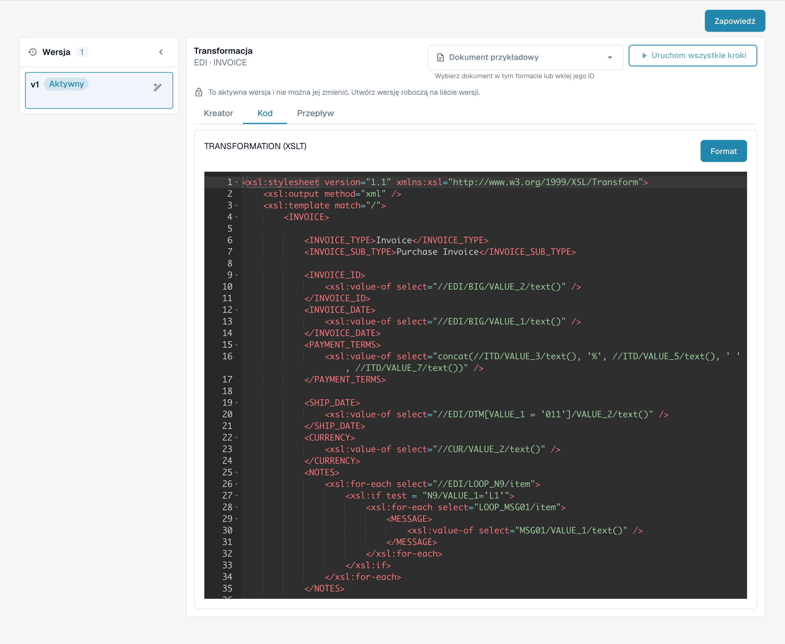

# Konfiguracja Szablonów EDI

## Oto instrukcje krok po kroku dotyczące konfigurowania szablonów EDI:

<figure><figcaption>
Istniejący format EDI z czterema skonfigurowanymi atrybutami.
</figcaption></figure>

**Zdefiniuj deskryptor struktury:**

* Zidentyfikuj typ komunikatu EDI, z którym pracujesz, np. ANSI X12, EDIFACT lub format niestandardowy.
* Określ segmenty, elementy i podelementy w strukturze EDI.
* Utwórz deskryptor struktury, który dokładnie odzwierciedla hierarchię i organizację komunikatu EDI. Można to zrobić za pomocą specjalnej składni, takiej jak XML lub JSON.

<figure><figcaption>
Aktywny atrybut STRUCTUREDESCRIPTOR: deskryptor struktury JSON w edytorze tylko do odczytu.
</figcaption></figure>

**Skonfiguruj transformacje:**

* Użyj odpowiedniego narzędzia lub oprogramowania obsługującego transformacje EDI, takiego jak translator EDI.
* Zdefiniuj reguły konwersji komunikatu EDI na wewnętrzny format systemu i odwrotnie.
* Skonfiguruj transformacje tak, aby interpretowały i przetwarzały segmenty, elementy i podelementy zgodnie z wymaganiami systemu. Dokładnie przetestuj transformacje, aby upewnić się, że dane są poprawnie interpretowane i formatowane.

<figure><figcaption>
Aktywny atrybut TRANSFORMATION: kod źródłowy XSLT do transformacji pośredniego XML.
</figcaption></figure>

**Skonfiguruj ścieżki ekstrakcji dla optymalnego wyodrębniania i formatowania danych:**

* Zidentyfikuj pola danych, które mają zostać wyodrębnione i przesłane do wewnętrznego systemu.
* Zdefiniuj ścieżki ekstrakcji lub reguły wyodrębniania odpowiednich pól danych z komunikatów EDI.
* Weź pod uwagę różne warianty i formaty, które mogą wystąpić w przychodzących komunikatach EDI, i upewnij się, że ścieżki ekstrakcji są wystarczająco elastyczne, aby je obsłużyć.
* Zweryfikuj wyniki ekstrakcji, aby upewnić się, że wyodrębniono prawidłowe pola danych i zostały one poprawnie sformatowane.

<figure><figcaption>
Aktywny atrybut EXTRACTIONPATHS: konfiguracja JSON zawierająca wyrażenia XPath do ekstrakcji.
</figcaption></figure>

Starannie definiując deskryptor struktury, konfigurując transformacje i ścieżki ekstrakcji, możesz zapewnić optymalne wyodrębnianie i formatowanie danych w szablonach EDI. Pomoże to zwiększyć wydajność i dokładność Twojej elektronicznej komunikacji biznesowej.

Widoki przedstawiają istniejącą konfigurację i wersję. Ustawienia różnią się w zależności od typu dokumentu i formatu. Sprawdź zmiany w wersji roboczej przed aktywacją.

Ilustracje przedstawiają polskie karty etapów oraz aktywną wersję konfiguracji w trybie tylko do odczytu. W pokazanej wersji interfejsu przycisk podglądu ma błędny podpis „Zapowiedź”; odpowiada on funkcji podglądu, oznaczonej w karcie jako „Podgląd”. Techniczne nagłówki edytora, identyfikatory atrybutów i kod konfiguracji pozostają w oryginalnej postaci.
