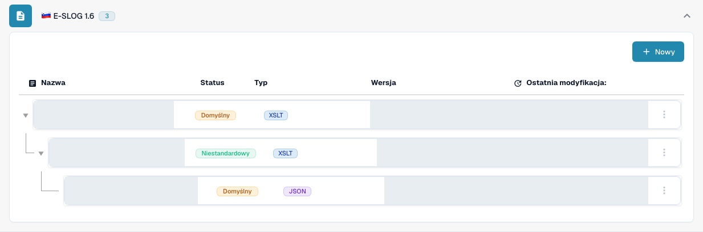
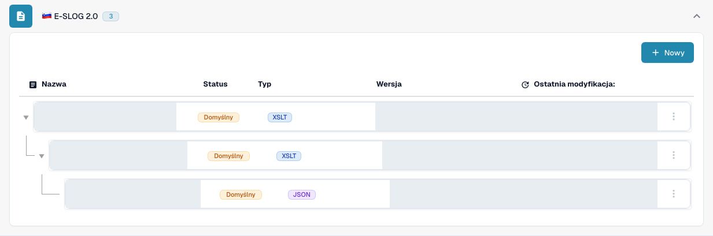

# eSLOG 1.6 i 2.0

**eSLOG 1.6** i **eSLOG 2.0** są w DocBits osobnymi formatami faktur elektronicznych. Wybierz wersję używaną przez przychodzącą słoweńską fakturę. Poniższe zrzuty ekranu pokazują rzeczywisty polski interfejs DocBits w widoku testowym; nie dowodzą, że faktura w którejkolwiek z tych wersji została przetworzona pomyślnie.

## Znajdowanie konfiguracji

1. Przejdź do **Ustawienia → Typy dokumentów → Faktura → E-dokument**.
2. Rozwiń **E-SLOG 1.6** lub **E-SLOG 2.0**. Każdy format ma własne trzy wpisy.

<figure><figcaption>E-SLOG 1.6: od góry transformacja, podgląd i ścieżki ekstrakcji. Widok testowy zawiera dwa wpisy domyślne i jeden istniejący wpis niestandardowy. Nazwy, wersje i daty są zamaskowane.</figcaption></figure>

<figure><figcaption>E-SLOG 2.0: osobne wpisy dla tych samych trzech etapów, tutaj wszystkie oznaczone jako Domyślny. Nazwy, wersje i daty są zamaskowane.</figcaption></figure>

| Wpis | Co kontroluje | Kolejny przewodnik |
| --- | --- | --- |
| **TRANSFORMATION (XSLT)** | Konwertuje dane źródłowe formatu na ustrukturyzowany XML. | [Transformacja](edi/edi-transformation-file-guide.md) |
| **PREVIEW (XSLT)** | Definiuje czytelny widok dokumentu. | [Podgląd](edi/edi-preview-file-guide.md) |
| **EXTRACTION PATHS (JSON)** | Mapuje wartości XML na pola DocBits i kolumny tabeli. | [Ścieżki ekstrakcji](edi/edi-extraction-paths-file-guide.md) |

Kliknij wiersz, aby zobaczyć jego wersje i konfigurację. **Domyślny** oznacza dostarczony wpis, a **Niestandardowy** własny wariant. Kolumna **Ostatnia modyfikacja:** pokazuje, kiedy wpis ostatnio zmieniono. Przycisk **Nowy** otwiera formularz dodatkowego wpisu konfiguracji. Menu z trzema kropkami w wierszu domyślnym oferuje **Dostosuj**, które natychmiast tworzy kopię specyficzną dla organizacji, oraz **Usuwać**; przed użyciem opcji Usuwać uważnie sprawdź wybrany wiersz.

W konfiguracji ołówek obok aktywnej wersji tworzy wersję roboczą. Sprawdź wersję roboczą w panelu testowym **Preview**, używając ID reprezentatywnego przesłanego dokumentu, zanim aktywujesz ją znacznikiem wyboru. Ikona kosza przy wersji roboczej usuwa tę wersję roboczą. Rzeczywiste nazwy pól i ścieżki XML zależą od Twojego pliku eSLOG; szczegóły edytora znajdziesz w odpowiednim przewodniku powyżej.
