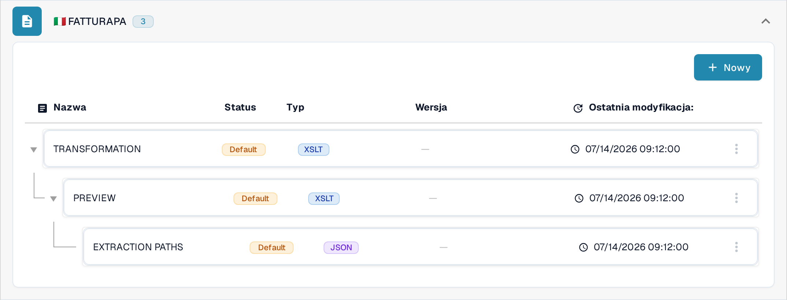
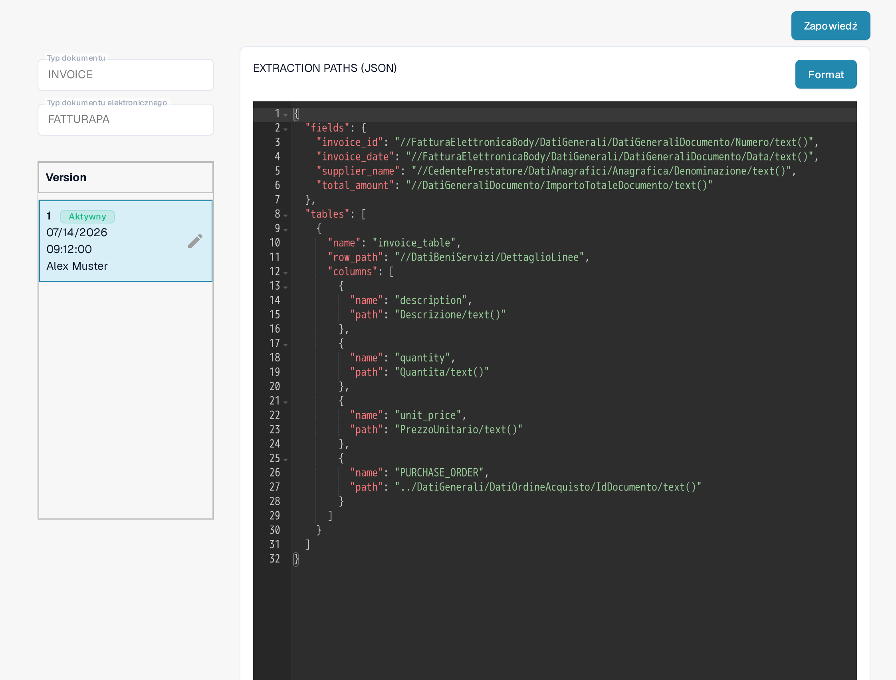
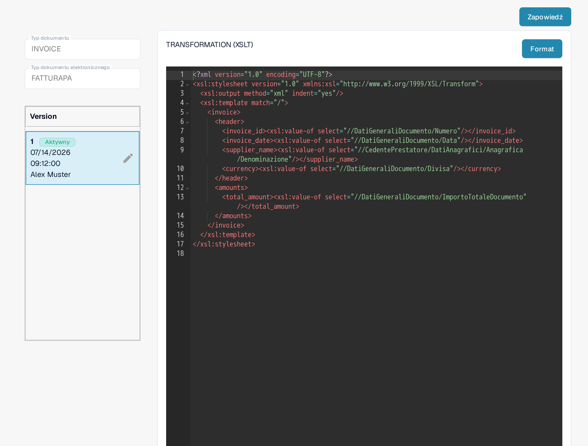
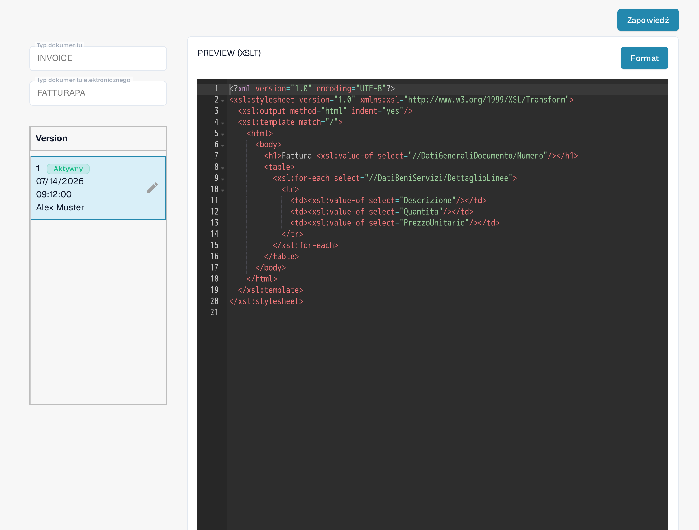

# FatturaPA: wyświetlanie atrybutu w liniach faktury

FatturaPA to włoski format faktur elektronicznych. Ta strona wyjaśnia, gdzie sprawdzić atrybut linii, np. numer zamówienia zakupu, przed zmianą mapowania lub podglądu faktury. **Nie dodawaj drugiej kolumny `PURCHASE_ORDER` bez wcześniejszego sprawdzenia aktywnego mapowania:** bieżące mapowanie w Sandboksie już je zawiera.

## Odnajdź trzy pliki FatturaPA

Otwórz **Ustawienia → Typy Dokumentów → E-Doc**, wybierz **INVOICE**, a następnie rozwiń **FATTURAPA**. Bieżąca lista zawiera trzy różne pliki:

* **TRANSFORMATION (XSLT)** odczytuje źródłowy plik XML FatturaPA i tworzy znormalizowane dane faktury.
* **PREVIEW (XSLT)** buduje wizualny podgląd faktury w stylu HTML/PDF na podstawie tych danych.
* **EXTRACTION PATHS (JSON)** mapuje znormalizowane wartości na pola i kolumny tabel DocBits.

<figure><figcaption>
Aktualna lista plików FATTURAPA w polskiej wersji Sandboksa.
</figcaption></figure>

## Sprawdź wyekstrahowaną wartość linii

Otwórz **EXTRACTION PATHS (JSON)**. W aktywnej wersji znajdź tablicę `tables` i jej `columns`. Widoczna wersja w Sandboksie zawiera już `{"name": "PURCHASE_ORDER", "path": "PURCHASE_ORDER"}`. Sprawdź wartość na rzeczywistej fakturze testowej przed jej edycją. Jeśli potrzebujesz innego atrybutu, ustal jego wartość w znormalizowanych danych, a następnie dodaj odrębną nazwę kolumny i odpowiadającą jej ścieżkę w wersji roboczej.

<figure><figcaption>
Aktywne mapowanie ekstrakcji JSON zawiera już kolumnę numeru zamówienia zakupu.
</figcaption></figure>

## Zmieniaj transformację lub podgląd tylko wtedy, gdy to konieczne

Jeśli znormalizowana wartość jest nieobecna, obejrzyj **TRANSFORMATION (XSLT)** oraz ścieżkę XML źródła, która ma ją wygenerować. Zmiana w tym miejscu wpływa na dane używane przez kolejne kroki mapowania i podglądu. Jeśli wartość jest wyekstrahowana poprawnie, ale nie pojawia się na wizualnej fakturze, obejrzyj **PREVIEW (XSLT)** oraz odpowiedni wiersz tabeli w tym szablonie. Oba pliki XSLT mają różne przeznaczenie.

<figure><figcaption>
Transformacja odczytuje źródłowy XML i buduje znormalizowane pola faktury.
</figcaption></figure>

<figure><figcaption>
Podgląd steruje wizualnym wynikiem faktury.
</figcaption></figure>

Użyj ikony ołówka na karcie wersji, aby przygotować zmianę. Przejrzyj wersję roboczą i użyj **Zapowiedzi** z reprezentatywną fakturą FatturaPA przed jej aktywacją. Zrzuty ekranu pokazują aktualne wersje aktywne; w tej sesji Sandboksa nie zapisano wersji roboczej ani nie uruchomiono testu podglądu.

Dawna instrukcja, że wszystkie dokumenty elektroniczne mają jako pochodzenie Wielką Brytanię, nie jest bezpieczną regułą ogólną. Sprawdź kraj, walutę i format liczbowy faktury w odniesieniu do dokumentu źródłowego oraz konfiguracji Twojej organizacji.
