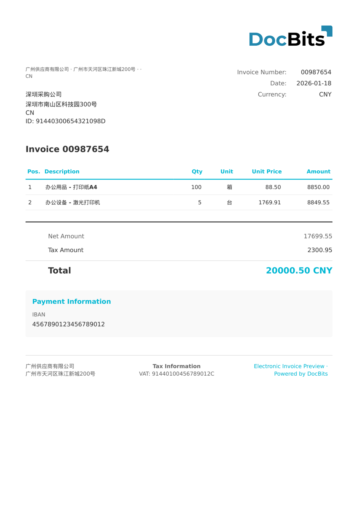

# 🇨🇳 China Fapiao

<!-- edocs-country-scope -->


Sprawdź w przewodniku krajowym ograniczenia wersji, faktycznie używaną konfigurację i film objaśniający dla kraju. [Chiny](countries/china.md). Udokumentowany adapter używa przestrzeni nazw XML urn:china:tax:fapiao:1.0. Nie zakładaj, że każdy natywny plik OFD, PDF lub eksport z platformy podatkowej jest zgodny z tym kontraktem danych.


| Właściwość | Wartość |
|----------|-------|
| **Kraj / Region** | China |
| **Typy dokumentów** | Ogólna faktura VAT (普通发票), Specjalna faktura VAT (专用发票), E-Fapiao |
| **Format** | XML |
| **Standard** | Fapiao (发票), State Taxation Administration |
| **Ustawienia regionalne** | `zh_CN` |

Katalog obejmuje Fapiao, E-Fapiao, General VAT Invoice i Special VAT Invoice. Udokumentowany adapter używa przestrzeni nazw XML urn:china:tax:fapiao:1.0. Nie zakładaj, że każdy natywny plik OFD, PDF lub eksport z platformy podatkowej jest zgodny z tym kontraktem danych.

| Wartość fapiao_type | Typ dokumentu |
|-------------------|--------------|
| 普通发票 | Ogólna faktura VAT (FAPIAO / GENERAL VAT INVOICE) |
| 专用发票 | Specjalna faktura VAT (SPECIAL VAT INVOICE) |
| 电子发票 | E-Fapiao (E-FAPIAO) |

## Status obsługi

| Komponent | Status |
|-----------|--------|
| Podgląd | ✅ Supported |
| Ekstrakcja pól | ✅ Supported |
| Transformacja | ✅ Supported |

## Domyślny podgląd

<figure><figcaption>
Domyślny podgląd DocBits dla chińskiej ogólnej faktury VAT Fapiao (普通发票)
</figcaption></figure>

## Mapowanie pól

### Pola nagłówka

| Pole DocBits | Źródłowy element XML | Uwagi |
|---|---|---|
| `invoice_id` | `fapiao_head/fapiao_number` | Numer Fapiao — 8 cyfr (发票号码) |
| `invoice_date` | `fapiao_head/issue_date` | Data wystawienia (ISO 8601) |
| `currency` | Stałe: `CNY` | Zawsze chiński juan renminbi |
| `total_amount` | `total/total_with_tax` | Kwota całkowita z VAT (价税合计) |
| `net_amount` | `total/total_amount` | Netto podstawa opodatkowania bez VAT (金额) |
| `tax_amount` | `total/total_tax` | Łączna kwota VAT (税额) |
| `supplier_name` | `seller/name` | Nazwa firmy sprzedawcy (销售方名称) |
| `supplier_id` | `seller/taxpayer_id` | NIP sprzedawcy — 18 znaków (纳税人识别号) |
| `supplier_address` | `seller/address` | Adres sprzedawcy |
| `supplier_country` | Stałe: `CN` | Zawsze Chiny |
| `iban` | `seller/bank_account` | Numer konta bankowego sprzedawcy |
| `buyer_name` | `buyer/name` | Nazwa firmy kupującego (购买方名称) |
| `buyer_id` | `buyer/taxpayer_id` | NIP kupującego (纳税人识别号) |
| `buyer_address` | `buyer/address` | Adres kupującego |
| `buyer_country` | Stałe: `CN` | Zawsze Chiny |

### Tabela pozycji (`INVOICE_TABLE`)

Ścieżka wiersza: `items/item`

| Kolumna | Źródłowy element XML | Uwagi |
|---|---|---|
| `POSITION` | `seq` | Numer kolejny pozycji |
| `DESCRIPTION` | `name` + `spec` | Nazwa artykułu i specyfikacja (połączone) |
| `QUANTITY` | `quantity` | Ilość |
| `UNIT` | `unit` | Jednostka miary (np. 箱, 台, 项) |
| `UNIT_PRICE` | `unit_price` | Cena jednostkowa bez VAT |
| `VAT_RATE` | `tax_rate` | Stawka VAT w % (zazwyczaj 6%, 9% lub 13%) |
| `VAT` | `tax_amount` | Kwota VAT dla pozycji |
| `NET_AMOUNT` | `amount` | Wartość pozycji bez VAT |

## Reguły klasyfikacji

DocBits wykrywa dokumenty China Fapiao przez dopasowanie przestrzeni nazw XML i `fapiao_type`:

| Typ dokumentu elektronicznego | Wzorzec |
|--------------------------|---------|
| CHINA GENERAL VAT INVOICE | `urn:china:tax:fapiao:1.0` + `<fapiao_type>普通发票</fapiao_type>` |
| CHINA SPECIAL VAT INVOICE | `urn:china:tax:fapiao:1.0` + `<fapiao_type>专用发票</fapiao_type>` |
| CHINA E-FAPIAO | `urn:china:tax:fapiao:1.0` + `<fapiao_type>电子发票</fapiao_type>` |

Elementem głównym jest `<fapiao>` z przestrzenią nazw `urn:china:tax:fapiao:1.0`. Klasyfikacja stosuje zasadę **first-match-wins** posortowaną według długości wzorca (najdłuższy pierwszy).

## Powiązane

- [Aktualnie obsługiwane standardy e-faktur](../currently-supported-e-invoice-standards/README.md)
- [Obsługiwane dokumenty elektroniczne](./)
