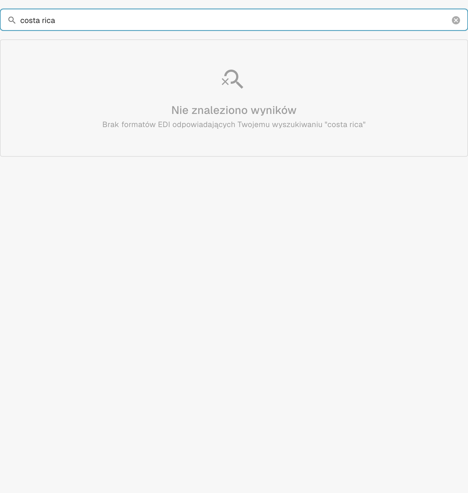

# Kostaryka

Skorzystaj z tego przewodnika, aby ustalić skonfigurowaną rodzinę i zakres wersji przed testowaniem pliku źródłowego.

[Wszystkie kraje i zakres obsługi](../README.md)

## Warianty i ograniczenia wersji

Starsza dokumentacja wymienia Kostarykę, ale w sprawdzonym katalogu środowiska deweloperskiego nie znaleziono pasującego wpisu klasyfikacji ani konfiguracji.

**Składnia:** Niepotwierdzone

Ta kontrola nie potwierdza aktualnego wbudowanego przetwarzania. Poproś pomoc techniczną o sprawdzenie wdrożonego mapowania i przetestuj reprezentatywny plik źródłowy przed wdrożeniem.

Tabele przedstawiają wyniki kontroli katalogu środowiska deweloperskiego z 17 października 2026 i odpowiadającego mu kodu przetwarzania. Opisują dostępne reguły i komponenty konfiguracji, a nie certyfikację każdego pliku, wymogu prawnego czy wdrożenia produkcyjnego. Twoja organizacja może nadpisać ustawienia domyślne.

## Macierz sprawdzonych reguł i komponentów

Nie znaleziono pasującego wpisu klasyfikacji ani konfiguracji. Ta kontrola nie potwierdza aktualnej wbudowanej obsługi.

## Znajdź mapowanie w DocBits

<figure><figcaption>
Rzeczywisty interfejs środowiska deweloperskiego: wyszukiwanie nazwy tego kraju nie zwróciło pasującego wpisu konfiguracji w sprawdzonym katalogu.
</figcaption></figure>

## Film objaśniający dla kraju

Narracja i napisy WebVTT w wybranym języku wyjaśniają wybór formatu, konfigurację i kontrole akceptacyjne.

Ten przegląd bez wprowadzania zmian pokazuje istniejącą konfigurację kraju w DocBits. Sprawdź używane źródło i aktywną wersję, a następnie przetestuj reprezentatywne faktury, noty kredytowe i eksporty we własnej organizacji.


Kostaryka — Film objaśniający dla kraju



WebVTT


## Kontrole akceptacyjne

Kontrola komponentów potwierdza obecność konfiguracji. Nie jest testem pełnego przetwarzania każdej wersji. Przetestuj dokładną zawartość danych oraz ścieżkę faktury lub noty kredytowej wymaganą przez integrację.

## Sprawdź format w swojej organizacji

1. Zachowaj oryginalny plik XML lub PDF z osadzonym XML. Odczytaj przestrzeń nazw, schemat lub identyfikator dostosowania oraz zadeklarowaną wersję lub profil.

2. Otwórz Ustawienia → Typy dokumentów → E-Doc dla odpowiedniego dokumentu biznesowego. Wyszukaj dokładny format dokumentu elektronicznego podany w przewodniku.

3. Sprawdź faktycznie używane źródło Default lub Custom oraz aktywną wersję konfiguracji. Sprawdź Transformation, Preview i Extraction Paths. Zapisanie wersji roboczej nie powoduje jej aktywowania.

4. Przetestuj reprezentatywne pliki źródłowe dla każdej wymaganej składni, wersji i rodzaju dokumentu biznesowego. Sprawdź kluczowe pola, kwoty, podatek, klasyfikację faktury lub noty kredytowej i eksport do ERP.

5. Osobno potwierdź zasady walidacji i transport. Zachowaj mapowania niestandardowe oraz sprawdź zatwierdzenia i historię eksportu przed ponownym uruchomieniem istniejących dokumentów.

## Powiązana dokumentacja formatu

- [🇨🇷 COSTA RICA](../costa-rica.md)
