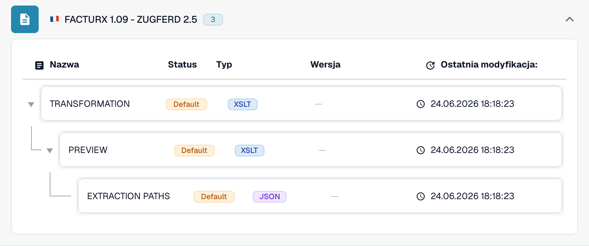

# Francja

Skorzystaj z tego przewodnika, aby ustalić skonfigurowaną rodzinę i zakres wersji przed testowaniem pliku źródłowego.

[Wszystkie kraje i zakres obsługi](../README.md)

## Warianty i ograniczenia wersji

Factur-X ma wpisy ogólne i przypisane do konkretnych wydań, w tym 1.0.05, 1.08 i 1.09. VRBL FR CIUS 1.0 jest odrębny.

**Składnia:** CII / PDF + XML

Znacznik XML 1p0 i Factur-X XMP Version 1.0 nie określają wydania publikacji. Zachowaj ogólne oznaczenie, gdy wydanie jest nieznane.

Tabele przedstawiają wyniki kontroli katalogu środowiska deweloperskiego z 17 października 2026 i odpowiadającego mu kodu przetwarzania. Opisują dostępne reguły i komponenty konfiguracji, a nie certyfikację każdego pliku, wymogu prawnego czy wdrożenia produkcyjnego. Twoja organizacja może nadpisać ustawienia domyślne.

## Macierz sprawdzonych reguł i komponentów

| Dokładne oznaczenie formatu | Klucz dokumentu reguły | Dostępne komponenty |
| --- | --- | --- |
| `FACTURX` | `INVOICE` | C / T / P / E |
| `FACTURX 1.0.05 - ZUGFERD 2.1` | `INVOICE` | C / T / P / E |
| `FACTURX 1.0.05 BASIC` | `INVOICE` | C / T / P / E |
| `FACTURX 1.0.05 EN16931` | `INVOICE` | C / T / P / E |
| `FACTURX 1.0.05 EXTENDED` | `INVOICE` | C / T / P / E |
| `FACTURX 1.08 - ZUGFERD 2.4` | `INVOICE` | C / T / P / E |
| `FACTURX 1.09 - ZUGFERD 2.5` | `INVOICE` | C / T / P / E |
| `VRBL FR CIUS 1.0` | `INVOICE` | C / T / P / E |

C = klasyfikacja, T = Transformation, P = Preview, E = Extraction Paths. Klucz dokumentu służy do wyszukiwania reguł i konfiguracji; nie gwarantuje ostatecznej zapisanej wartości invoice_type. Transformacja może sklasyfikować notę kredytową za pomocą mapowania INVOICE.

Myślnik oznacza, że kontrola statusu nie wykazała dedykowanego komponentu dla tej dokładnej pary formatu i klucza dokumentu. Nie wyklucza to mapowania współdzielonego lub rezerwowego. Zanim oprzesz się na tej ścieżce, sprawdź faktycznie używany mechanizm wyboru mapowania i reprezentatywny plik.

### Dodatkowe oznaczenia konfiguracji

Te oznaczenia mają wpisy konfiguracji, ale nie mają samodzielnej reguły klasyfikacji w sprawdzonym katalogu. Ogólna rodzina lub doprecyzowanie tożsamości formatu może wybrać zgodną ścieżkę. Sama ich obecność nie potwierdza automatycznego wykrywania danej publikacji lub profilu.

- `FACTURX 1.0.05 BASIC WL`
- `FACTURX 1.0.05 MINIMUM`
- `FACTURX 1.0.06 BASIC`
- `FACTURX 1.0.06 BASIC WL`
- `FACTURX 1.0.06 EN16931`
- `FACTURX 1.0.06 EXTENDED`
- `FACTURX 1.0.06 MINIMUM`
- `FACTURX 1.0.07 BASIC`
- `FACTURX 1.0.07 BASIC WL`
- `FACTURX 1.0.07 EN16931`
- `FACTURX 1.0.07 EXTENDED`
- `FACTURX 1.0.07 MINIMUM`
- `FACTURX 1.0.07.2 - ZUGFERD 2.3.2`
- `FACTURX 1.0.07.2 BASIC`
- `FACTURX 1.0.07.2 BASIC WL`
- `FACTURX 1.0.07.2 EN16931`
- `FACTURX 1.0.07.2 EXTENDED`
- `FACTURX 1.0.07.2 MINIMUM`
- `FACTURX 1.08 BASIC`
- `FACTURX 1.08 BASIC WL`
- `FACTURX 1.08 EN16931`
- `FACTURX 1.08 EXTENDED`
- `FACTURX 1.08 MINIMUM`
- `FACTURX 1.09 BASIC`
- `FACTURX 1.09 BASIC WL`
- `FACTURX 1.09 EN16931`
- `FACTURX 1.09 EXTENDED`
- `FACTURX 1.09 MINIMUM`

### Factur-X / ZUGFeRD: nie zakładaj wersji publikacji

Zharmonizowany CII Guideline ID może identyfikować rodzinę i profil, mimo że kilka wydań używa tego samego znacznika 1p0. Factur-X XMP Version 1.0 jest znacznikiem schematu, a nie publikacją taką jak 1.08 czy 1.09. ZUGFeRD XMP może deklarować swoją wersję. Gdy brakuje miarodajnych metadanych, zachowaj ogólny wynik rozpoznania rodziny i potwierdź oryginalny plik z nadawcą.

MINIMUM i BASIC WL mogą pomijać dane pozycji potrzebne w dalszym przetwarzaniu. BASIC, EN16931/COMFORT i EXTENDED zapewniają różny zakres danych. Szerszy profil może zawierać pola, których mapowanie ekstrakcji nie wykorzystuje. Sprawdź wymagane pola na rzeczywistych przykładach.

## Znajdź mapowanie w DocBits

<figure><figcaption>
Rzeczywisty interfejs środowiska deweloperskiego: przykładowy format i dostępne komponenty konfiguracji. Pozostałe wersje wymieniono w macierzy.
</figcaption></figure>

## Film objaśniający dla kraju

Narracja i napisy WebVTT w wybranym języku wyjaśniają wybór formatu, konfigurację i kontrole akceptacyjne.

Ten przegląd bez wprowadzania zmian pokazuje istniejącą konfigurację kraju w DocBits. Sprawdź używane źródło i aktywną wersję, a następnie przetestuj reprezentatywne faktury, noty kredytowe i eksporty we własnej organizacji.


Francja — Film objaśniający dla kraju



WebVTT


## Kontrole akceptacyjne

Kontrola komponentów potwierdza obecność konfiguracji. Nie jest testem pełnego przetwarzania każdej wersji. Przetestuj dokładną zawartość danych oraz ścieżkę faktury lub noty kredytowej wymaganą przez integrację.

## Sprawdź format w swojej organizacji

1. Zachowaj oryginalny plik XML lub PDF z osadzonym XML. Odczytaj przestrzeń nazw, schemat lub identyfikator dostosowania oraz zadeklarowaną wersję lub profil.

2. Otwórz Ustawienia → Typy dokumentów → E-Doc dla odpowiedniego dokumentu biznesowego. Wyszukaj dokładny format dokumentu elektronicznego podany w przewodniku.

3. Sprawdź faktycznie używane źródło Default lub Custom oraz aktywną wersję konfiguracji. Sprawdź Transformation, Preview i Extraction Paths. Zapisanie wersji roboczej nie powoduje jej aktywowania.

4. Przetestuj reprezentatywne pliki źródłowe dla każdej wymaganej składni, wersji i rodzaju dokumentu biznesowego. Sprawdź kluczowe pola, kwoty, podatek, klasyfikację faktury lub noty kredytowej i eksport do ERP.

5. Osobno potwierdź zasady walidacji i transport. Zachowaj mapowania niestandardowe oraz sprawdź zatwierdzenia i historię eksportu przed ponownym uruchomieniem istniejących dokumentów.

## Powiązana dokumentacja formatu

- [🇫🇷 FACTURX](../facturx.md)
- [🇫🇷 FACTURX 1.0.05 - ZUGFERD 2.1](../facturx-1-0-05-zugferd-2-1.md)
- [🇫🇷 FACTURX 1.0.07.2 - ZUGFERD 2.3.2](../facturx-1-0-07-2-zugferd-2-3-2.md)
- [🇫🇷 FACTURX 1.09 - ZUGFERD 2.5](../facturx-1-09-zugferd-2-5.md)
