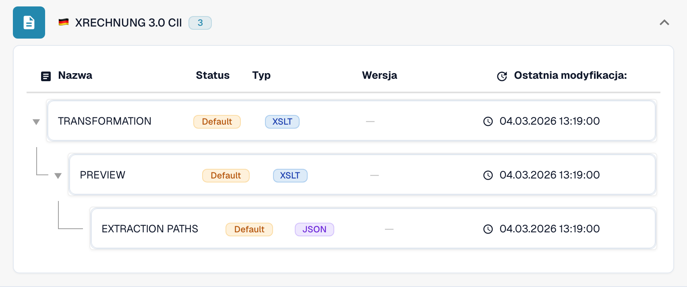

# Niemcy

Skorzystaj z tego przewodnika, aby ustalić skonfigurowaną rodzinę i zakres wersji przed testowaniem pliku źródłowego.

[Wszystkie kraje i zakres obsługi](../README.md)

## Warianty i ograniczenia wersji

XRechnung ma trzynaście oznaczeń wersji od 1.0 do 3.0.2, każde w CII i UBL. ZUGFeRD obejmuje starsze profile oraz wpisy 2.5 dla CII i UBL.

**Składnia:** CII / UBL / PDF + XML

Składnia, wersja publikacji i profil to różne wybory. Nie wnioskuj o publikacji Factur-X na podstawie wspólnego znacznika 1p0.

Tabele przedstawiają wyniki kontroli katalogu środowiska deweloperskiego z 17 października 2026 i odpowiadającego mu kodu przetwarzania. Opisują dostępne reguły i komponenty konfiguracji, a nie certyfikację każdego pliku, wymogu prawnego czy wdrożenia produkcyjnego. Twoja organizacja może nadpisać ustawienia domyślne.

## Macierz sprawdzonych reguł i komponentów

| Dokładne oznaczenie formatu | Klucz dokumentu reguły | Dostępne komponenty |
| --- | --- | --- |
| `EDNA UTILITY CII` | `INVOICE` | C / T / P / E |
| `XRECHNUNG 1.0 CII` | `INVOICE` | C / T / P / E |
| `XRECHNUNG 1.0 UBL` | `INVOICE` | C / T / P / E |
| `XRECHNUNG 1.1 CII` | `INVOICE` | C / T / P / E |
| `XRECHNUNG 1.1 UBL` | `INVOICE` | C / T / P / E |
| `XRECHNUNG 1.2 CII` | `INVOICE` | C / T / P / E |
| `XRECHNUNG 1.2 UBL` | `INVOICE` | C / T / P / E |
| `XRECHNUNG 1.2.1 CII` | `INVOICE` | C / T / P / E |
| `XRECHNUNG 1.2.1 UBL` | `INVOICE` | C / T / P / E |
| `XRECHNUNG 1.2.2 CII` | `INVOICE` | C / T / P / E |
| `XRECHNUNG 1.2.2 UBL` | `INVOICE` | C / T / P / E |
| `XRECHNUNG 2.0 CII` | `INVOICE` | C / T / P / E |
| `XRECHNUNG 2.0 UBL` | `INVOICE` | C / T / P / E |
| `XRECHNUNG 2.0.1 CII` | `INVOICE` | C / T / P / E |
| `XRECHNUNG 2.0.1 UBL` | `INVOICE` | C / T / P / E |
| `XRECHNUNG 2.1 CII` | `INVOICE` | C / T / P / E |
| `XRECHNUNG 2.1 UBL` | `INVOICE` | C / T / P / E |
| `XRECHNUNG 2.2 CII` | `INVOICE` | C / T / P / E |
| `XRECHNUNG 2.2 UBL` | `INVOICE` | C / T / P / E |
| `XRECHNUNG 2.3 CII` | `INVOICE` | C / T / P / E |
| `XRECHNUNG 2.3 UBL` | `INVOICE` | C / T / P / E |
| `XRECHNUNG 3.0 CII` | `INVOICE` | C / T / P / E |
| `XRECHNUNG 3.0 CII CREDITNOTE` | `CREDIT_NOTE` | C / T / P / E |
| `XRECHNUNG 3.0 UBL` | `INVOICE` | C / T / P / E |
| `XRECHNUNG 3.0.1 CII` | `INVOICE` | C / T / P / E |
| `XRECHNUNG 3.0.1 CII CREDITNOTE` | `CREDIT_NOTE` | C / T / P / E |
| `XRECHNUNG 3.0.1 UBL` | `INVOICE` | C / T / P / E |
| `XRECHNUNG 3.0.2 CII` | `INVOICE` | C / T / P / E |
| `XRECHNUNG 3.0.2 CII CREDITNOTE` | `CREDIT_NOTE` | C / T / P / E |
| `XRECHNUNG 3.0.2 UBL` | `INVOICE` | C / T / P / E |
| `XRECHNUNG ORDER` | `PURCHASE_ORDER` | C / T / P / E |
| `XRECHNUNG ORDER RESPONSE` | `ORDER_CONFIRMATION` | C / T / P / E |
| `ZUGFERD 1.0 BASIC` | `INVOICE` | C / T / P / E |
| `ZUGFERD 1.0 COMFORT` | `INVOICE` | C / T / P / E |
| `ZUGFERD 1.0 EXTENDED` | `INVOICE` | C / T / P / E |
| `ZUGFERD 2.2` | `INVOICE` | C / T / P / E |
| `ZUGFERD 2.3.2` | `INVOICE` | C / T / P / E |
| `ZUGFERD 2.4` | `INVOICE` | C / T / P / E |
| `ZUGFERD 2.5 CII` | `INVOICE` | C / T / P / E |
| `ZUGFERD 2.5 UBL` | `INVOICE` | C / T / P / E |

C = klasyfikacja, T = Transformation, P = Preview, E = Extraction Paths. Klucz dokumentu służy do wyszukiwania reguł i konfiguracji; nie gwarantuje ostatecznej zapisanej wartości invoice_type. Transformacja może sklasyfikować notę kredytową za pomocą mapowania INVOICE.

Myślnik oznacza, że kontrola statusu nie wykazała dedykowanego komponentu dla tej dokładnej pary formatu i klucza dokumentu. Nie wyklucza to mapowania współdzielonego lub rezerwowego. Zanim oprzesz się na tej ścieżce, sprawdź faktycznie używany mechanizm wyboru mapowania i reprezentatywny plik.

### Dodatkowe oznaczenia konfiguracji

Te oznaczenia mają wpisy konfiguracji, ale nie mają samodzielnej reguły klasyfikacji w sprawdzonym katalogu. Ogólna rodzina lub doprecyzowanie tożsamości formatu może wybrać zgodną ścieżkę. Sama ich obecność nie potwierdza automatycznego wykrywania danej publikacji lub profilu.

- `ZUGFERD 1.0`
- `ZUGFERD 2.1 BASIC`
- `ZUGFERD 2.1 BASIC WL`
- `ZUGFERD 2.1 EN16931`
- `ZUGFERD 2.1 EXTENDED`
- `ZUGFERD 2.1 MINIMUM`
- `ZUGFERD 2.2 BASIC`
- `ZUGFERD 2.2 BASIC WL`
- `ZUGFERD 2.2 EN16931`
- `ZUGFERD 2.2 EXTENDED`
- `ZUGFERD 2.2 MINIMUM`
- `ZUGFERD 2.3`
- `ZUGFERD 2.3 BASIC`
- `ZUGFERD 2.3 BASIC WL`
- `ZUGFERD 2.3 EN16931`
- `ZUGFERD 2.3 EXTENDED`
- `ZUGFERD 2.3 MINIMUM`
- `ZUGFERD 2.3.2 BASIC`
- `ZUGFERD 2.3.2 BASIC WL`
- `ZUGFERD 2.3.2 EN16931`
- `ZUGFERD 2.3.2 EXTENDED`
- `ZUGFERD 2.3.2 MINIMUM`
- `ZUGFERD 2.4 BASIC`
- `ZUGFERD 2.4 BASIC WL`
- `ZUGFERD 2.4 EN16931`
- `ZUGFERD 2.4 EXTENDED`
- `ZUGFERD 2.4 MINIMUM`
- `ZUGFERD 2.5 CII BASIC`
- `ZUGFERD 2.5 CII BASIC WL`
- `ZUGFERD 2.5 CII EN16931`
- `ZUGFERD 2.5 CII EXTENDED`
- `ZUGFERD 2.5 CII MINIMUM`
- `ZUGFERD 2.5 UBL BASIC`
- `ZUGFERD 2.5 UBL BASIC WL`
- `ZUGFERD 2.5 UBL EN16931`
- `ZUGFERD 2.5 UBL EXTENDED`
- `ZUGFERD 2.5 UBL MINIMUM`

### Factur-X / ZUGFeRD: nie zakładaj wersji publikacji

Zharmonizowany CII Guideline ID może identyfikować rodzinę i profil, mimo że kilka wydań używa tego samego znacznika 1p0. Factur-X XMP Version 1.0 jest znacznikiem schematu, a nie publikacją taką jak 1.08 czy 1.09. ZUGFeRD XMP może deklarować swoją wersję. Gdy brakuje miarodajnych metadanych, zachowaj ogólny wynik rozpoznania rodziny i potwierdź oryginalny plik z nadawcą.

MINIMUM i BASIC WL mogą pomijać dane pozycji potrzebne w dalszym przetwarzaniu. BASIC, EN16931/COMFORT i EXTENDED zapewniają różny zakres danych. Szerszy profil może zawierać pola, których mapowanie ekstrakcji nie wykorzystuje. Sprawdź wymagane pola na rzeczywistych przykładach.

## Znajdź mapowanie w DocBits

<figure><figcaption>
Rzeczywisty interfejs środowiska deweloperskiego: przykładowy format i dostępne komponenty konfiguracji. Pozostałe wersje wymieniono w macierzy.
</figcaption></figure>

## Film objaśniający dla kraju

Narracja i napisy WebVTT w wybranym języku wyjaśniają wybór formatu, konfigurację i kontrole akceptacyjne.

Ten przegląd bez wprowadzania zmian pokazuje istniejącą konfigurację kraju w DocBits. Sprawdź używane źródło i aktywną wersję, a następnie przetestuj reprezentatywne faktury, noty kredytowe i eksporty we własnej organizacji.


Niemcy — Film objaśniający dla kraju



WebVTT


## Kontrole akceptacyjne

Kontrola komponentów potwierdza obecność konfiguracji. Nie jest testem pełnego przetwarzania każdej wersji. Przetestuj dokładną zawartość danych oraz ścieżkę faktury lub noty kredytowej wymaganą przez integrację.

## Sprawdź format w swojej organizacji

1. Zachowaj oryginalny plik XML lub PDF z osadzonym XML. Odczytaj przestrzeń nazw, schemat lub identyfikator dostosowania oraz zadeklarowaną wersję lub profil.

2. Otwórz Ustawienia → Typy dokumentów → E-Doc dla odpowiedniego dokumentu biznesowego. Wyszukaj dokładny format dokumentu elektronicznego podany w przewodniku.

3. Sprawdź faktycznie używane źródło Default lub Custom oraz aktywną wersję konfiguracji. Sprawdź Transformation, Preview i Extraction Paths. Zapisanie wersji roboczej nie powoduje jej aktywowania.

4. Przetestuj reprezentatywne pliki źródłowe dla każdej wymaganej składni, wersji i rodzaju dokumentu biznesowego. Sprawdź kluczowe pola, kwoty, podatek, klasyfikację faktury lub noty kredytowej i eksport do ERP.

5. Osobno potwierdź zasady walidacji i transport. Zachowaj mapowania niestandardowe oraz sprawdź zatwierdzenia i historię eksportu przed ponownym uruchomieniem istniejących dokumentów.

## Powiązana dokumentacja formatu

- [🇩🇪 XRECHNUNG 1.0 CII](../xrechnung-1-0-cii.md)
- [🇩🇪 XRECHNUNG 1.0 UBL](../xrechnung-1-0-ubl.md)
- [🇩🇪 XRECHNUNG 1.1 CII](../xrechnung-1-1-cii.md)
- [🇩🇪 XRECHNUNG 1.1 UBL](../xrechnung-1-1-ubl.md)
- [🇩🇪 XRECHNUNG 1.2 CII](../xrechnung-1-2-cii.md)
- [🇩🇪 XRECHNUNG 1.2 UBL](../xrechnung-1-2-ubl.md)
- [🇩🇪 XRECHNUNG 1.2.1 CII](../xrechnung-1-2-1-cii.md)
- [🇩🇪 XRECHNUNG 1.2.1 UBL](../xrechnung-1-2-1-ubl.md)
- [🇩🇪 XRECHNUNG 1.2.2 CII](../xrechnung-1-2-2-cii.md)
- [🇩🇪 XRECHNUNG 1.2.2 UBL](../xrechnung-1-2-2-ubl.md)
- [🇩🇪 XRECHNUNG 2.0 CII](../xrechnung-2-0-cii.md)
- [🇩🇪 XRECHNUNG 2.0 UBL](../xrechnung-2-0-ubl.md)
- [🇩🇪 XRECHNUNG 2.0.1 CII](../xrechnung-2-0-1-cii.md)
- [🇩🇪 XRECHNUNG 2.0.1 UBL](../xrechnung-2-0-1-ubl.md)
- [🇩🇪 XRECHNUNG 2.1 CII](../xrechnung-2-1-cii.md)
- [🇩🇪 XRECHNUNG 2.1 UBL](../xrechnung-2-1-ubl.md)
- [🇩🇪 XRECHNUNG 2.2 CII](../xrechnung-2-2-cii.md)
- [🇩🇪 XRECHNUNG 2.2 UBL](../xrechnung-2-2-ubl.md)
- [🇩🇪 XRECHNUNG 2.3 CII](../xrechnung-2-3-cii.md)
- [🇩🇪 XRECHNUNG 2.3 UBL](../xrechnung-2-3-ubl.md)
- [🇩🇪 XRECHNUNG 3.0 CII](../xrechnung-3-0-cii.md)
- [🇩🇪 XRECHNUNG 3.0 UBL](../xrechnung-3-0-ubl.md)
- [🇩🇪 XRECHNUNG 3.0.1 CII](../xrechnung-3-0-1-cii.md)
- [🇩🇪 XRECHNUNG 3.0.1 UBL](../xrechnung-3-0-1-ubl.md)
- [🇩🇪 XRECHNUNG 3.0.2 CII](../xrechnung-3-0-2-cii.md)
- [🇩🇪 XRECHNUNG 3.0.2 UBL](../xrechnung-3-0-2-ubl.md)
- [🇩🇪 ZUGFERD 1.0](../zugferd-1-0.md)
- [🇩🇪 ZUGFERD 1.0 BASIC](../zugferd-1-0-basic.md)
- [🇩🇪 ZUGFERD 1.0 COMFORT](../zugferd-1-0-comfort.md)
- [🇩🇪 ZUGFERD 1.0 EXTENDED](../zugferd-1-0-extended.md)
- [🇩🇪 ZUGFERD 2.2](../zugferd-2-2.md)
- [🇩🇪 ZUGFERD 2.3](../zugferd-2-3.md)
- [🇩🇪 ZUGFERD 2.3.2](../zugferd-2-3-2.md)
- [🇩🇪 ZUGFERD 2.5](../zugferd-2-5.md)
