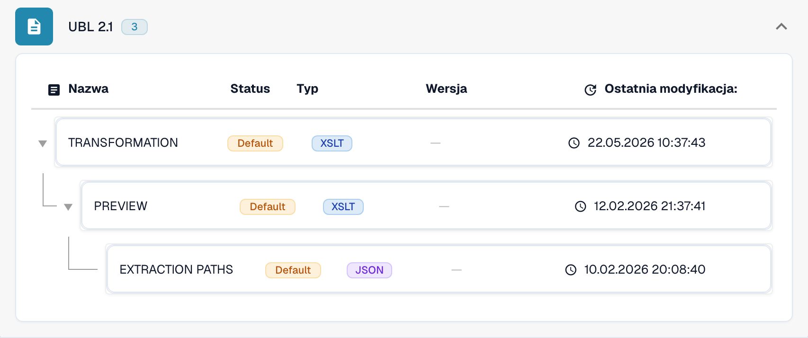

# Międzynarodowe

Skorzystaj z tego przewodnika, aby ustalić skonfigurowaną rodzinę i zakres wersji przed testowaniem pliku źródłowego.

[Wszystkie kraje i zakres obsługi](../README.md)

## Film objaśniający dla kraju

Narracja i napisy WebVTT w wybranym języku wyjaśniają wybór formatu, konfigurację i kontrole akceptacyjne.

Ten przegląd bez wprowadzania zmian pokazuje istniejącą konfigurację kraju w DocBits. Sprawdź używane źródło i aktywną wersję, a następnie przetestuj reprezentatywne faktury, noty kredytowe i eksporty we własnej organizacji.



[Międzynarodowe — Film objaśniający dla kraju](https://docbits-videos.fra1.cdn.digitaloceanspaces.com/settings-assistant/edocs_country_international/v2/pl.mp4)

[WebVTT](https://docbits-videos.fra1.cdn.digitaloceanspaces.com/settings-assistant/edocs_country_international/v2/pl.vtt)

## Warianty i ograniczenia wersji

Wpisy międzynarodowe obejmują Peppol BIS 3.0, UBL 2.1, czysty CII, EDI, INVOIC02, cXML, OCI, BOD i SPS Commerce RSX 7.7.4.

**Składnia:** UBL / CII / EDI / cXML

Mapowania faktur, zamówień, odpowiedzi i awiz wysyłki są odrębne. Samo przetwarzanie plików nie zapewnia punktu dostępowego Peppol ani łączności z partnerami handlowymi.

Tabele przedstawiają wyniki kontroli katalogu środowiska deweloperskiego z 17 października 2026 i odpowiadającego mu kodu przetwarzania. Opisują dostępne reguły i komponenty konfiguracji, a nie certyfikację każdego pliku, wymogu prawnego czy wdrożenia produkcyjnego. Twoja organizacja może nadpisać ustawienia domyślne.

## Macierz sprawdzonych reguł i komponentów

| Dokładne oznaczenie formatu | Klucz dokumentu reguły | Dostępne komponenty |
| --- | --- | --- |
| `BOD` | `PURCHASE_ORDER` | C / — / — / — |
| `CXML ORDER CONFIRMATION` | `ORDER_CONFIRMATION` | C / T / P / E |
| `CXML PURCHASE ORDER` | `PURCHASE_ORDER` | C / T / P / E |
| `EDI` | `PURCHASE_ORDER` | C / T / P / E |
| `EDI` | `ORDER_CONFIRMATION` | C / T / P / E |
| `EDI` | `INVOICE` | C / T / P / E |
| `INVOIC02` | `INVOICE` | C / T / P / E |
| `OCI CATALOG ORDER` | `PURCHASE_ORDER` | C / T / P / E |
| `PEPPOL BIS 3.0` | `INVOICE` | C / T / P / E |
| `PEPPOL DESPATCH ADVICE 3.0` | `DELIVERY_NOTE` | C / T / P / E |
| `PEPPOL ORDER 3.0` | `PURCHASE_ORDER` | C / T / P / E |
| `PEPPOL ORDER RESPONSE 3.0` | `ORDER_CONFIRMATION` | C / T / P / E |
| `PURCHASE ORDER BOD` | `PURCHASE_ORDER` | C / T / P / E |
| `PURE CII D16B EU` | `INVOICE` | C / T / P / E |
| `PURE CII D16B EU CREDITNOTE` | `CREDIT_NOTE` | C / T / P / E |
| `PURE CII D16B NON-EU` | `INVOICE` | C / T / P / E |
| `PURE CII D16B NON-EU CREDITNOTE` | `CREDIT_NOTE` | C / T / P / E |
| `PURE CII D22B EU` | `INVOICE` | C / T / P / E |
| `PURE CII D22B EU CREDITNOTE` | `CREDIT_NOTE` | C / T / P / E |
| `PURE CII D22B NON-EU` | `INVOICE` | C / T / P / E |
| `PURE CII D22B NON-EU CREDITNOTE` | `CREDIT_NOTE` | C / T / P / E |
| `PURE CII D23B EU` | `INVOICE` | C / T / P / E |
| `PURE CII D23B EU CREDITNOTE` | `CREDIT_NOTE` | C / T / P / E |
| `PURE CII D23B NON-EU` | `INVOICE` | C / T / P / E |
| `PURE CII D23B NON-EU CREDITNOTE` | `CREDIT_NOTE` | C / T / P / E |
| `PURE CII D24B EU` | `INVOICE` | C / T / P / E |
| `PURE CII D24B EU CREDITNOTE` | `CREDIT_NOTE` | C / T / P / E |
| `PURE CII D24B NON-EU` | `INVOICE` | C / T / P / E |
| `PURE CII D24B NON-EU CREDITNOTE` | `CREDIT_NOTE` | C / T / P / E |
| `PURE CII V1 EU` | `INVOICE` | C / T / P / E |
| `PURE CII V1 EU CREDITNOTE` | `CREDIT_NOTE` | C / T / P / E |
| `PURE CII V1 NON-EU` | `INVOICE` | C / T / P / E |
| `PURE CII V1 NON-EU CREDITNOTE` | `CREDIT_NOTE` | C / T / P / E |
| `SPS COMMERCE RSX 7.7.4` | `PURCHASE_ORDER_ACKNOWLEDGMENT` | C / T / P / E |
| `SPS COMMERCE RSX 7.7.4` | `ADVANCE_SHIP_NOTICE` | C / T / P / E |
| `SPS COMMERCE RSX 7.7.4` | `PURCHASE_ORDER` | C / T / P / E |
| `SPS COMMERCE RSX 7.7.4` | `INVOICE` | C / T / P / E |
| `SPS COMMERCE RSX 7.7.4` | `PURCHASE_ORDER_CHANGE` | C / T / P / E |
| `UBL 2.1` | `INVOICE` | C / T / P / E |
| `UBL 2.1 CREDITNOTE` | `CREDIT_NOTE` | C / T / P / E |
| `UBL 2.1 DESPATCH ADVICE` | `DELIVERY_NOTE` | C / T / P / E |
| `UBL 2.1 ORDER` | `PURCHASE_ORDER` | C / T / P / E |
| `UBL 2.1 ORDER RESPONSE` | `ORDER_CONFIRMATION` | C / T / P / E |

C = klasyfikacja, T = Transformation, P = Preview, E = Extraction Paths. Klucz dokumentu służy do wyszukiwania reguł i konfiguracji; nie gwarantuje ostatecznej zapisanej wartości invoice_type. Transformacja może sklasyfikować notę kredytową za pomocą mapowania INVOICE.

Myślnik oznacza, że kontrola statusu nie wykazała dedykowanego komponentu dla tej dokładnej pary formatu i klucza dokumentu. Nie wyklucza to mapowania współdzielonego lub rezerwowego. Zanim oprzesz się na tej ścieżce, sprawdź faktycznie używany mechanizm wyboru mapowania i reprezentatywny plik.

## Znajdź mapowanie w DocBits

<figure><figcaption>
Rzeczywisty interfejs środowiska deweloperskiego: przykładowy format i dostępne komponenty konfiguracji. Pozostałe wersje wymieniono w macierzy.
</figcaption></figure>

## Kontrole akceptacyjne

Kontrola komponentów potwierdza obecność konfiguracji. Nie jest testem pełnego przetwarzania każdej wersji. Przetestuj dokładną zawartość danych oraz ścieżkę faktury lub noty kredytowej wymaganą przez integrację.

## Sprawdź format w swojej organizacji

1. Zachowaj oryginalny plik XML lub PDF z osadzonym XML. Odczytaj przestrzeń nazw, schemat lub identyfikator dostosowania oraz zadeklarowaną wersję lub profil.

2. Otwórz Ustawienia → Typy dokumentów → E-Doc dla odpowiedniego dokumentu biznesowego. Wyszukaj dokładny format dokumentu elektronicznego podany w przewodniku.

3. Sprawdź faktycznie używane źródło Default lub Custom oraz aktywną wersję konfiguracji. Sprawdź Transformation, Preview i Extraction Paths. Zapisanie wersji roboczej nie powoduje jej aktywowania.

4. Przetestuj reprezentatywne pliki źródłowe dla każdej wymaganej składni, wersji i rodzaju dokumentu biznesowego. Sprawdź kluczowe pola, kwoty, podatek, klasyfikację faktury lub noty kredytowej i eksport do ERP.

5. Osobno potwierdź zasady walidacji i transport. Zachowaj mapowania niestandardowe oraz sprawdź zatwierdzenia i historię eksportu przed ponownym uruchomieniem istniejących dokumentów.

## Powiązana dokumentacja formatu

- [INVOIC02](../invoic02.md)
- [🇪🇺 PEPPOL BIS 3.0](../peppol-bis-3-0.md)
- [SPS COMMERCE RSX 7.7.4](../sps-commerce-rsx-7-7-4.md)
- [UBL 2.1](../ubl-2-1.md)
