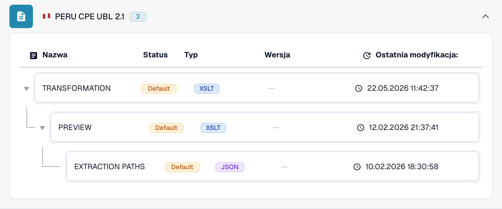

# Peru

Skorzystaj z tego przewodnika, aby ustalić skonfigurowaną rodzinę i zakres wersji przed testowaniem pliku źródłowego.

[Wszystkie kraje i zakres obsługi](../README.md)

## Film objaśniający dla kraju

Narracja i napisy WebVTT w wybranym języku wyjaśniają wybór formatu, konfigurację i kontrole akceptacyjne.

Ten przegląd bez wprowadzania zmian pokazuje istniejącą konfigurację kraju w DocBits. Sprawdź używane źródło i aktywną wersję, a następnie przetestuj reprezentatywne faktury, noty kredytowe i eksporty we własnej organizacji.



[Peru — Film objaśniający dla kraju](https://docbits-videos.fra1.cdn.digitaloceanspaces.com/settings-assistant/edocs_country_peru/v2/pl.mp4)

[WebVTT](https://docbits-videos.fra1.cdn.digitaloceanspaces.com/settings-assistant/edocs_country_peru/v2/pl.vtt)

## Warianty i ograniczenia wersji

Peru CPE ma wpisy ogólne oraz UBL 2.0 i UBL 2.1. Factura Electronica to kolejne oznaczenie.

**Składnia:** UBL XML

Wybierz rzeczywistą wersję UBL i strukturę dokumentu. Przetworzenie pliku nie dowodzi akceptacji przez SUNAT.

Tabele przedstawiają wyniki kontroli katalogu środowiska deweloperskiego z 17 października 2026 i odpowiadającego mu kodu przetwarzania. Opisują dostępne reguły i komponenty konfiguracji, a nie certyfikację każdego pliku, wymogu prawnego czy wdrożenia produkcyjnego. Twoja organizacja może nadpisać ustawienia domyślne.

## Macierz sprawdzonych reguł i komponentów

| Dokładne oznaczenie formatu | Klucz dokumentu reguły | Dostępne komponenty |
| --- | --- | --- |
| `PERU CPE` | `INVOICE` | C / T / P / E |
| `PERU CPE UBL 2.0` | `INVOICE` | C / T / P / E |
| `PERU CPE UBL 2.1` | `INVOICE` | C / T / P / E |
| `PERU FACTURA ELECTRONICA` | `INVOICE` | C / T / P / E |

C = klasyfikacja, T = Transformation, P = Preview, E = Extraction Paths. Klucz dokumentu służy do wyszukiwania reguł i konfiguracji; nie gwarantuje ostatecznej zapisanej wartości invoice_type. Transformacja może sklasyfikować notę kredytową za pomocą mapowania INVOICE.

Myślnik oznacza, że kontrola statusu nie wykazała dedykowanego komponentu dla tej dokładnej pary formatu i klucza dokumentu. Nie wyklucza to mapowania współdzielonego lub rezerwowego. Zanim oprzesz się na tej ścieżce, sprawdź faktycznie używany mechanizm wyboru mapowania i reprezentatywny plik.

## Znajdź mapowanie w DocBits

<figure><figcaption>
Rzeczywisty interfejs środowiska deweloperskiego: przykładowy format i dostępne komponenty konfiguracji. Pozostałe wersje wymieniono w macierzy.
</figcaption></figure>

## Kontrole akceptacyjne

Kontrola komponentów potwierdza obecność konfiguracji. Nie jest testem pełnego przetwarzania każdej wersji. Przetestuj dokładną zawartość danych oraz ścieżkę faktury lub noty kredytowej wymaganą przez integrację.

## Sprawdź format w swojej organizacji

1. Zachowaj oryginalny plik XML lub PDF z osadzonym XML. Odczytaj przestrzeń nazw, schemat lub identyfikator dostosowania oraz zadeklarowaną wersję lub profil.

2. Otwórz Ustawienia → Typy dokumentów → E-Doc dla odpowiedniego dokumentu biznesowego. Wyszukaj dokładny format dokumentu elektronicznego podany w przewodniku.

3. Sprawdź faktycznie używane źródło Default lub Custom oraz aktywną wersję konfiguracji. Sprawdź Transformation, Preview i Extraction Paths. Zapisanie wersji roboczej nie powoduje jej aktywowania.

4. Przetestuj reprezentatywne pliki źródłowe dla każdej wymaganej składni, wersji i rodzaju dokumentu biznesowego. Sprawdź kluczowe pola, kwoty, podatek, klasyfikację faktury lub noty kredytowej i eksport do ERP.

5. Osobno potwierdź zasady walidacji i transport. Zachowaj mapowania niestandardowe oraz sprawdź zatwierdzenia i historię eksportu przed ponownym uruchomieniem istniejących dokumentów.

## Powiązana dokumentacja formatu

- [🇵🇪 PERU CPE](../peru-cpe.md)
- [🇵🇪 PERU CPE UBL 2.0](../peru-cpe-ubl-2-0.md)
- [🇵🇪 PERU CPE UBL 2.1](../peru-cpe-ubl-2-1.md)
- [🇵🇪 PERU FACTURA ELECTRONICA](../peru-factura-electronica.md)
