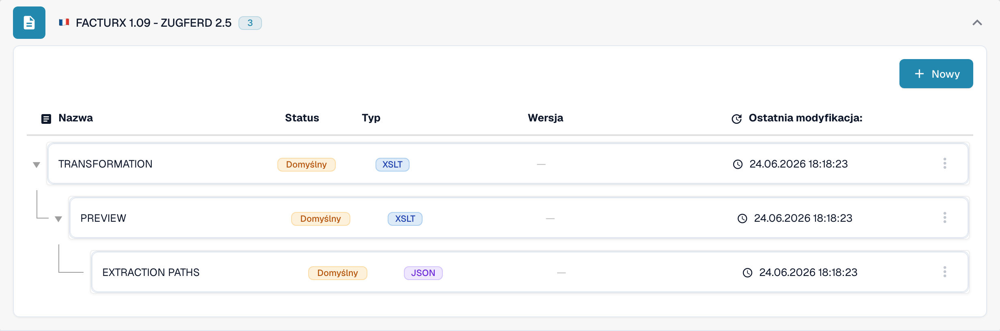

# 🇫🇷 FACTURX 1.09 - ZUGFERD 2.5

<!-- edocs-country-scope -->


Sprawdź w przewodniku krajowym ograniczenia wersji, faktycznie używaną konfigurację i film objaśniający dla kraju. [Francja](countries/france.md). Znacznik XML 1p0 i Factur-X XMP Version 1.0 nie określają wydania publikacji. Zachowaj ogólne oznaczenie, gdy wydanie jest nieznane.


| Właściwość | Wartość |
|----------|-------|
| **Kraj / Region** | Francja / Niemcy |
| **Typy dokumentów** | Faktura, nota kredytowa (sprawdzić rzeczywiste mapowanie) |
| **Format** | XML CII osadzony w PDF/A-3 |
| **Standard** | Factur-X 1.09 / ZUGFeRD 2.5 |
| **Oparty na** | EN 16931 |

ZUGFeRD 2.5 i Factur-X 1.09 są równoważnymi publikacjami. Format hybrydowy osadza XML CII D22B w PDF/A-3; UBL nie jest jego składnią XML. Zobacz [informacje o publikacji FeRD](https://www.ferd-net.de/publikationen-produkte/publikationen/detailseite/zugferd-25-english).

Standard określa profile MINIMUM, BASIC WL, BASIC, EN16931 i EXTENDED. Nazwa profilu w katalogu nie dowodzi automatycznego rozpoznawania ani pełnej obsługi wszystkich pól. MINIMUM i BASIC WL mogą nie zawierać informacji o wierszach potrzebnych w danej integracji.

Ta strona opisuje publikację z czerwca 2026 r. [Późniejsza publikacja Factur-X 1.09.2 / ZUGFeRD 2.5.2](https://fnfe-mpe.org/factur-x/factur-x_en/) wymaga osobnej identyfikacji; sam identyfikator rodziny `1p0` nie wystarcza.

## Status obsługi

Kontrola katalogu środowiska rozwojowego w trybie tylko do odczytu, 31 października 2026 r., potwierdziła `FACTURX 1.09 - ZUGFERD 2.5` dla `INVOICE`.

| Komponent | Zaobserwowana konfiguracja |
|-----------|----------------------------|
| Podgląd | `PREVIEW` (XSLT) |
| Ekstrakcja pól | `EXTRACTION_PATHS` (JSON) |
| Transformacja | `TRANSFORMATION` (XSLT) |

Te wpisy potwierdzają dostępną konfigurację, a nie pomyślne przetworzenie każdego pliku lub profilu. Sprawdź źródło domyślne lub niestandardowe oraz aktywną wersję w swojej organizacji. Zgodność wsteczna standardu nie gwarantuje niezmienionych wyników ekstrakcji lub transformacji. Oddzielnie przetestuj reprezentatywne faktury i noty kredytowe, wymagane pola oraz eksport ERP; walidacja prawna i wymagania sieci transmisyjnej wymagają własnych testów odbiorczych.

<figure><figcaption>
Polski interfejs środowiska rozwojowego, sprawdzony tylko do odczytu 31 października 2026 r.: wpis katalogowy dla INVOICE i dostępne komponenty domyślne. Ten zrzut ekranu nie przedstawia testu przetwarzania pliku.
</figcaption></figure>

## Powiązane

- [ZUGFeRD 2.5](zugferd-2-5.md)
- [Konfiguracja ZUGFeRD](../zugferd/configuration.md)
- [Mapowanie pól ZUGFeRD](../zugferd/README.md)
- [Obsługiwane dokumenty elektroniczne](./)
