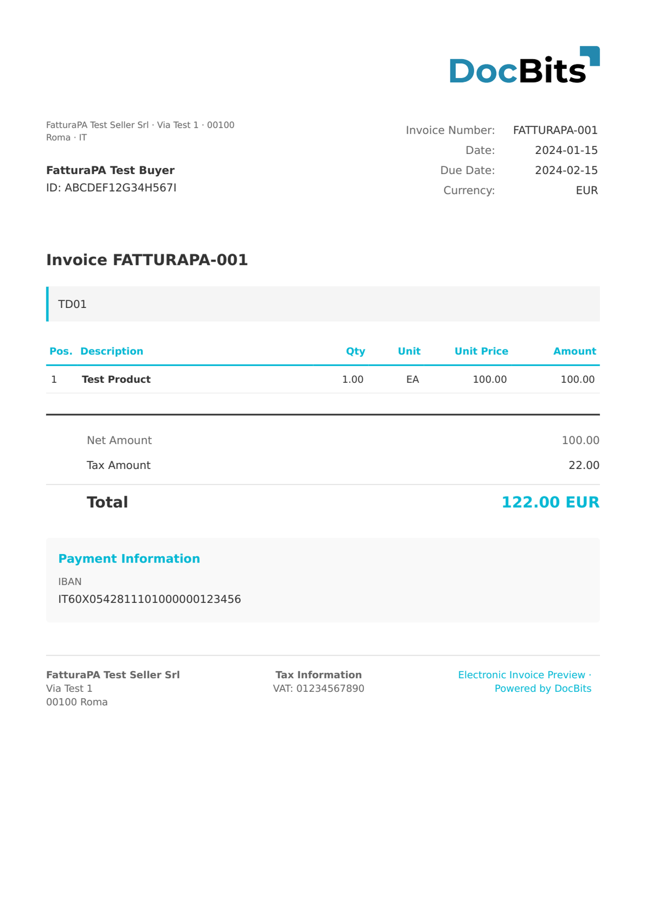

# 🇮🇹 FATTURAPA

<!-- edocs-country-scope -->


Sprawdź w przewodniku krajowym ograniczenia wersji, faktycznie używaną konfigurację i film objaśniający dla kraju. [Włochy](countries/italy.md). Oznaczenie rodziny nie certyfikuje każdego wydania FatturaPA ani przesyłania przez SDI. Sprawdź schemat źródłowy i wymagania odbiorcy.


| Właściwość           | Wartość                                  |
| -------------------- | ---------------------------------------- |
| **Kraj / Region**    | Włochy                                   |
| **Typy dokumentów**  | Faktura, nota kredytowa, faktura uproszczona |
| **Format**           | XML (FatturaPA 1.2.x)                    |
| **Standard**         | FatturaPA (SDI)                          |

FatturaPA to włoski standard fakturowania elektronicznego, wprowadzony obowiązkowo przez Agenzia delle Entrate. Od stycznia 2019 roku wszystkie faktury między włoskimi przedsiębiorstwami muszą być przesyłane za pośrednictwem Sistema di Interscambio (SDI). DocBits przetwarza dokumenty XML FatturaPA i ekstrahuje wszystkie pola nagłówka oraz pozycji.

## Status obsługi

| Komponent        | Status         |
| ---------------- | -------------- |
| Podgląd          | ✅ Obsługiwane |
| Ekstrakcja pól   | ✅ Obsługiwane |
| Transformacja    | ✅ Obsługiwane |

## Domyślny podgląd

<figure><figcaption>
Domyślny podgląd DocBits dla włoskiej faktury FatturaPA
</figcaption></figure>

## Powiązane

* [Obsługiwane dokumenty elektroniczne](./)
