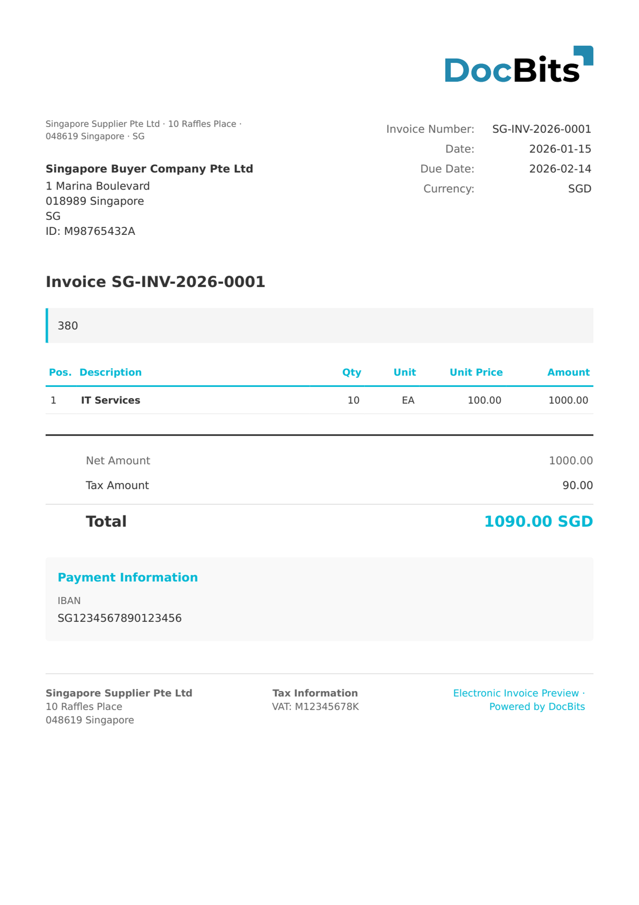

# 🇸🇬 INVOICENOW

<!-- edocs-country-scope -->


Sprawdź w przewodniku krajowym ograniczenia wersji, faktycznie używaną konfigurację i film objaśniający dla kraju. [Singapur](countries/singapore.md). Sprawdź singapurskie identyfikatory profilu. Profil krajowy i ogólny Peppol BIS mogą używać tej samej składni UBL, lecz różnych reguł biznesowych.


| Właściwość           | Wartość                 |
| -------------------- | ----------------------- |
| **Kraj / Region**    | Singapur                |
| **Typy dokumentów**  | Faktura, Nota kredytowa |
| **Format**           | UBL 2.1 XML (Peppol)    |
| **Standard**         | InvoiceNow (IMDA)       |

InvoiceNow to krajowa inicjatywa e-fakturowania Singapuru, zbudowana na sieci Peppol i prowadzona przez IMDA (Infocomm Media Development Authority). Umożliwia firmom wymianę ustrukturyzowanych faktur elektronicznych za pośrednictwem punktów dostępowych Peppol w formacie UBL 2.1.

## Status obsługi

| Komponent      | Status         |
| -------------- | -------------- |
| Podgląd        | ✅ Obsługiwane |
| Ekstrakcja pól | ✅ Obsługiwane |
| Transformacja  | ✅ Obsługiwane |

## Domyślny podgląd

<figure><figcaption>
Domyślny podgląd DocBits dla faktury InvoiceNow z Singapuru
</figcaption></figure>

## Powiązane

* [Obsługiwane dokumenty elektroniczne](./)
* [InvoiceNow SG](invoicenow-sg.md)
* [Peppol BIS 3.0](peppol-bis-3-0.md)
