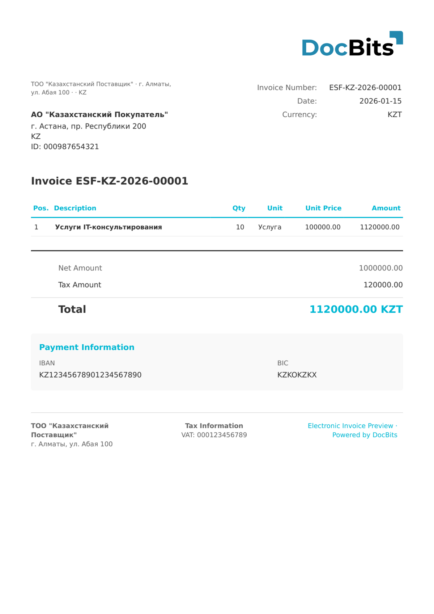

# 🇰🇿 KAZAKHSTAN ESF

<!-- edocs-country-scope -->


Sprawdź w przewodniku krajowym ograniczenia wersji, faktycznie używaną konfigurację i film objaśniający dla kraju. [Kazachstan](countries/kazakhstan.md). Oznaczenie nie podaje wydania. Potwierdź rzeczywisty schemat XML i nie wnioskuj o przesyłaniu do platformy podatkowej na podstawie obsługi ekstrakcji.


| Właściwość           | Wartość                                              |
| -------------------- | ---------------------------------------------------- |
| **Kraj / Region**    | Kazachstan                                           |
| **Typy dokumentów**  | Faktura                                              |
| **Format**           | XML                                                  |
| **Standard**         | ESF (Электронные счета-фактуры / Faktura elektroniczna) |

Kazakhstan ESF (Электронные счета-фактуры) to system faktur elektronicznych prowadzony przez Komitet Dochodów Państwowych. Wszystkie firmy zarejestrowane jako podatnicy VAT muszą wystawiać faktury elektroniczne za pośrednictwem systemu informatycznego ESF. Dokumenty zawierają identyfikację podatkową BIN/IIN, obliczenia VAT i są podpisywane cyfrowo.

## Status obsługi

| Komponent      | Status         |
| -------------- | -------------- |
| Podgląd        | ✅ Obsługiwane |
| Ekstrakcja pól | ✅ Obsługiwane |
| Transformacja  | ✅ Obsługiwane |

## Domyślny podgląd

<figure><figcaption>
Domyślny podgląd DocBits dla faktury Kazakhstan ESF
</figcaption></figure>

## Powiązane

* [Obsługiwane dokumenty elektroniczne](./)
