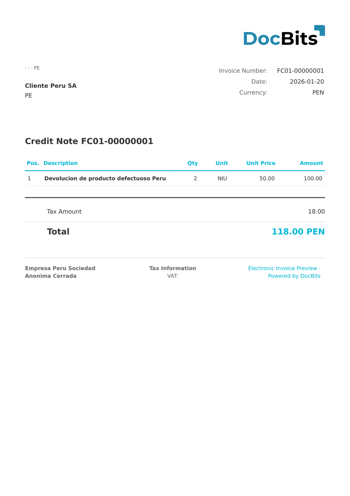

# 🇵🇪 PERU FACTURA ELECTRONICA

<!-- edocs-country-scope -->


Sprawdź w przewodniku krajowym ograniczenia wersji, faktycznie używaną konfigurację i film objaśniający dla kraju. [Peru](countries/peru.md). Wybierz rzeczywistą wersję UBL i strukturę dokumentu. Przetworzenie pliku nie dowodzi akceptacji przez SUNAT.


| Właściwość | Wartość |
| ---------- | ------- |
| **Kraj/Region** | Peru |
| **Typy dokumentów** | Faktura |
| **Format** | UBL XML |
| **Standard** | Factura Electrónica (SUNAT) |

Peru Factura Electrónica to typ faktury elektronicznej w systemie CPE SUNAT. Odpowiada kodowi typu dokumentu 01 (Factura) i zawiera wszystkie obowiązkowe pola wymagane przez SUNAT, w tym serię, numer kolejny oraz podpis elektroniczny.

## Stan wsparcia

| Komponent | Status |
| --------- | ------ |
| Podgląd | ✅ Obsługiwane |
| Ekstrakcja pól | ✅ Obsługiwane |
| Transformacja | ✅ Obsługiwane |

## Domyślny podgląd

<figure><figcaption>
Domyślny podgląd DocBits dla Peru Factura Electronica
</figcaption></figure>

## Powiązane

* [Obsługiwane dokumenty elektroniczne](./)
