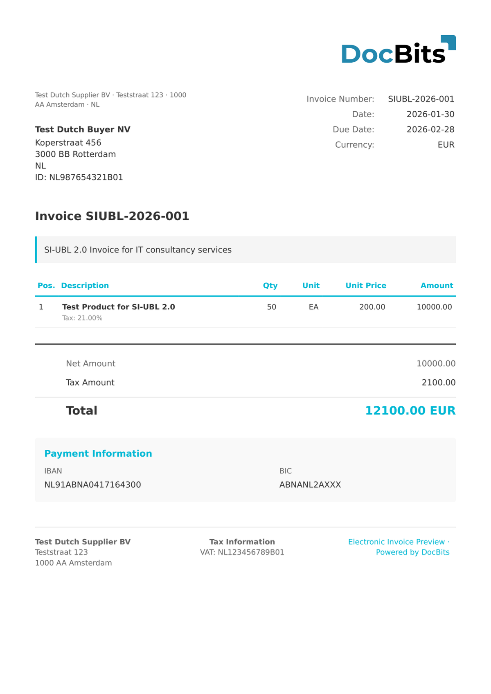

# 🇳🇱 SI-UBL 2.0

| Właściwość | Wartość |
| ---------- | ------- |
| **Kraj/Region** | Holandia |
| **Typy dokumentów** | Faktura, Nota kredytowa |
| **Format** | UBL 2.1 XML |
| **Standard** | SI-UBL 2.0 (Standaard Invoice - UBL) |

SI-UBL 2.0 to holenderski standard e-fakturowania oparty na OASIS UBL 2.1. Jest utrzymywany przez NLCIUS (Netherlands Core Invoice Usage Specification) i jest zgodny z EN 16931. SI-UBL jest szeroko stosowany w holenderskich transakcjach B2G i B2B, zwłaszcza za pośrednictwem sieci Peppol.

## Stan wsparcia

| Komponent | Status |
| --------- | ------ |
| Podgląd | ✅ Obsługiwane |
| Ekstrakcja pól | ✅ Obsługiwane |
| Transformacja | ✅ Obsługiwane |

## Domyślny podgląd

<figure><figcaption>
Domyślny podgląd DocBits dla holenderskiej faktury SI-UBL 2.0
</figcaption></figure>

## Powiązane

* [Obsługiwane dokumenty elektroniczne](./)
