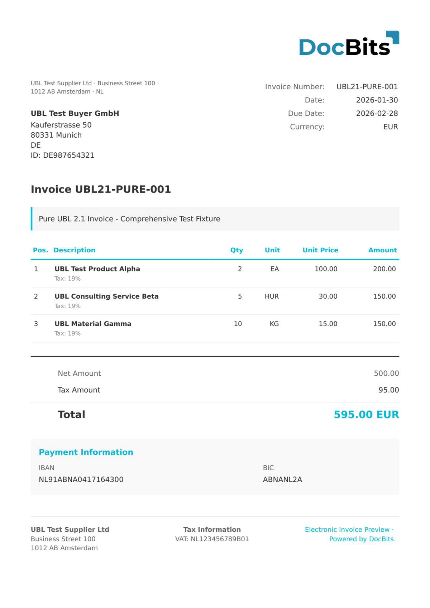

# UBL 2.1

| Właściwość | Wartość |
| ---------- | ------- |
| **Kraj/Region** | Międzynarodowo |
| **Typy dokumentów** | Faktura, Nota kredytowa, Zamówienie, Awizo wysyłki |
| **Format** | UBL 2.1 XML |
| **Standard** | OASIS UBL 2.1 (Universal Business Language) |

UBL 2.1 (Universal Business Language) to otwarty standard OASIS dla dokumentów biznesowych. Stanowi podstawę wielu krajowych standardów e-fakturowania, w tym Peppol BIS, XRechnung (wariant UBL), OIOUBL i SI-UBL. DocBits przetwarza ogólne faktury UBL 2.1, które nie pasują do żadnego standardu specyficznego dla danego kraju.

## Stan wsparcia

| Komponent | Status |
| --------- | ------ |
| Podgląd | ✅ Obsługiwane |
| Ekstrakcja pól | ✅ Obsługiwane |
| Transformacja | ✅ Obsługiwane |

## Domyślny podgląd

<figure><figcaption>
Domyślny podgląd DocBits dla faktury UBL 2.1
</figcaption></figure>

## Powiązane

* [Obsługiwane dokumenty elektroniczne](./)
