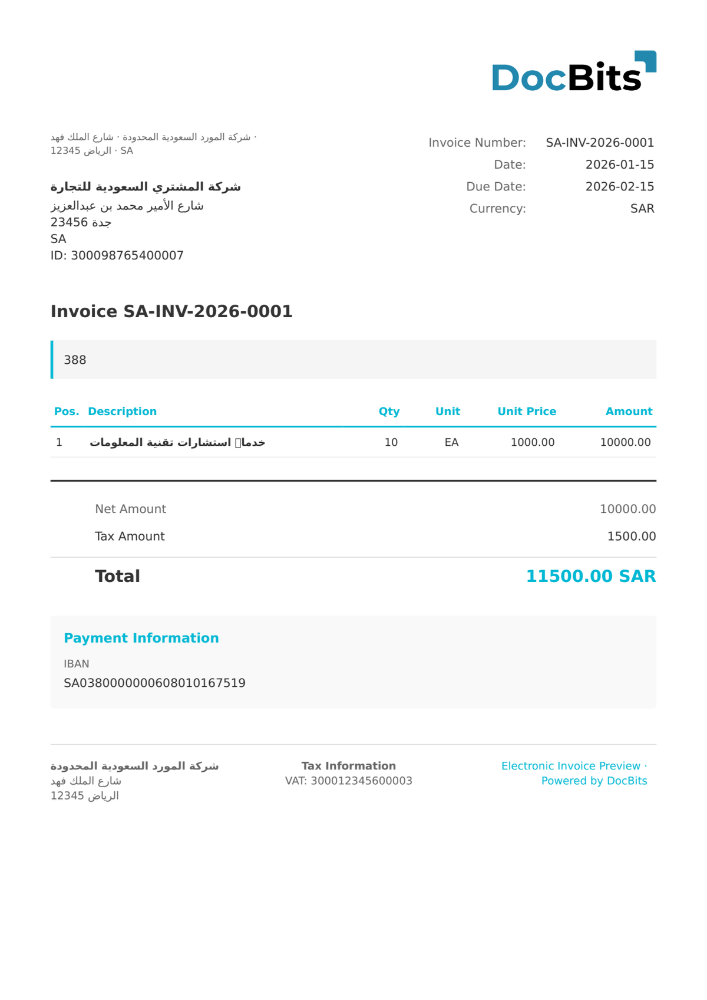

# 🇸🇦 ZATCA TAX INVOICE

| Właściwość           | Wartość                    |
| -------------------- | -------------------------- |
| **Kraj/Region**      | Arabia Saudyjska           |
| **Typy dokumentów**  | Standardowa faktura VAT    |
| **Format**           | UBL 2.1 XML                |
| **Standard**         | ZATCA Standard Tax Invoice |

ZATCA Tax Invoice to standardowy format faktury VAT B2B w saudyjskim systemie e-fakturowania. Wymaga pełnej identyfikacji nabywcy i sprzedawcy (w tym numerów rejestracyjnych VAT), szczegółowych pozycji z wyliczeniem VAT, a przed przekazaniem nabywcy musi zostać zatwierdzona (clearance) przez platformę ZATCA.

## Stan wsparcia

| Komponent        | Status        |
| ---------------- | ------------- |
| Podgląd          | ✅ Obsługiwany |
| Ekstrakcja pól   | ✅ Obsługiwany |
| Transformacja    | ✅ Obsługiwany |

## Domyślny podgląd

<figure><figcaption>
Domyślny podgląd DocBits dla saudyjskiej faktury ZATCA Tax Invoice
</figcaption></figure>

## Powiązane

* [Obsługiwane dokumenty elektroniczne](./)
