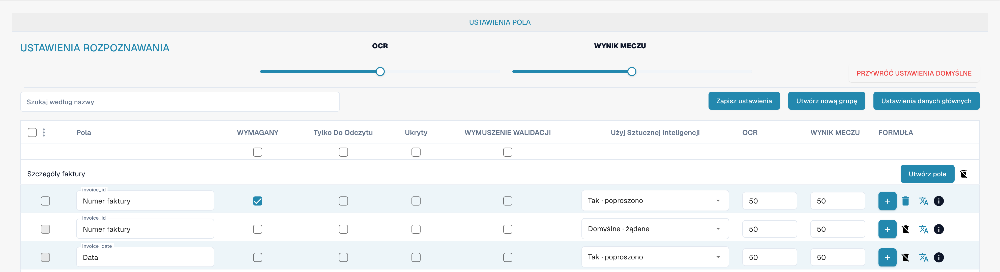

# Pola

Pola określają dane zbierane dla typu dokumentu i sposób ich kontroli. Otwórz typ dokumentu w ustawieniach, a następnie jego pola.

<figure><figcaption>
Pola typu dokumentu Faktura. Etykieta WYNIK MECZU oznacza tu próg dopasowania (Match Score), nie wynik sportowy.
</figcaption></figure>

## Właściwości i rozpoznawanie

* **Wymagane** oznacza konieczność podania wartości do walidacji.
* **Tylko do odczytu** uniemożliwia edycję; **Ukryte** usuwa pole ze zwykłego widoku.
* **Wymuszona walidacja** wymaga jawnego sprawdzenia pola. Nie tworzy reguły porównania ani wyrażenia regularnego; niestandardowe reguły walidacji konfiguruje się oddzielnie.
* **OCR** ustawia liczbowy próg pewności rozpoznawania. Nie jest przełącznikiem włączającym OCR.
* **Próg dopasowania** ustawia liczbowy próg dopasowania. Nie jest tekstem odniesienia ani listą wartości.
* Opcja **Sztuczna inteligencja** określa żądaną ekstrakcję pola.

Wyszukaj pole po nazwie i sprawdź jego wiersz przed zmianą właściwości. Możesz organizować grupy, dodawać pola i otwierać opcje formuł lub danych podstawowych. Dostępne działania zależą od pola i uprawnień; usuwanie pól standardowych może być ograniczone.

Zapisz wyłącznie zamierzone zmiany i sprawdź walidację na reprezentatywnych dokumentach. Obrazy nie potwierdzają zapisania zmian.

Zobacz [Właściwości pól](configuring-field-properties-1.md), [Walidacja i Match Score](setting-validation-and-match-score.md) oraz [Pola z dodatkowymi opłatami](new-fields-with-charges.md).
