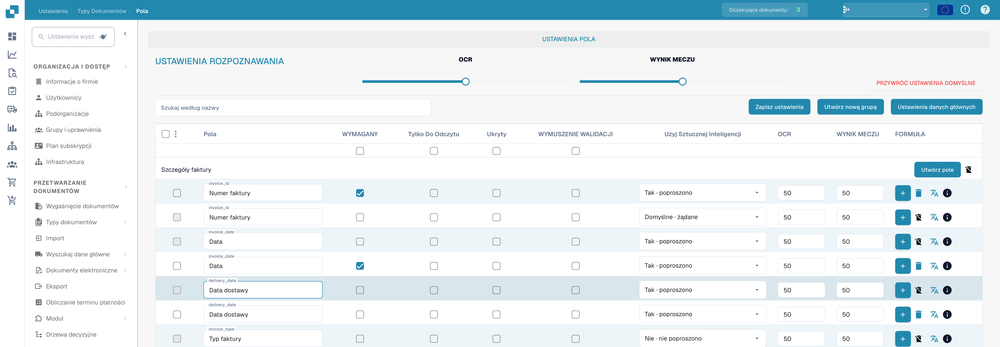
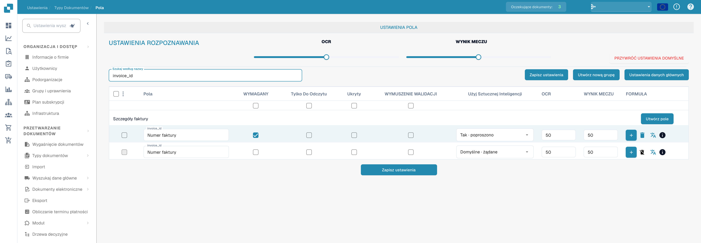

# Konfigurowanie właściwości pól

Otwórz **Ustawienia → Typy dokumentów → Pola** i wybierz typ dokumentu. Obrazy pokazują fakturę w polskim interfejsie; identyfikatory techniczne, takie jak `invoice_id`, pozostają bez zmian.

<figure><figcaption>
Właściwości pól: wymagane, tylko do odczytu, ukryte i wymuszona walidacja. Etykieta WYNIK MECZU oznacza tu próg dopasowania (Match Score), nie wynik sportowy.
</figcaption></figure>

## Znajdowanie pola i zmiana jego właściwości

1. W polu **Szukaj według nazwy** wpisz nazwę lub etykietę pola. Filtruje to listę; nie zmienia pola.
2. Znajdź wiersz pola. Na przykład **Numer faktury** ma nazwę techniczną `invoice_id`.
3. Dostosuj elementy sterujące w tym wierszu, a następnie wybierz **Zapisz ustawienia**. Ten sam przycisk zapisu jest dostępny nad tabelą i pod nią.

<figure><figcaption>
Pola filtrowane według invoice_id z progami OCR i Match Score. Etykieta WYNIK MECZU oznacza tu próg dopasowania (Match Score), nie wynik sportowy.
</figcaption></figure>

| Element sterujący | Do czego służy |
| --- | --- |
| **Obowiązkowe** | Oznacza informacje, które muszą być obecne do walidacji. Po zmianie tego ustawienia sprawdź wynik walidacji dokumentu. |
| **Tylko do odczytu** | Wyświetla pole bez możliwości edycji jego wartości przez użytkowników. |
| **Ukryty** | Ukrywa pole w zwykłym widoku dokumentu. |
| **Wymuszenie walidacji** | Wymaga jawnego sprawdzenia pola. Nie tworzy reguł porównania ani wyrażeń regularnych; niestandardowe reguły walidacji konfiguruje się osobno. |
| **Użyj sztucznej inteligencji** | Włącza lub wyłącza żądanie ekstrakcji AI dla tego pola. Wiersz pokazuje, czy ekstrakcja jest żądana. |
| **OCR** | Wprowadź próg pewności OCR dla pola. Jest to liczba, a nie przełącznik włącz/wyłącz ani ustawienie języka. |
| **Próg dopasowania** | Wprowadź próg dopasowania dla pola. Jest to liczba, a nie przełącznik włącz/wyłącz. |

Suwaki **OCR** i **Próg dopasowania** w sekcji **Ustawienia rozpoznawania** stosują wartości do całej listy pól. Pola wyboru bezpośrednio pod tytułami kolumn stosują **Obowiązkowe**, **Tylko do odczytu**, **Ukryty** lub **Wymuszenie walidacji** do całej listy. Przed wybraniem **Zapisz ustawienia** sprawdź, których wierszy dotyczą zmiany. **Przywróć ustawienia domyślne** resetuje konfigurację pól; używaj tej opcji tylko wtedy, gdy chcesz zastąpić wprowadzone zmiany.

## Inne elementy sterujące w tym widoku

- **Utwórz nową grupę** i **Utwórz pole** dodają grupę lub pole. Zobacz [Dodawanie i edytowanie pól](adding-and-editing-fields.md).
- **Ustawienia danych głównych** otwiera [konfigurację danych podstawowych](master-data-settings.md).
- Skrajne lewe pola wyboru zaznaczają pola. Sąsiednie menu oferuje **Przypisz ponownie grupę pól** dla zaznaczonych pól.
- Przycisk plus **Formuła** otwiera edytor formuł dla tego pola. Ikona **info** pokazuje informacje o polu. Ikona usuwania jest niedostępna dla pól standardowych.

Więcej informacji o walidacji i dopasowywaniu znajdziesz w [Walidacja i próg dopasowania](setting-validation-and-match-score.md).
