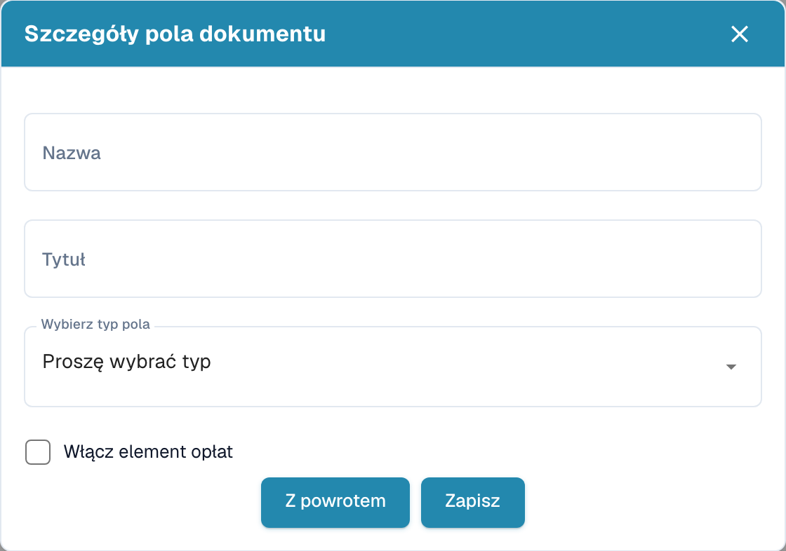
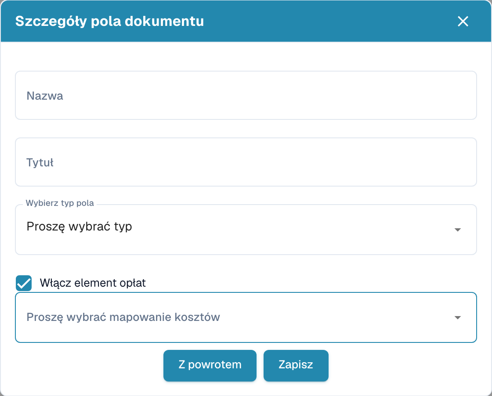

# Tworzenie pól z dodatkowymi opłatami

Otwórz typ dokumentu i jego pola w ustawieniach. W odpowiedniej grupie wybierz tworzenie pola.

<figure><figcaption>
Dane pola przed utworzeniem nowego pola.
</figcaption></figure>

1. Wprowadź nazwę techniczną i czytelną etykietę.
2. Wybierz typ danych.
3. Włącz opcję dodatkowych opłat, aby wyświetlić ich przypisanie.
4. Wybierz właściwe przypisanie. Dostępność opcji zależy od konfiguracji organizacji.

<figure><figcaption>
Projekt pola z włączoną opcją dodatkowych opłat.
</figcaption></figure>

Przykład jest niezapisanym projektem. Zapisanie utworzy pole; wróć, jeśli nie chcesz go tworzyć. Następnie sprawdź oddzielnie wymagalność, wymuszoną walidację, OCR i Match Score na liście pól.
