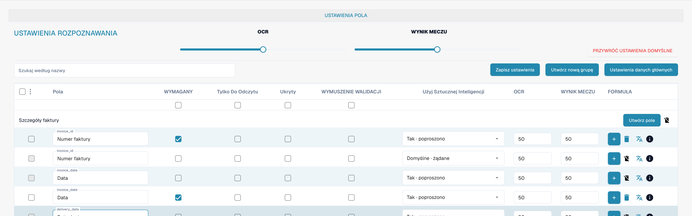
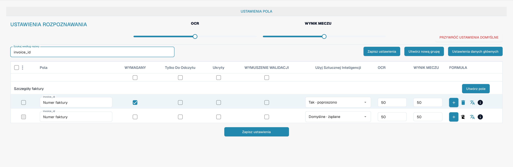

# Walidacja i próg dopasowania

Wymagalność, wymuszona walidacja, OCR i Match Score to różne właściwości pola. Otwórz pola typu dokumentu, aby je sprawdzić.

<figure><figcaption>
Oddzielne kolumny wymuszonej walidacji, OCR i Match Score. Etykieta WYNIK MECZU oznacza tu próg dopasowania (Match Score), nie wynik sportowy.
</figcaption></figure>

## Wymuszona walidacja

Wymuszona walidacja wymaga jawnego sprawdzenia pola. Sama nie tworzy wyrażenia regularnego ani reguły porównania. Niestandardowe reguły walidacji konfiguruje się oddzielnie.

<figure><figcaption>
Oddzielne ustawianie walidacji i rozpoznawania każdego pola. Etykieta WYNIK MECZU oznacza tu próg dopasowania (Match Score), nie wynik sportowy.
</figcaption></figure>

## OCR i Match Score

OCR określa próg rozpoznawania pola. Match Score jest liczbowym progiem dopasowania. Nie jest tekstem odniesienia ani listą wyboru porównywanej wartości.

<figure><figcaption>
Przefiltrowany numer faktury z wymuszoną walidacją i Match Score. Etykieta WYNIK MECZU oznacza tu próg dopasowania (Match Score), nie wynik sportowy.
</figcaption></figure>

Przed zapisaniem ustawień sprawdź zachowanie na reprezentatywnych dokumentach. Pole wymagane nie zastępuje wymuszonej walidacji.
