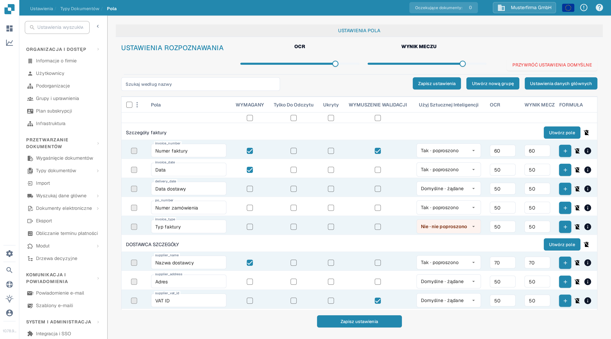
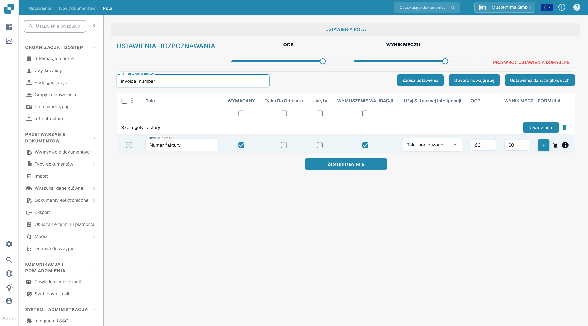

# Ustawianie walidacji i wyniku dopasowania

W sekcji **Pola** można ustawić progi walidacji i rozpoznawania dla typu dokumentu. Strona używa typu **Faktura** w testowej organizacji dokumentacji. Opisuje aktualne pole wyboru **WYMUSZENIE WALIDACJI** oraz elementy sterujące **WYNIK MECZU**.

## Otwieranie ustawień pól

1. Przejdź do **Ustawienia → Typy dokumentów → Faktura → Pola**.
2. Użyj pola **Szukaj według nazwy**, aby znaleźć pole, na przykład `invoice_number` (wyświetlane jako **Numer faktury**).
3. Sprawdź wiersz pola przed zmianą ustawienia. **WYMAGANY**, **Tylko Do Odczytu**, **Ukryty** i **WYMUSZENIE WALIDACJI** to oddzielne pola wyboru.

<figure><figcaption>Elementy sterujące rozpoznawaniem znajdują się nad listą pól.</figcaption></figure>

## WYMUSZENIE WALIDACJI (Force Validation)

Zaznacz **WYMUSZENIE WALIDACJI** w wierszu pola, aby zastosować dla tego pola surowszą walidację. Pole wyboru jest niezależne od opcji **WYMAGANY**: oznaczenie pola jako wymagane nie zaznacza automatycznie opcji WYMUSZENIE WALIDACJI. Pole wyboru może być niedostępne, gdy pole jest ukryte lub tylko do odczytu. Po zmianie konfiguracji pól kliknij **Zapisz ustawienia**.

Stare instrukcje sugerowały wpisywanie w tym miejscu limitów liczbowych lub wyrażeń regularnych. Aktualna tabela pól nie wyświetla edytora reguł w komórce WYMUSZENIE WALIDACJI. Reguły specyficzne dla pól opisuje strona [Konfigurowanie właściwości pola](configuring-field-properties-1.md).

## WYNIK MECZU (Match Score)

**WYNIK MECZU** to próg liczbowy, a nie stała wartość referencyjna. Suwaki **OCR** i **WYNIK MECZU** w sekcji **USTAWIENIA ROZPOZNAWANIA** stosują swoją wartość do wierszy pól typu dokumentu; aby ustawić wartość dla pojedynczego pola, użyj pola **WYNIK MECZU** w danym wierszu. W testowej organizacji oba suwaki pokazują **80**, a wiersz `invoice_number` pokazuje **60**. Przejrzyj objęte pola, a następnie kliknij **Zapisz ustawienia**.

<figure><figcaption>Wyszukaj pole, aby sprawdzić jego pole wyboru WYMUSZENIE WALIDACJI i wartość WYNIK MECZU.</figcaption></figure>

**OCR** to oddzielny próg rozpoznawania obok wyniku dopasowania. **PRZYWRÓĆ USTAWIENIA DOMYŚLNE** resetuje ustawienia; użyj tej opcji tylko wtedy, gdy chcesz odrzucić własne progi. Inne opcje pól opisuje [Przegląd pól](README.md).
