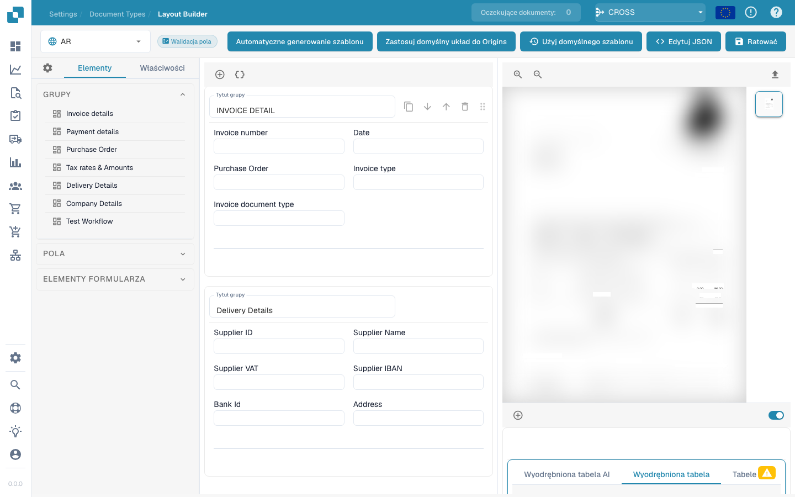

# Menedżer układu

<figure><figcaption></figcaption></figure>

#### Przegląd

Menedżer układu umożliwia administratorom wizualne konfigurowanie i modyfikowanie układu typów dokumentów poprzez ustawianie właściwości różnych pól danych i grup w dokumencie. Interfejs ten pomaga zapewnić, że modele ekstrakcji i punkty ręcznego wprowadzania danych są dokładnie dopasowane do struktury dokumentu w postaci zeskanowanej lub przesłanej do Docbits.

#### Główne składniki

1. **Grupy i pola**:
   * **Grupy**: Jednostki organizacyjne w obrębie typu dokumentu, które kategoryzują powiązane pola (np. Szczegóły faktury, Szczegóły płatności). Można je rozwijać lub zwijać i układać tak, aby odzwierciedlały logiczne grupowanie w rzeczywistym dokumencie.
   * **Fields**: Poszczególne punkty danych w każdej grupie (np. numer faktury, warunki płatności). Każde pole można dostosować pod kątem sposobu przechwytywania, wyświetlania i przetwarzania danych.
2. **Properties Panel**:
   * Panel ten wyświetla właściwości wybranego pola lub grupy, umożliwiając szczegółową konfigurację, taką jak:
     * **Label**: Widoczna etykieta pola w interfejsie użytkownika.
     * **Nazwa pola**: Identyfikator techniczny używany w systemie.
     * **Szerokość elementu w procentach**: Określa szerokość pola w stosunku do układu dokumentu.
     * **Indeks zakładek**: Kontroluje kolejność tabulatorów podczas nawigacji.
     * **Uruchom skrypt po zmianie**: Określa, czy wykonać skrypt po zmianie wartości pola.
     * **Wyświetl etykietę po lewej stronie**: Określa, czy etykieta jest wyświetlana po lewej stronie pola, czy nad nim.
     * **Is Textarea**: Określa, czy pole powinno być obszarem tekstowym, mieszczącym większą ilość tekstu.
     * **Wybierz typ modelu**: Opcja pozwalająca wybrać typ modelu, który będzie obsługiwał ekstrakcję tego pola.
     * **Długość pola**: Maksymalna długość danych akceptowanych w tym polu.
     * **Zablokowane słowa kluczowe**: Słowa kluczowe niedozwolone w tym polu.
3. **Template Preview**:
   * Pokazuje podgląd w czasie rzeczywistym wyglądu dokumentu w oparciu o bieżącą konfigurację układu. Pomaga to zapewnić, że układ odpowiada rzeczywistej strukturze dokumentu i jest niezbędne do testowania i udoskonalania konfiguracji przetwarzania dokumentu.



