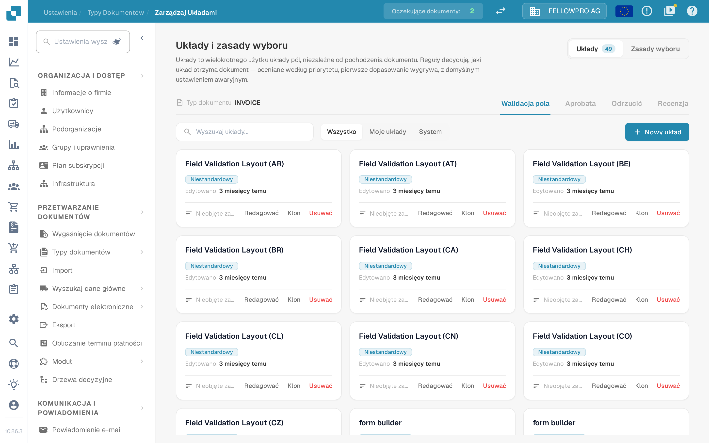

# Menedżer układu

<figure><figcaption>Menedżer układu dla typu dokumentu Invoice.</figcaption></figure>

**Menedżer układu** decyduje o tym, jak typ dokumentu wygląda dla osób, które weryfikują, zatwierdzają, odrzucają i recenzują dokumenty: które pola i grupy pojawiają się na ekranie, w jakiej kolejności i jak zachowuje się każde pole. Każdy typ dokumentu ma własne układy.

Strona otwiera się jako **Układy i zasady wyboru**: układy to wielokrotnego użytku układy pól, niezależne od pochodzenia dokumentu, a reguły decydują, jaki układ otrzymuje dokument.

#### Ekrany i typy układów

Walidacja, zatwierdzanie, odrzucanie i recenzja to osobne ekrany, a każdy z nich ma własne układy, własne reguły i własny układ domyślny — reguła zatwierdzania nigdy nie zmienia ekranu walidacji. Ekran zmienisz zakładkami **Walidacja pola**, **Aprobata**, **Odrzucić** i **Recenzja**.

#### Karty układów

Na karcie **Układy** każdy układ wybranego ekranu jest osobną kartą. Karta pokazuje nazwę układu, informację o tym, czy należy on do Twojej organizacji (**Niestandardowy**), czy jest domyślnym układem systemowym, kiedy był ostatnio edytowany oraz czy korzysta z niego reguła wyboru. **Redagować** otwiera układ w Layout Builderze, **Klon** kopiuje go pod wybraną nazwą, a **Usuwać** go usuwa — domyślny układ systemowy można tylko przeglądać, nie da się go zmienić ani usunąć. **Nowy układ** prosi o nazwę i otwiera Layout Builder z nowym, pustym układem. Filtr nad kartami przełącza między **Wszystko**, **Moje układy** i **System**.

#### Layout Builder

**Redagować** otwiera [Layout Builder](navigating-the-layout-manager.md):

* **Struktura**, **Pola** i **Elementy** po lewej stronie — układ w postaci drzewa, każde pole typu dokumentu wraz z licznikiem już umieszczonych pól oraz grupy i elementy formularza, które przeciągasz na obszar roboczy.
* **Obszar roboczy** pośrodku pokazuje układ tak, jak widzi go użytkownik. **Układ główny** i **Tabela** przełączają między stroną a tabelą pozycji, a **Dokument** otwiera obok przykładowy dokument.
* Panel **Właściwości** po prawej stronie podąża za wybranym elementem; jego ustawienia pogrupowano w wyświetlanie, zachowanie, wartości i listy, automatyzację oraz obramowania i odstępy.

**Zapisz** w nagłówku zapisuje układ. Pozostałe akcje nagłówka opisuje [Zapisywanie i stosowanie zmian](save-and-apply-changes.md).

#### Jaki układ otrzymuje dokument

Karta **Zasady wyboru** każdego ekranu zawiera reguły wybierające układ: są oceniane według priorytetu, wygrywa pierwsze dopasowanie, a gdy żadna reguła nie pasuje, stosowane jest ustawienie awaryjne. Zobacz [Reguły wyboru układu](layout-selection-rules.md).
