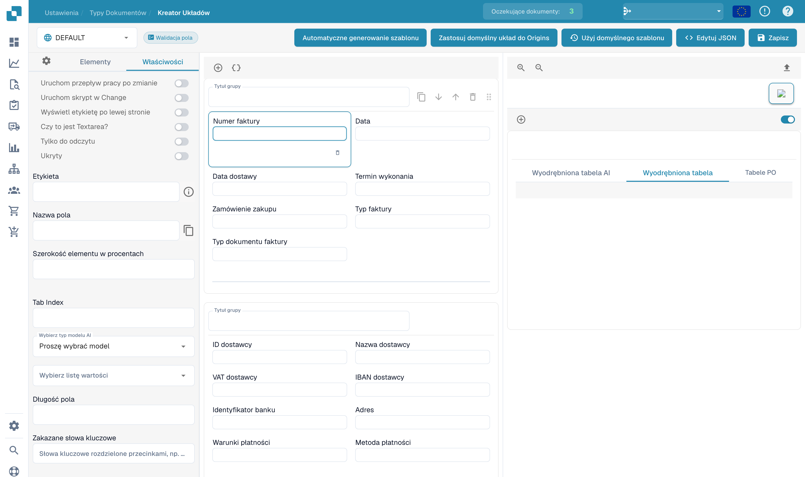

# Konfigurowanie właściwości pól

Otwórz istniejący układ w kreatorze i wybierz pole w podglądzie. Panel właściwości pokazuje opcje wybranego elementu.

<figure><figcaption>
Właściwości pola w kreatorze układów.
</figcaption></figure>

Sprawdź etykietę, nazwę techniczną, szerokość procentową i kolejność przechodzenia klawiszem Tab. Zależnie od elementu dostępne są również ustawienia tylko do odczytu, widoczności, położenia etykiety, wielu wierszy tekstu oraz uruchamiania przepływu lub skryptu przy zmianie wartości.

W razie potrzeby wybierz model AI lub listę wartości. Długość i zabronione słowa dodają ograniczenia. Nazwy techniczne i skonfigurowane nazwy pochodzeń nie zmieniają się wraz z językiem interfejsu.

Sprawdź podgląd po każdej zmianie. Zapisz zamierzone zmiany i przetestuj walidację na reprezentatywnych dokumentach. Reguły walidacji i progi rozpoznawania typu dokumentu ustawia się oddzielnie.
