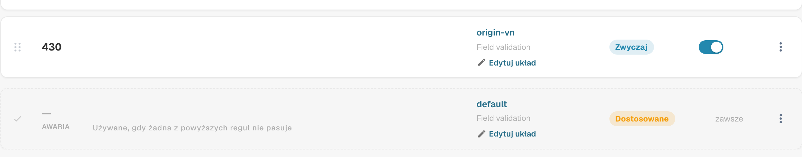
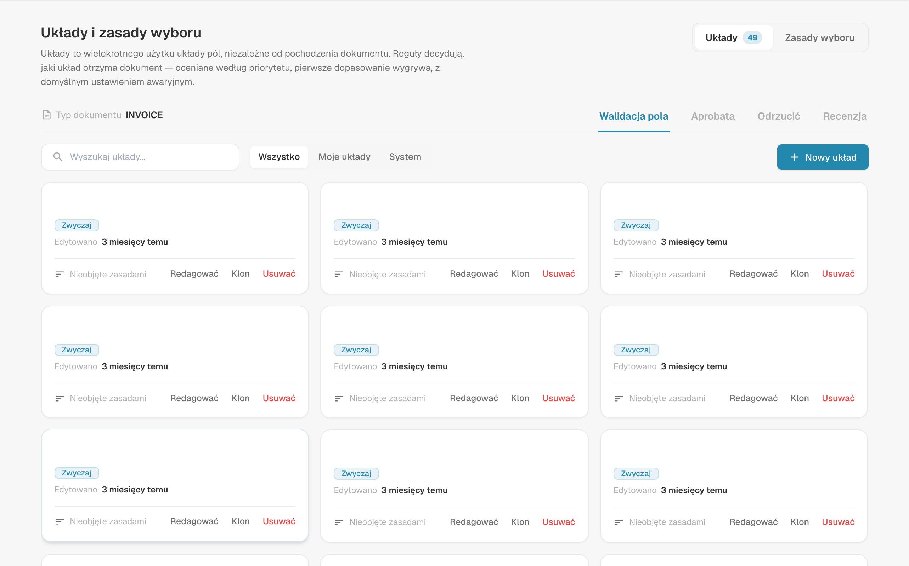
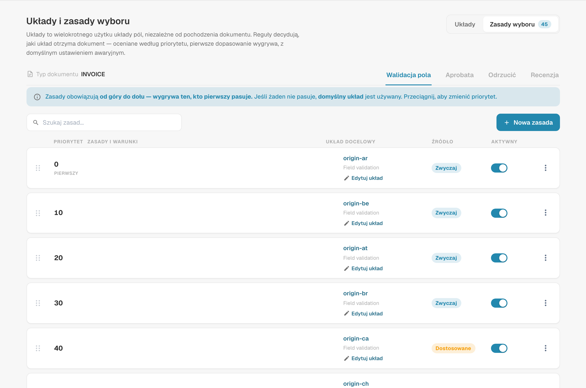
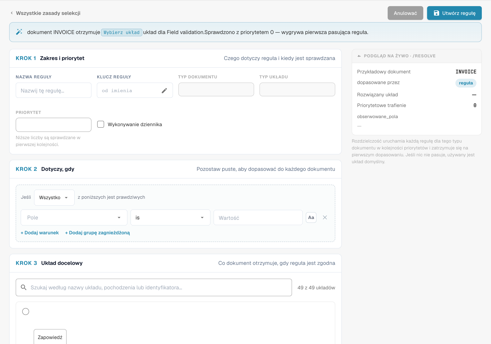
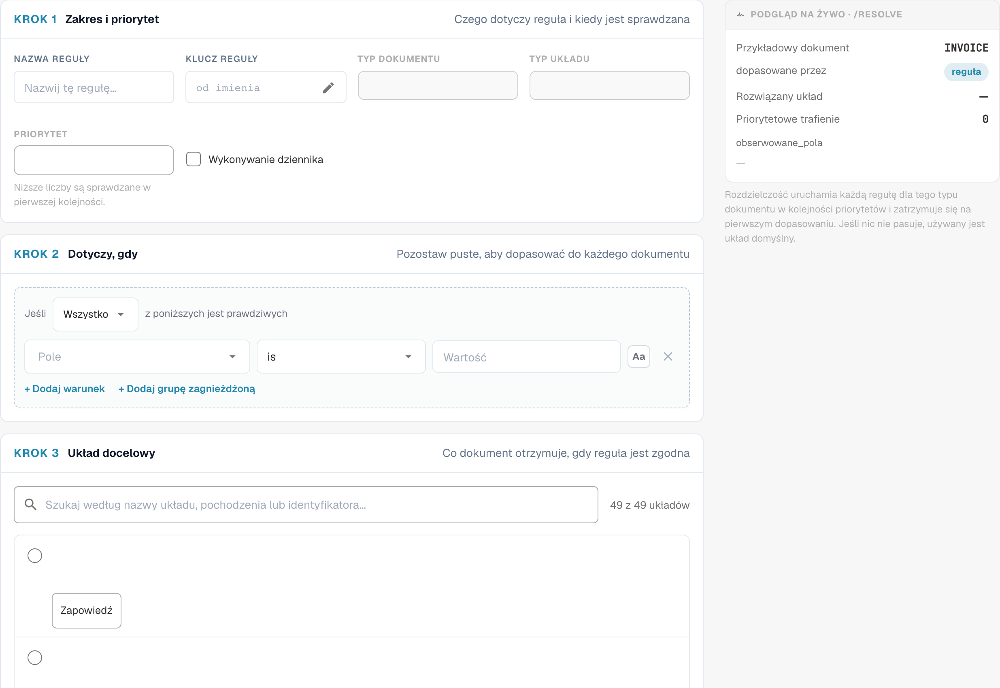

# Reguły wyboru układu

## Przegląd

**Układ** decyduje, jakie pola i grupy użytkownik widzi — i w jakiej kolejności — na ekranach **walidacji**, **akceptacji**, **odrzucenia** oraz **przeglądu** dokumentu. Układy projektujesz w [Menedżerze Układów](README.md).

Klasycznie DocBits wybierał układ na podstawie **pochodzenia** dokumentu: kraju lub regionu pobranego z ustawień językowych dokumentu, takiego jak `DE` czy `US`. Każde pochodzenie miało własną kopię układu i nic innego nie mogło wpłynąć na wybór.

Dzięki **regułom wyboru układu** układy stają się wielokrotnie używanymi elementami składowymi, niezależnymi od pochodzenia, a to **reguły** decydują, jaki układ otrzyma dokument:

> *Gdy* dokument spełnia warunek, *wtedy* otrzymuje ten układ. Reguły są sprawdzane od góry do dołu; **wygrywa pierwsza pasująca reguła**. Jeśli żadna reguła nie pasuje, używany jest **układ domyślny**.

Pochodzenie nadal jest dostępne — jako jeden z wielu warunków. Reguła może równie dobrze uwzględniać dostawcę, kwotę, status dokumentu, metodę ekstrakcji lub dowolne pole nagłówka.

### Problemy, które rozwiązują

| Wymaganie | Klasyczne układy oparte na pochodzeniu | Z regułami wyboru |
| --- | --- | --- |
| Faktury jednego dostawcy wymagają dodatkowych pól (projekt, numer celny) | niemożliwe bez nowego pochodzenia | reguła *Supplier ID is 20723* → układ „Faktura z polami projektu” |
| Dokumenty DE, AT i CH powinny wyglądać tak samo | trzy kopie tego samego układu do utrzymania | jeden układ, jedna reguła na pochodzenie (lub grupa ANY) wskazująca na niego |
| E-faktury wymagają prostszego ekranu niż skanowane pliki PDF | niemożliwe | reguła *Extraction Method is ELECTRONIC_DOCUMENT* → układ „E-faktura” |
| Faktury o wysokiej wartości wymagają więcej pól na ekranie akceptacji | niemożliwe | reguła Approval *Total Amount greater than 10000* → układ „Akceptacja wysokich kwot” |
| Drugi akceptujący powinien widzieć inny ekran niż pierwszy | osobny typ układu „druga akceptacja” | reguła Approval *Document Status is Pending second approval* → układ „Druga akceptacja” |

## Włączanie układów opartych na regułach

Układy oparte na regułach włącza się **dla każdego typu dokumentu** osobno, jako **administrator organizacji**.

1. Przejdź do **Ustawienia → Ustawienia ogólne → Typy dokumentów**.
2. Kliknij ikonę **ustawień** (koło zębate) na karcie typu dokumentu.
3. Otwórz **Zarządzaj układami** i włącz przełącznik.

<figure><figcaption>
Przełącznik Manage Layouts w dodatkowych ustawieniach typu dokumentu
</figcaption></figure>

Link **Układy** na karcie typu dokumentu otwiera teraz **Układy i zasady wyboru**.

### Co się dzieje po włączeniu

DocBits przekształca istniejące układy oparte na pochodzeniu w reguły — jednorazowo, dla danego typu dokumentu i dla każdego ekranu:

* Układ o pochodzeniu **DEFAULT** staje się **układem domyślnym** (rozwiązaniem awaryjnym).
* Każdy układ konkretnego pochodzenia staje się regułą **„Layout for XX”** z warunkiem *Document Origin is XX*, wskazującą na ten układ. Reguły te otrzymują priorytety co 10 (na przykład 2000, 2010, 2020 …), dzięki czemu własne reguły możesz umieścić przed nimi, między nimi lub po nich.

<figure><figcaption>
Układ zastępczy na końcu listy reguł wyboru. Niektóre nazwy typów lub układów, takie jak Field validation, pozostają angielskie. Skonfigurowane nazwy i identyfikatory pozostają bez zmian. Etykieta AWARIA oznacza układ zastępczy używany przy braku pasującej reguły, nie zarejestrowaną awarię.
</figcaption></figure>

Nic nie jest usuwane ani zmieniane w samych układach. Zaraz po aktywacji każdy dokument otrzymuje więc dokładnie ten układ, który otrzymywał wcześniej. Zachowanie zmienia się dopiero wtedy, gdy dodasz lub zmienisz reguły.

**Wyłączenie** funkcji natychmiast przywraca dla typu dokumentu wybór oparty na pochodzeniu. Reguły są zachowane, ale nieużywane, i zaczynają działać ponownie po ponownym włączeniu przełącznika.

## Ekran Layouts & Selection Rules

<figure><figcaption>
Przegląd układów i reguł wyboru. Niektóre nazwy typów lub układów, takie jak Field validation, pozostają angielskie. Skonfigurowane nazwy i identyfikatory pozostają bez zmian.
</figcaption></figure>

* **Layouts / Selection rules** (prawy górny róg) przełączają między listą układów a listą reguł. Liczby pokazują, ile ich jest.
* **Field Validation / Approval / Reject / Review** przełączają **ekran**. Każdy ekran ma własne układy, własne reguły i własny układ domyślny — reguła Approval nigdy nie zmienia ekranu walidacji.
* Na zakładce **Układy** możesz tworzyć, edytować, klonować i usuwać układy. Każda karta pokazuje, czy układ jest używany przez jakąś regułę („Not targeted by rules”, gdy żadna go nie używa). Filtruj za pomocą **All / My layouts / System**; układy systemowe są dostarczane z DocBits i można je przeglądać oraz klonować, ale nie zmieniać.


Pierwsza i druga akceptacja współdzielą układy i reguły **Aprobata**. Aby nadać drugiemu etapowi akceptacji własny ekran, dodaj regułę Approval z warunkiem *Document Status is Pending second approval* — zobacz [przykład](#rozne-ekrany-dla-pierwszej-i-drugiej-akceptacji).


## Jak wybierany jest układ

Za każdym razem, gdy dokument jest otwierany, oraz ponownie po jego zapisaniu, DocBits ustala jego układ dla bieżącego ekranu:

1. **Aktywne reguły** ekranu są sprawdzane w kolejności **priorytetu** (od najniższego numeru). **Wygrywa pierwsza reguła, której warunek jest prawdziwy**, i używany jest jej układ.
2. Jeśli żadna reguła nie pasuje, używany jest **układ domyślny**.
3. Jeśli nie ma też układu domyślnego, DocBits wraca do klasycznego wyboru opartego na pochodzeniu.

Reguły, których układ został usunięty lub jest pusty, są pomijane.

### Przykład krok po kroku

Reguły ekranu **Walidacja pola**:

| Priorytet | Reguła | Warunek | Układ |
| --- | --- | --- | --- |
| 5 | Faktury Example Supplier | *Supplier ID is HP0000278* | Faktura z polami projektu |
| 10 | E-faktury | *Extraction Method is ELECTRONIC_DOCUMENT* | E-faktura |
| 2020 | Layout for DE | *Document Origin is DE* | Field Validation Layout (DE) |
| — | Układ domyślny | — | Field Validation Layout (Base) |

Jaki układ otrzymuje każdy dokument:

| Dokument | Dostawca | Ekstrakcja | Pochodzenie | Układ | Dlaczego |
| --- | --- | --- | --- | --- | --- |
| 1 | HP0000278 | e-faktura | DE | Faktura z polami projektu | najpierw pasuje priorytet 5; kolejne reguły nie są sprawdzane |
| 2 | 10040 | e-faktura | DE | E-faktura | priorytet 5 nie pasuje, 10 pasuje |
| 3 | 10040 | skanowany PDF | DE | Field Validation Layout (DE) | pasuje tylko reguła pochodzenia |
| 4 | 10040 | skanowany PDF | US | Field Validation Layout (Base) | żadna reguła nie pasuje → układ domyślny |

**Kolejność ma znaczenie**: reguły szczegółowe (jeden dostawca) umieszczaj nad regułami ogólnymi (jeden kraj).

### Gdy użytkownik zmieni pole, które reguły uwzględniają

Układ jest zawsze wybierany na podstawie **bieżących** wartości dokumentu. Jeśli użytkownik poprawi na przykład dostawcę na ekranie walidacji, DocBits po zapisaniu wybierze układ ponownie, a ekran może przełączyć się na inny układ. Żadne dane nie są tracone: pole, które nie należy do nowego układu, zachowuje swoją wartość; po prostu nie jest wyświetlane, dopóki nie zacznie obowiązywać układ, który je zawiera.

## Zarządzanie regułami wyboru

<figure><figcaption>
Reguły wyboru z ukrytymi skonfigurowanymi nazwami. Niektóre nazwy typów lub układów, takie jak Field validation, pozostają angielskie. Skonfigurowane nazwy i identyfikatory pozostają bez zmian.
</figcaption></figure>

Każdy wiersz pokazuje **priorytet** (pierwszy wiersz jest oznaczony **FIRST**), **nazwę i klucz reguły** wraz z jej **warunkami**, **układ docelowy**, plakietkę **źródła** oraz przełącznik **Aktywny**.

| Zadanie | Jak |
| --- | --- |
| Utworzenie reguły | **Nowa zasada** |
| Edycja reguły | Kliknij wiersz |
| Zmiana kolejności | Przeciągnij uchwyt po lewej stronie wiersza w górę lub w dół. Nowa kolejność jest zapisywana natychmiast. |
| Wyłączenie reguły | Przełącznik **Aktywny**. Nieaktywne reguły są ignorowane. |
| Duplikowanie lub usuwanie | Menu **⋮** wiersza |
| Wyszukiwanie reguły | **Search rules…** |

Plakietka **źródła** informuje, skąd pochodzi reguła: reguły **System** są dostarczane z DocBits. Edycja takiej reguły tworzy kopię dla Twojej organizacji, oznaczoną jako **Dostosowane**; oryginał pozostaje nienaruszony i można go przywrócić. Reguły, które tworzysz, mają źródło **Niestandardowy**.

### Układ domyślny

Ostatni wiersz, oznaczony **FALLBACK** i **is_default**, to układ domyślny: jest używany zawsze, gdy żadna z reguł powyżej nie pasuje, i nie ma warunku. Powstaje po włączeniu funkcji (z układu o pochodzeniu DEFAULT).


Aby użyć innego układu awaryjnego, utwórz regułę **bez żadnego warunku** i nadaj jej najwyższy numer priorytetu, tak aby była sprawdzana jako ostatnia. Pasuje do każdego dokumentu, którego nie dopasowała żadna wcześniejsza reguła, jeszcze zanim zostanie użyty układ domyślny.


## Tworzenie reguły

Kliknij **Nowa zasada** na zakładce Selection rules ekranu, który chcesz zmienić.

<figure><figcaption>
Zakres, warunki i układ docelowy reguły wyboru. Niektóre nazwy typów lub układów, takie jak Field validation, pozostają angielskie. Skonfigurowane nazwy i identyfikatory pozostają bez zmian.
</figcaption></figure>

Zdanie u góry podsumowuje regułę w trakcie jej budowania — „When header.supplier_id = HP0000278, an INVOICE document gets the Field Validation Layout (Base) layout for Field validation. Checked at priority 5 — the first matching rule wins.”

### Krok 1 — Zakres i priorytet

| Ustawienie | Co robi |
| --- | --- |
| **Nazwa reguły** | Wyświetlana na liście reguł. Opisz przypadek biznesowy: „Faktury Example Supplier”, „E-faktury”, „Akceptacja wysokich kwot”. |
| **Klucz reguły** | Generowany z nazwy; pozostaje taki sam po zmianie nazwy reguły. |
| **Typ dokumentu** / **Typ układu** | Typ dokumentu i ekran, dla którego jest reguła. Przejmowane z miejsca, w którym kliknięto **Nowa zasada**. |
| **Priorytet** | Niższe numery są sprawdzane jako pierwsze. Zostawiaj odstępy (5, 10, 20 …), aby móc później wstawiać reguły. |

### Krok 2 — Dotyczy, gdy

Warunek, który musi spełniać dokument. Możesz użyć:

* **atrybutów dokumentu**: Document Origin, Extraction Method, Document Status, Sub Document Type,
* **pól nagłówka**: Supplier ID, Total Amount, Currency, Purchase Order i każde inne pole typu dokumentu,
* **własnej ścieżki JSON** (Advanced).

Kolumny tabeli nie są dostępne: układ jest wybierany jednorazowo dla całego dokumentu.

Pozostaw krok pusty, aby dopasować każdy dokument przy tym priorytecie. Sposób działania warunków — ALL / ANY, zagnieżdżone grupy, wszystkie operatory, puste wartości, wielkość liter — wyjaśniono na stronie [Warunki reguł (Dotyczy, gdy)](../rule-conditions-applies-when.md).

### Krok 3 — Układ docelowy

Kliknij układ, który ma otrzymać dokument. Lista pokazuje Twoje własne układy oraz układy systemowe wybranego ekranu. Układu nie można usunąć, dopóki jakaś reguła nadal na niego wskazuje.

### Podgląd na żywo · /resolve

Panel po prawej stronie pokazuje, co reguła robi dla przykładowego dokumentu o wartościach z Twoich warunków:

| Wiersz | Znaczenie |
| --- | --- |
| **Przykładowy dokument** | Wartości użyte w podglądzie, pobrane z Twoich warunków |
| **matched_by** | `rule`, jeśli dopasowała się reguła, w przeciwnym razie układ domyślny |
| **Rozwiązany układ** | Układ, który otrzymałby przykładowy dokument |
| **Priorytet dopasowanej reguły** | Priorytet reguły, która się dopasowała |
| **watched_fields** | Pola, od których zależy wybór układu. Gdy użytkownik zmieni któreś z nich, układ jest wybierany ponownie. |

Kliknij **Utwórz regułę** (lub **Zapisz regułę** podczas edycji), aby zapisać. **Anulować** wraca do listy reguł.

## Przykłady

### Dodatkowe pola dla jednego dostawcy

Ekran **Walidacja pola** · priorytet **5** · *Supplier ID is HP0000278* · cel *Faktura z polami projektu* (klon standardowego układu z dodatkowymi polami projektu i miejsca powstawania kosztów).

### Jeden układ dla kilku krajów

Ekran **Walidacja pola** · priorytet **100** · **Dowolny z warunków**: *Document Origin is Deutsch*, *Document Origin is Austria*, *Document Origin is Switzerland* · cel *Faktura DACH*. Dezaktywuj zmigrowane reguły „Layout for AT” i „Layout for CH”, jeśli wskazują na starsze kopie.

### Prostszy ekran dla e-faktur

Ekran **Walidacja pola** · priorytet **10** · *Extraction Method is ELECTRONIC_DOCUMENT* · cel *E-faktura* (bez pól związanych z OCR).

### Bardziej rygorystyczny ekran akceptacji dla wysokich kwot

Ekran **Aprobata** · priorytet **10** · *Total Amount greater than 10000* · cel *Akceptacja wysokich kwot* (pokazujący miejsce powstawania kosztów, właściciela budżetu i numer umowy).

### Różne ekrany dla pierwszej i drugiej akceptacji

Ekran **Aprobata** · priorytet **5** · *Document Status is Pending second approval* · cel *Second Approval Layout*. Dokumenty na etapie pierwszej akceptacji nie pasują i otrzymują domyślny układ Approval.

<figure><figcaption>
Niezapisany projekt reguły wyboru układu. Niektóre nazwy typów lub układów, takie jak Field validation, pozostają angielskie. Skonfigurowane nazwy i identyfikatory pozostają bez zmian.
</figcaption></figure>

### Specjalny ekran odrzucenia dla wybranych dostawców

Ekran **Odrzuć** · priorytet **10** · *Supplier ID is one of* `10040, 10041` · cel *Odrzucenie z kodami przyczyn*.

## Dobre praktyki

* **Najpierw szczegółowe, potem ogólne.** Reguły dostawców nad regułami krajów, reguły krajów nad układem domyślnym.
* **Zostawiaj odstępy w priorytetach** (5, 10, 20 …), aby nowe reguły można było wstawić bez zmiany numeracji.
* **Opieraj warunki na wiarygodnych polach.** Dostawca i pochodzenie są ustalane wcześnie i rzadko się zmieniają. Warunki oparte na polach, które użytkownicy często edytują, powodują przełączanie układów w trakcie pracy.
* **Klonuj, zamiast zaczynać od zera.** Sklonuj standardowy układ i dostosuj go, aby wszystkie układy zachowały tę samą podstawową strukturę.
* **Sprawdzaj podgląd na żywo** i po zmianie reguł otwórz rzeczywisty dokument każdego rodzaju.
* **Zachowaj sensowny układ domyślny** dla każdego ekranu, aby żaden dokument nie został bez układu.

## Rozwiązywanie problemów

| Objaw | Co sprawdzić |
| --- | --- |
| Dokument otrzymuje zły układ | Wcześniejsza reguła pasuje jako pierwsza. Sprawdź reguły powyżej lub **Priorytet dopasowanej reguły** w podglądzie. |
| Używany jest układ domyślny, choć reguła powinna pasować | Czy reguła jest **Aktywny**? Czy warunek pasuje do dokładnej wartości (wielkość liter, spacje)? Czy reguła jest na właściwej zakładce **ekranu**? |
| Układ zmienia się w trakcie pracy użytkownika | Zmieniono pole z **watched_fields**. Oprzyj regułę na bardziej stabilnym polu. |
| Nie można usunąć układu | Nadal wskazuje na niego jakaś reguła. Najpierw zmień cel tej reguły lub ją usuń. |
| Nie jest wyświetlany żaden układ | Żadna reguła nie pasowała, nie ma układu domyślnego i dla tego ekranu nie istnieje układ oparty na pochodzeniu. Dodaj regułę bez warunku jako rozwiązanie zbiorcze. |
| Po aktywacji nic się nie zmieniło | Tak ma być: aktywacja odtwarza poprzedni wybór oparty na pochodzeniu. Dodaj własne reguły. |
| Druga akceptacja pokazuje układ pierwszej akceptacji | Dodaj regułę Approval z warunkiem *Document Status is Pending second approval* nad pozostałymi regułami Approval. |

## Powiązane

* [Warunki reguł (Dotyczy, gdy)](../rule-conditions-applies-when.md)
* [Niestandardowe reguły walidacji](../custom-validation-rules.md)
* [Zasady transformacji](../transformation-rules.md)
* [Nawigacja w Menedżerze Układów](navigating-the-layout-manager.md)
