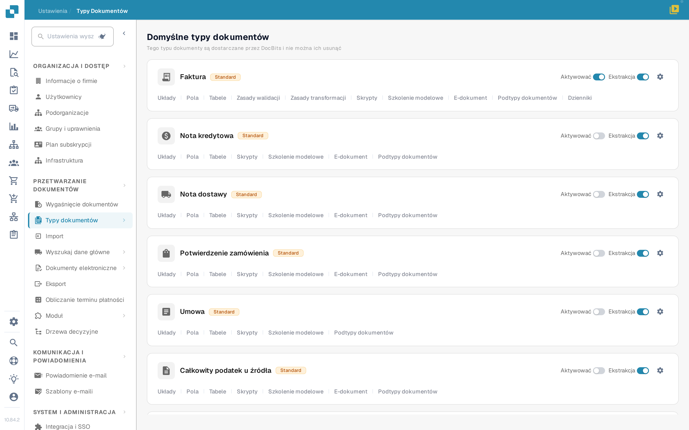
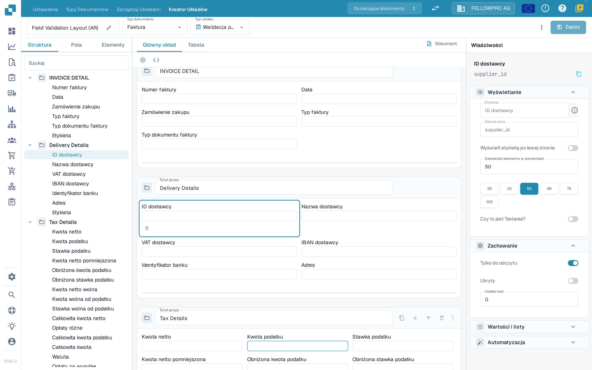
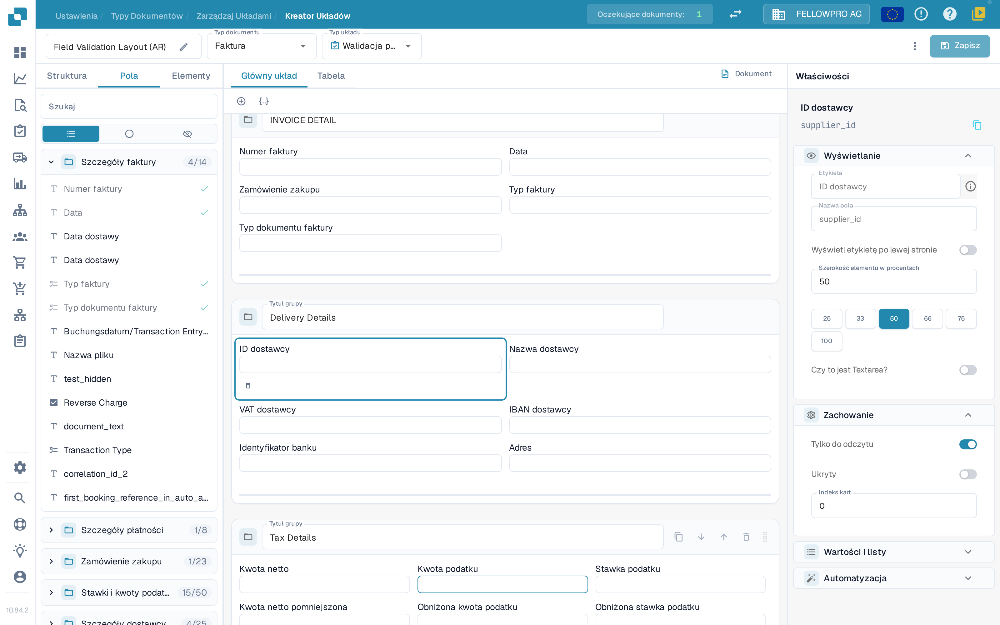
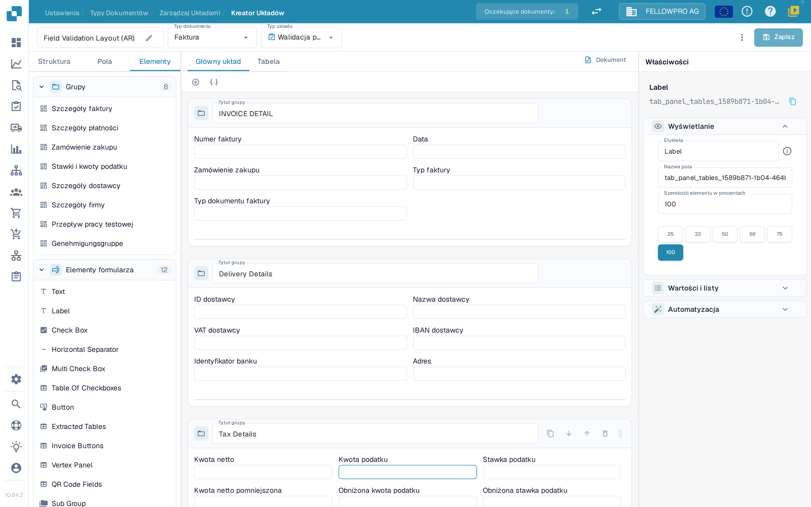

# Nawigacja w Menedżerze Układów

Użyj **Menedżera układów**, aby porządkować grupy i pola, które użytkownicy widzą na dokumencie. Zrzuty ekranu w tym artykule pokazują polski interfejs na przykładzie układu faktury.

## Otwieranie układu faktury

1. Przejdź do **Ustawienia → Typy dokumentów**.
2. Znajdź kartę **Faktura** i wybierz pod jej nazwą **Układy**. Menedżer układów otworzy się dla tego typu dokumentu.
3. W nagłówku zobaczysz nazwę układu (zmienisz ją ikoną ołówka), **Typ dokumentu** i **Typ układu**. Przez **Typ układu** przełączysz się na inny układ tego samego typu dokumentu.

<figure><figcaption>
Otwórz <strong>Układy</strong> na karcie Faktura.
</figcaption></figure>

## Praca z trzema kartami panelu

Panel po lewej stronie ma trzy karty: **Struktura**, **Pola** i **Elementy**. Menedżer układów otwiera się na karcie **Pola**.

**Struktura** pokazuje układ jako drzewo, w tej samej kolejności, w jakiej grupy i pola występują w dokumencie. Rozwiń grupę strzałką, aby zobaczyć jej pola; nazwę techniczną pola pokazuje panel **Właściwości**. Pole wyszukiwania filtruje drzewo, a zaznaczenie wiersza zaznacza ten sam element na obszarze roboczym.

<figure><figcaption>
Drzewo Struktury, obszar roboczy i panel Właściwości.
</figcaption></figure>

**Pola** lista wszystkie pola oferowane przez typ dokumentu, pogrupowane według jego grup. Licznik obok nazwy grupy pokazuje, ile jej pól jest już umieszczonych w układzie, na przykład **4/14**. Trzy przyciski pod polem wyszukiwania to same ikony: przełączają listę między wszystkimi polami, tylko polami jeszcze nieumieszczonymi i tylko polami ukrytymi. Każdy wiersz pokazuje etykietę pola, a zielony znacznik po prawej oznacza pola, które są już w układzie; umieszczone pola są wyszarzone.

<figure><figcaption>
Filtruj pola i rozpoznawaj umieszczone pola po znaczniku.
</figcaption></figure>

**Elementy** zawiera bloki, które przeciągasz na obszar roboczy: **Grupy** z grupami tego układu oraz **Elementy formularza** z pozycjami Text, Label, Check Box, Horizontal Separator, Multi Check Box, Table Of Checkboxes, Button, Extracted Tables, Invoice Buttons, Vertex Panel, QR Code Fields i Sub Group.

<figure><figcaption>
Palety Grupy i Elementy formularza.
</figcaption></figure>

## Umieszczanie i porządkowanie elementów

- Przeciągnij pole z karty **Pola** albo element z karty **Elementy** do grupy, w której ma się pojawić. Pola już umieszczone mają na karcie **Pola** znacznik.
- Przeciągnij pole w obrębie grupy lub między grupami, aby zmienić kolejność.
- **+** nad obszarem roboczym dodaje pustą grupę; ikona JSON obok tworzy grupę z definicji JSON.
- W nagłówku grupy możesz zmienić jej nazwę w polu **Tytuł grupy**, skopiować jej JSON, przesunąć grupę w dół lub w górę albo ją usunąć. Uchwyt po prawej stronie nagłówka przesuwa całą grupę.
- Zaznacz pole na obszarze roboczym, aby otworzyć jego właściwości po prawej. Mały pasek narzędzi pod zaznaczonym polem usuwa je z układu.

## Panel Właściwości

Panel **Właściwości** po prawej jest zawsze otwarty i podąża za zaznaczonym elementem. Jego ustawienia są podzielone na cztery sekcje: **Wyświetlanie**, **Zachowanie**, **Wartości i listy** oraz **Automatyzacja**. W sekcji **Wyświetlanie** znajdziesz etykietę, typ pola i **Szerokość elementu w procentach**, wybieraną z wartości 25, 33, 50, 66, 75 i 100. Poszczególne opcje opisuje strona [Konfigurowanie właściwości pól](configuring-field-properties.md).

Ustawienia walidacji, OCR i dopasowywania należą do samego pola, a nie do układu: skonfigurujesz je w osobnych [ustawieniach pól](../fields/configuring-field-properties-1.md).

## Podgląd i zapisywanie

Obszar roboczy pokazuje układ tak, jak będzie wyglądał w dokumencie. Kartami **Główny układ** i **Tabela** przełączasz się między stroną a tabelą pozycji, a **Dokument** otwiera przykładowy dokument obok obszaru roboczego. Zobacz [Korzystanie z podglądu szablonu](using-the-template-preview.md).

Na koniec wybierz **Zapisz** w nagłówku. Pozostałe działania nagłówka – między innymi generowanie szablonu, szablony domyślne i stosowanie układu do pochodzeń – opisuje strona [Zapisywanie i stosowanie zmian](save-and-apply-changes.md).
