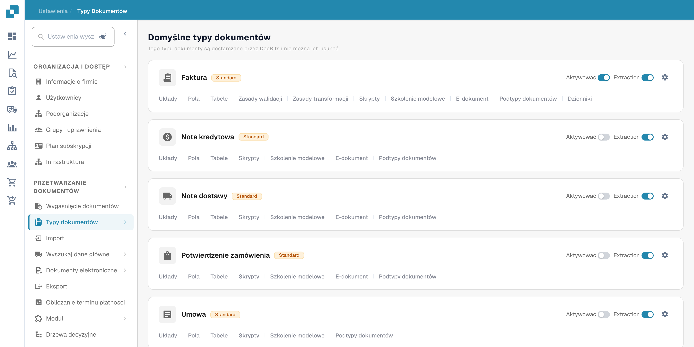
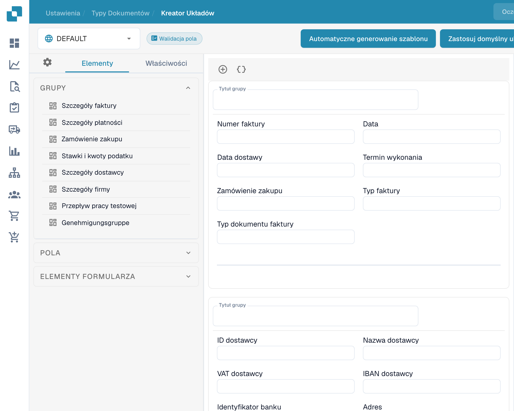
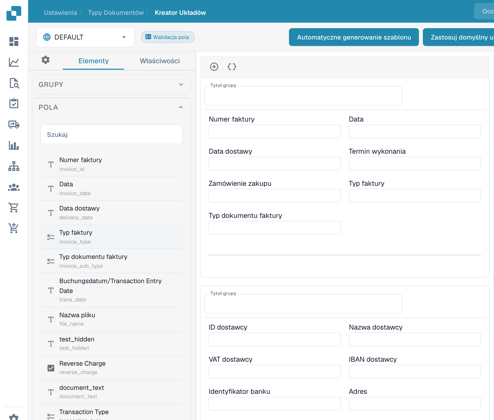
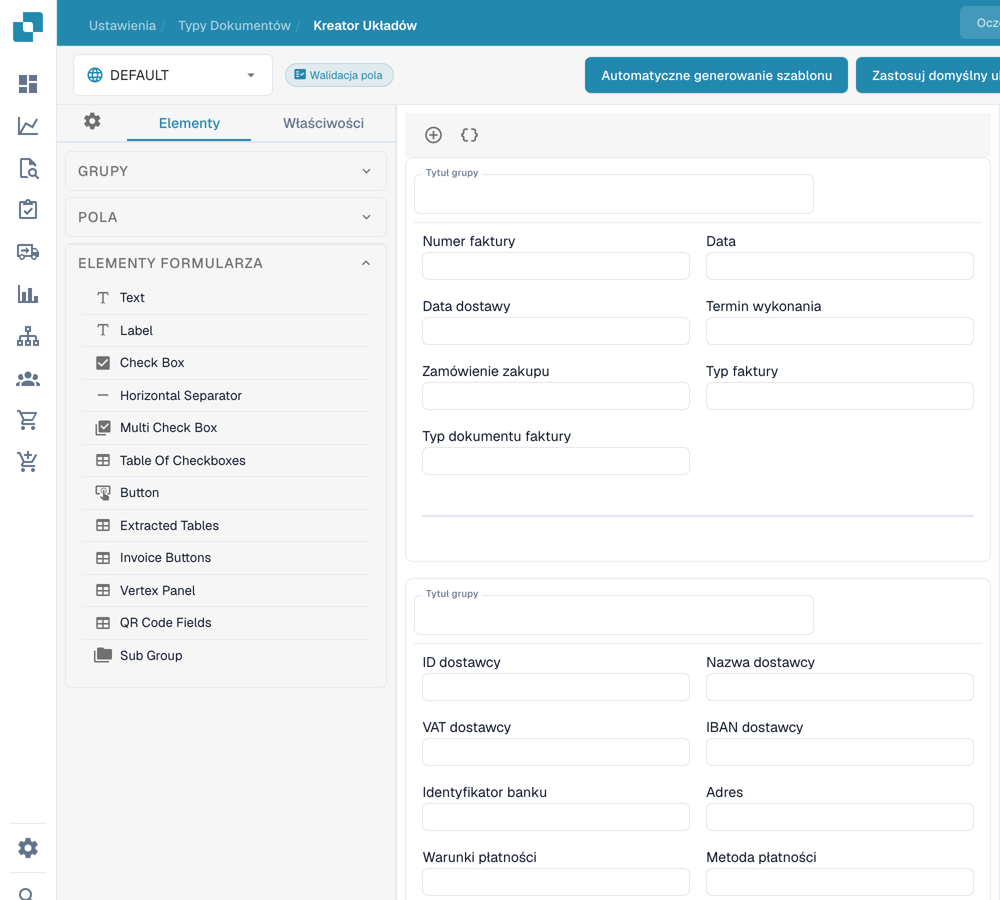

# Nawigacja w Layout Builder

Użyj **Kreator układów**, aby rozmieścić pola i grupy widoczne na dokumencie. Ten przewodnik wykorzystuje angielski układ **Faktura** w organizacji sandbox.

## Otwieranie układu Invoice

1. Przejdź do **Settings → Document Types**.
2. Znajdź **Faktura** i wybierz **Układy** na jego karcie. Layout Builder otworzy się dla tego typu dokumentu.
3. Sprawdź selektor układu w lewym górnym rogu. Poniższy przykład pokazuje **DEFAULT**.

<figure><figcaption>
Dostęp do typów dokumentów z ustawień.
</figcaption></figure>

## Znajdowanie grup i pól

Lewy panel **Elementy** ma trzy sekcje. **Grupy** wyświetla sekcje dokumentu; środkowy obszar roboczy pokazuje ich aktualny układ. Zaznacz pole w obszarze roboczym i otwórz **Właściwości**, aby zmienić jego ustawienia wyświetlania. Dostępne opcje opisuje [Configuring Field Properties](configuring-field-properties.md).

<figure><figcaption>
Elementy i grupy istniejącego układu.
</figcaption></figure>

Otwórz **Pola**, aby znaleźć dostępne pola dokumentu. Gdy lista jest długa, użyj pola wyszukiwania, a następnie przeciągnij pole do wybranej grupy w obszarze roboczym. Pola już umieszczone w układzie mogą być na liście niedostępne.

<figure><figcaption>
Dostępne pola w kreatorze układów.
</figcaption></figure>

Otwórz **Elementy formularza**, aby znaleźć elementy wizualne, takie jak Text, Label, Check Box, separator, Button i Sub Group. Przeciągnij potrzebny element do obszaru roboczego, a następnie sprawdź jego **Właściwości**.

<figure><figcaption>
Elementy formularza w kreatorze układów. Nazwy części elementów formularza pozostają angielskie.
</figcaption></figure>

## Rozmieszczanie i zapisywanie

- Zaznacz tytuł grupy w obszarze roboczym, aby go zmienić. Przycisk **+** nad obszarem roboczym dodaje grupę; sąsiednia ikona nawiasów klamrowych otwiera zaawansowany formularz grupy JSON.
- Najedź kursorem na grupę, aby zobaczyć akcje: kopiuj JSON, przesuń w górę, przesuń w dół, usuń i uchwyt przeciągania. Aby zmienić kolejność pól, przeciągaj je w obrębie grup lub między nimi.
- Zaznacz pole w obszarze roboczym, aby otworzyć **Właściwości**. Jego ikona usuwania usuwa je z tego układu. Aby skonfigurować walidację, OCR lub dopasowywanie, użyj osobnych [ustawień Fields](../fields/configuring-field-properties-1.md).
- Po edycji wybierz **Zapisz** na górnym pasku. Zanim użyjesz pozostałych akcji na górnym pasku, w tym generowania szablonów, szablonów domyślnych i stosowania układu do źródeł, zapoznaj się z [Save and Apply Changes](save-and-apply-changes.md).
