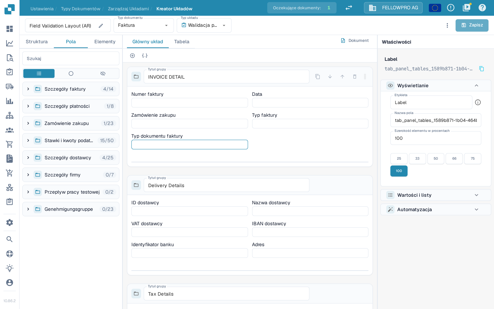
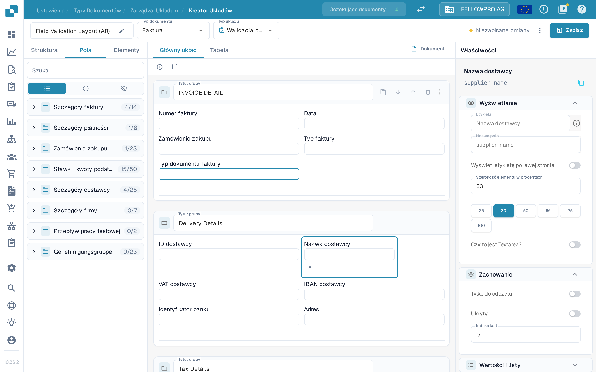
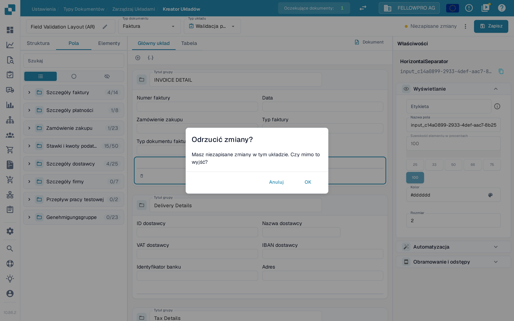
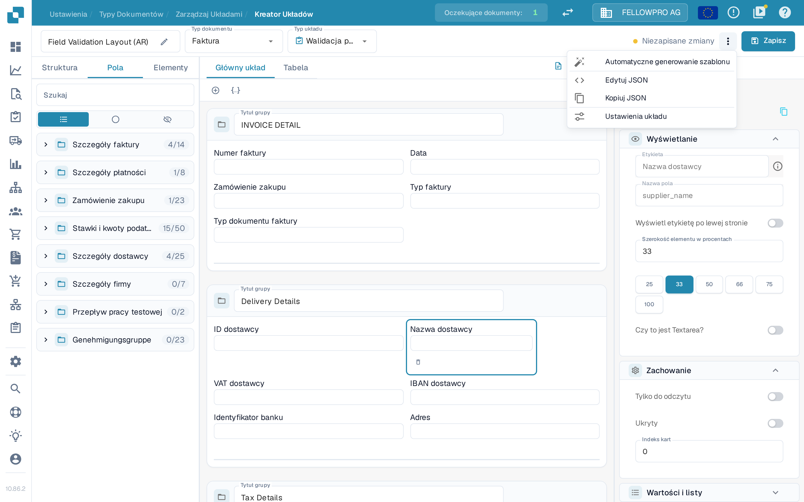

# Zapisywanie i stosowanie zmian

Zmiany wprowadzone w Layout Builderze zaczynają obowiązywać dopiero po ich zapisaniu. Zapis przypisuje układ do typu dokumentu, dzięki czemu nowe dokumenty z niego korzystają.

## Zapisywanie zmian

Po edycji układu wybierz **Zapisz** w prawym górnym rogu nagłówka.

<figure><figcaption>Przycisk **Zapisz** znajduje się w prawym górnym rogu Layout Buildera.</figcaption></figure>

Podczas pracy nagłówek pokazuje stan Twoich zmian:

- Przycisk **Zapisz** bez komunikatu obok oznacza, że układ nie został zmieniony.
- Komunikat **Niezapisane zmiany** pojawia się, gdy tylko zmodyfikujesz układ. Wybierz **Zapisz**, aby zachować zmiany.

<figure><figcaption>Komunikat **Niezapisane zmiany** jest widoczny, dopóki układ nie zostanie zapisany.</figcaption></figure>

Po udanym zapisie komunikat zastępuje godzina ostatniego zapisu. Ponowne wybranie **Zapisz** jest bezpieczne: jeśli od ostatniego zapisu nic się nie zmieniło, nic nie zostanie zapisane.

Jeśli spróbujesz opuścić Layout Builder z niezapisanymi zmianami, DocBits zapyta **Odrzucić zmiany?**. Wybierz **Anuluj**, aby zostać i zapisać, albo **OK**, aby wyjść bez zapisywania.

<figure><figcaption>Potwierdzenie wyświetlane przy wyjściu z niezapisanymi zmianami.</figcaption></figure>

## Pozostałe akcje w nagłówku

Menu z trzema kropkami obok przycisku **Zapisz** zawiera pozostałe akcje dotyczące układu:

- **Automatyczne generowanie szablonu** – tworzy układ automatycznie na podstawie pól typu dokumentu.
- **Edytuj JSON** – pozwala edytować definicję układu bezpośrednio w formacie JSON.
- **Kopiuj JSON** – kopiuje definicję układu do schowka.
- **Ustawienia układu** – otwiera ogólne ustawienia układu.

**Automatyczne generowanie szablonu** zastępuje istniejący układ, więc najpierw sprawdź, który układ jest otwarty. **Edytuj JSON** jest przeznaczone dla zaawansowanych użytkowników i warto z niego korzystać tylko wtedy, gdy znasz format szablonu.

<figure><figcaption>Akcje dostępne w menu z trzema kropkami.</figcaption></figure>

## Stosowanie zmian

Po zapisaniu układ jest używany przez przepływ pracy przetwarzania dokumentów dla tego typu dokumentu:

- Nowe dokumenty przetwarzane z tym typem dokumentu korzystają ze zaktualizowanego układu.
- Dokumenty już przetworzone zachowują układ, z którym zostały zarejestrowane.

## Testowanie zmian

Po zapisaniu otwórz dokument tego typu i sprawdź, czy pola i grupy wyglądają zgodnie z oczekiwaniami. Jeśli czegoś brakuje, wróć do Layout Buildera, popraw układ i zapisz ponownie.
