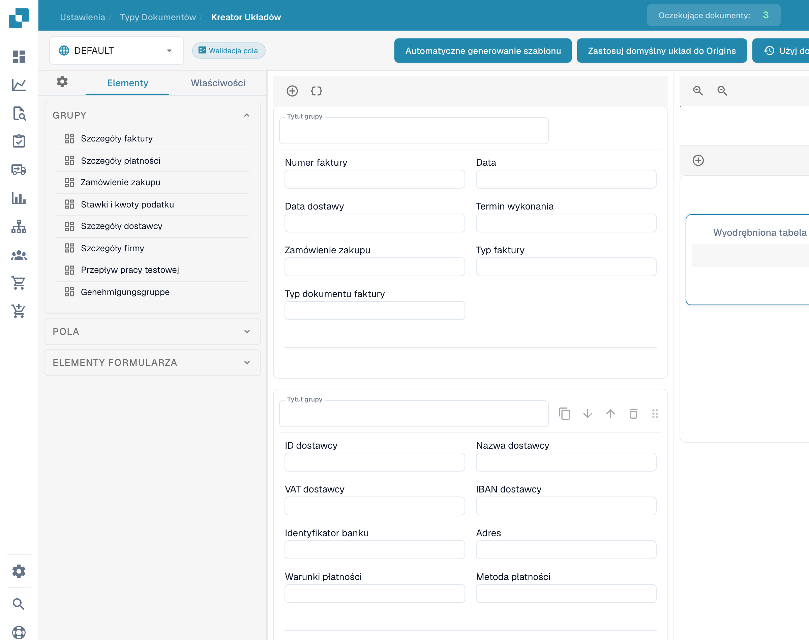

# Korzystanie z podglądu szablonu

Podgląd kreatora pokazuje rozmieszczenie grup, pól i tabel istniejącego układu.

<figure><figcaption>
Podgląd szablonu w kreatorze układów.
</figcaption></figure>

Otwórz odpowiedni typ dokumentu i układ. Sprawdź dostępne elementy i wybierz pole, aby skontrolować jego etykietę, szerokość i widoczność.

Wybór pochodzenia pozwala sprawdzić skonfigurowany kontekst. Nazwy pochodzeń pozostają bez zmian. Podgląd nie potwierdza zapisania nowego układu ani zastosowania go do innych pochodzeń.

Zapisz zamierzone zmiany i sprawdź wynikowy widok dokumentu.
