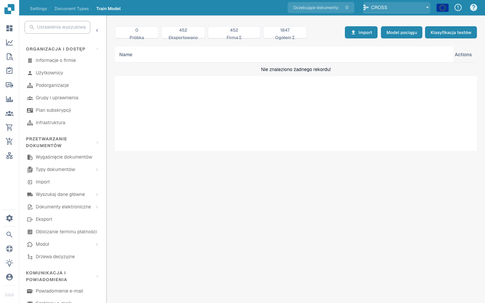

# Szkolenie Modelu

<figure><figcaption></figcaption></figure>

#### Przegląd

Szkolenie modelu umożliwia administratorom nadzorowanie i zarządzanie szkoleniem modeli uczenia maszynowego specyficznych dla każdego typu dokumentu. Dzięki zapewnieniu strukturalnego interfejsu do importowania danych próbkowych, szkolenia modeli i testowania ich wydajności, Docbits zapewnia, że zdolności ekstrakcji danych ciągle się poprawiają.

#### Główne funkcje i opcje

1. **Przegląd metryk**:

* **Próbka**: Liczba dokumentów próbkowych użytych do szkolenia.
* **Eksportowane**: Liczba dokumentów, które zostały pomyślnie wyeksportowane po przetworzeniu.
* **Suma firmy**: Łączna liczba dokumentów specyficznych dla firmy przetworzonych.
* **Suma ogólna**: Łączna liczba dokumentów przetworzonych we wszystkich kategoriach.

2. **Opcje szkolenia i testowania**:

* **Importuj**: Pozwala administratorom importować nowe zbiory danych szkoleniowych, które zazwyczaj są strukturalnymi próbkami dokumentów, które powinny być rozpoznawane przez system.
* **Trenuj model**: Rozpoczyna proces szkolenia, używając importowanych danych do poprawy zdolności rozpoznawania i ekstrakcji systemu.
* **Test klasyfikacji**: Umożliwia testowanie modelu w celu oceny jego wydajności w klasyfikowaniu i ekstrahowaniu danych z nowych lub niewidzianych dokumentów.

3. **Przyciski akcji**:

* **Utwórz pole**: Dodaj nowe pola danych, które model powinien rozpoznawać i ekstrahować.
* **Akcje**: To rozwijane menu może zawierać opcje takie jak wyświetlanie szczegółów, edytowanie konfiguracji lub usuwanie danych szkoleniowych.


