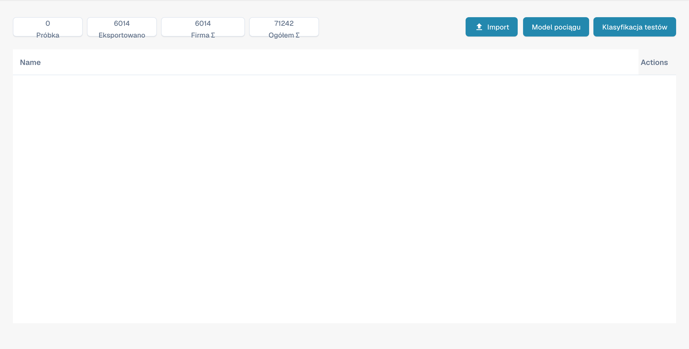

# Trenowanie modelu

Ten widok służy do zarządzania przykładami i sprawdzania klasyfikacji według typu dokumentu. Nie jest edytorem pól ekstrakcji.

<figure><figcaption>
Przegląd trenowania modelu w polskim interfejsie. Etykieta Model pociągu oznacza tutaj trenowanie modelu klasyfikacji; nagłówki Name i Actions pozostają angielskie.
</figcaption></figure>

## Liczniki i działania

U góry znajdują się przykłady, wyeksportowane dokumenty oraz liczniki organizacji i globalne. Interpretuj je z uwzględnieniem tego zakresu.

* Import dodaje przykłady treningowe.
* Działanie treningu uruchamia trenowanie modelu klasyfikacji.
* Test klasyfikacji sprawdza klasyfikację nowych dokumentów.

Ten widok nie tworzy pól; użyj ustawień pól typu dokumentu. Obrazy nie potwierdzają uruchomienia treningu ani testu klasyfikacji. Niektóre etykiety produktu mogą być angielskie lub niepoprawnie przetłumaczone.
