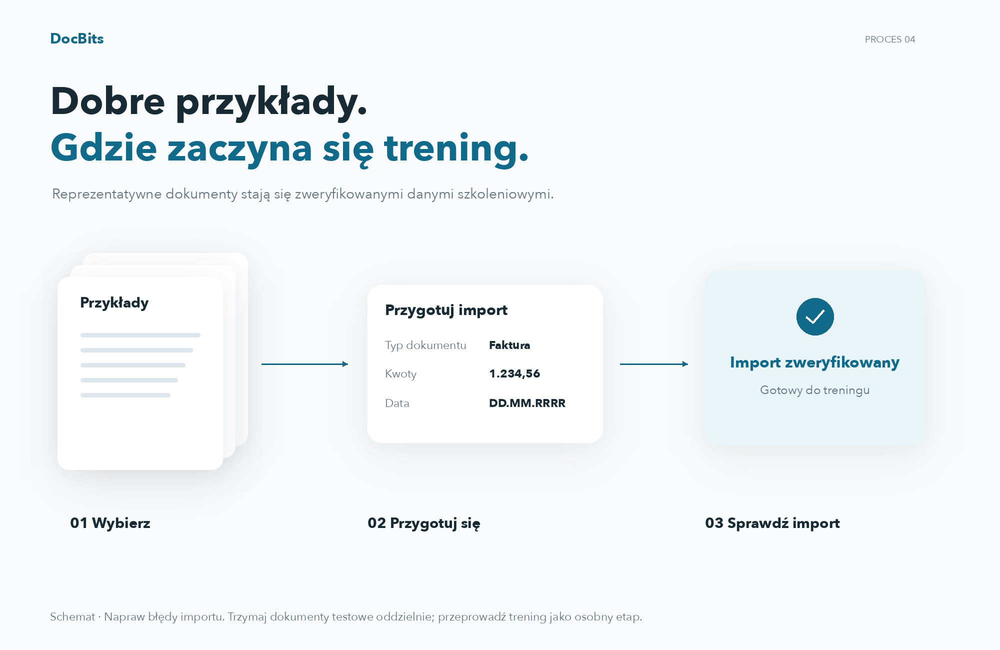
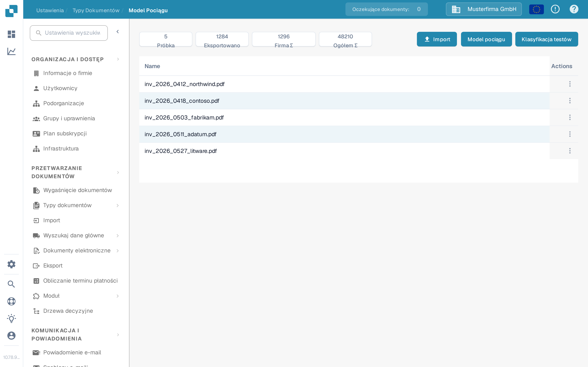
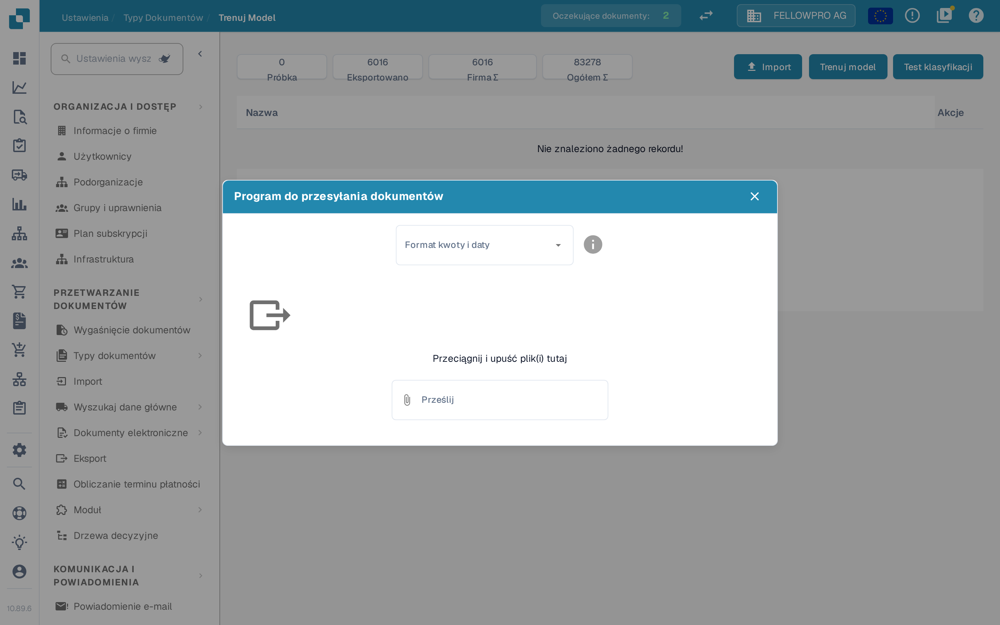
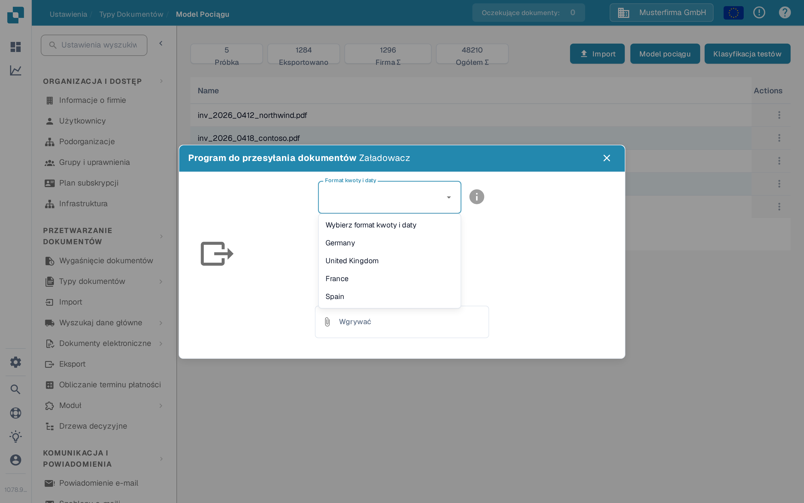
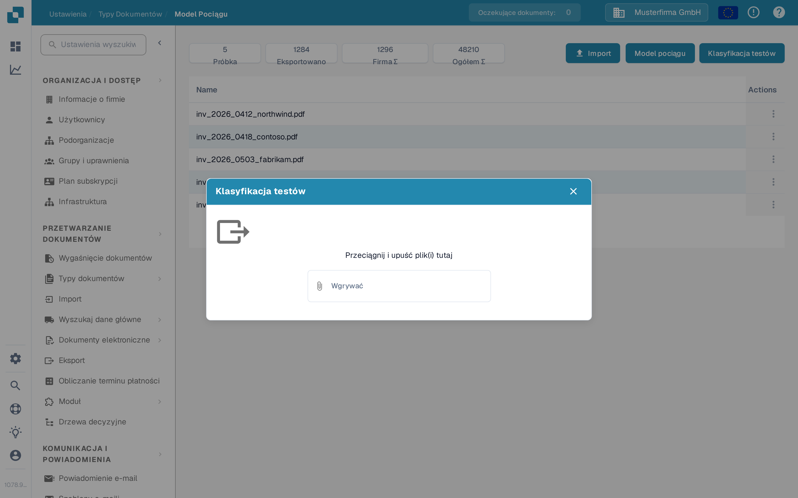

# Import danych: Trenowanie modelu

## Przygotuj, importuj i sprawdzaj przykładowe dokumenty

<figure><figcaption>
Przygotuj, importuj i sprawdzaj przykładowe dokumenty
</figcaption></figure>

Wybierz reprezentatywne przykładowe dokumenty, przygotuj dostępne opcje importu i sprawdź status importu. Tylko pomyślnie zaimportowane próbki są gotowe do dalszego treningu modelu. Rozwiąż błędy importu przed następnym krokiem i przechowuj niezależne dokumenty testowe oddzielnie od zbioru danych treningowych.

Ta strona służy do dodawania przykładowych plików PDF dla typu dokumentu, a następnie do trenowania lub testowania jego modelu klasyfikacji. Wymagany jest dostęp do **Ustawienia** i **Typy dokumentów**. O celu funkcji szkoleniowych przeczytaj w sekcji [Cel i zastosowanie: Trenowanie modelu](purpose-and-use-model-training.md).

## Otwórz typ dokumentu

1. Przejdź do **Ustawienia → Typy dokumentów**.
2. Znajdź typ dokumentu, który chcesz wytrenować. W jego wierszu wybierz **Szkolenie modelowe**. Poniższy przykład używa typu **Faktura**.

<figure><figcaption>
Otwórz Szkolenie modelowe z wybranego typu dokumentu.
</figcaption></figure>

Pozostałe elementy tej karty służą innym celom: **Aktywować** włącza typ dokumentu, **Extraction** przełącza jego tryb ekstrakcji, ikona zębatki otwiera jego ustawienia, a pozostałe linki prowadzą do innych obszarów konfiguracji. Nie musisz ich zmieniać, aby otworzyć Szkolenie modelowe.

Strona **Model Pociągu** pokazuje liczbę próbek oraz listę przesłanych dokumentów szkoleniowych. W organizacji przykładowej lista zawiera dokumenty; Twoja organizacja może wyświetlać inne dokumenty i inne liczby.

<figure><figcaption>
Trzy akcje znajdują się w prawym górnym rogu listy szkoleniowej.
</figcaption></figure>

## Importuj przykładowe pliki PDF

1. Wybierz **Import**.
2. Wybierz **Format kwoty i daty** pasujący do przykładowego dokumentu. Na przykład wybierz **Germany** dla konwencji liczb i dat niemieckich. Ten wybór mówi DocBits, jak interpretować wartości w przesłanym dokumencie; nie zmienia języka aplikacji.
3. Przeciągnij pliki PDF i upuść je w oknie dialogowym lub użyj przycisku **Wgrywać**, aby je wybrać. Obecny importer dokumentów przykładowych akceptuje **pliki PDF**; odrzuca inne typy plików. Wybranie plików rozpoczyna przesyłanie.
4. Zamknij okno dialogowe i sprawdź, czy dokumenty pojawiły się na liście szkoleniowej. Jeśli DocBits zgłosi błąd przesyłania lub dokument już istnieje, popraw plik lub wybierz inny przykład przed kontynuowaniem.

<figure><figcaption>
Wybierz format przed wybraniem przykładowych plików PDF.
</figcaption></figure>

<figure><figcaption>
Wybierz format użyty w dokumencie, a nie preferowany język interfejsu.
</figcaption></figure>

Informacje o działaniach na zaimportowanych próbkach znajdziesz w sekcji [Zarządzanie danymi treningowymi](manage-training-data.md).

## Wytrenuj i sprawdź model

Gdy wybrane przykładowe pliki PDF znajdą się na liście, wybierz **Model pociągu**. DocBits może przetwarzać szkolenie w tle; poczekaj na komunikat o zakończeniu, zanim uznasz nowy model za gotowy. Liczba próbek i ewentualny limit planu wyświetlane na tej stronie należą do Twojej organizacji.

Aby sprawdzić klasyfikację, wybierz **Klasyfikacja testów**, a następnie prześlij osobny plik przykładowy w oknie dialogowym. Po przetworzeniu DocBits pokazuje, czy przewidziany typ dokumentu odpowiada tej stronie, i raportuje szczegóły klasyfikacji. Poniższe puste okno dialogowe testu pokazano bez przesyłania pliku.

<figure><figcaption>
Użyj Klasyfikacja testów, aby sprawdzić model na innym dokumencie.
</figcaption></figure>

Informacje o interpretacji wyniku znajdziesz w sekcji [Testowanie modelu](testing-the-model.md). Jeśli wynik jest słaby, przejrzyj [dane treningowe](manage-training-data.md) i [przewodnik rozwiązywania problemów](troubleshooting.md), zanim dodasz więcej próbek.
