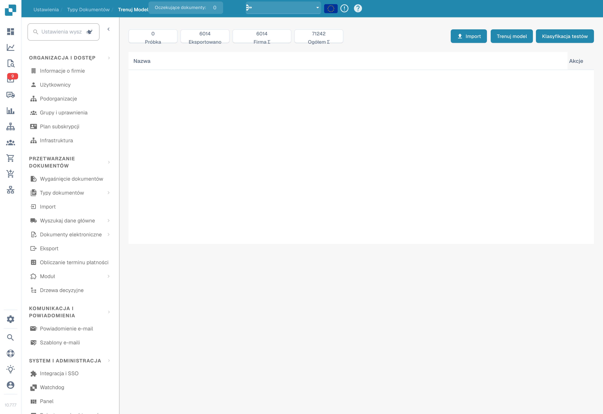
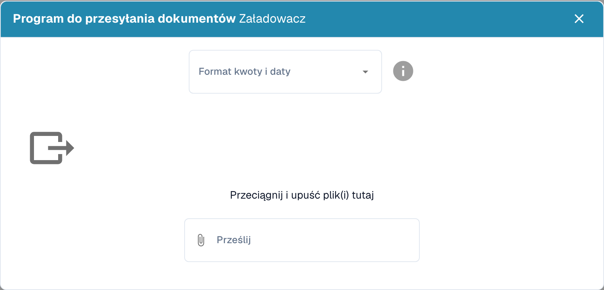

# Import danych: Trenowanie modelu

Przygotuj dokumenty reprezentatywne dla formatów, języków i typów dokumentów przetwarzanych w organizacji. Używaj wyłącznie formatów plików obsługiwanych przez swoją instalację. Usuń duplikaty i oddziel dokumenty treningowe od dokumentów przeznaczonych do oceny.

## Otwieranie importu

W ustawieniach odpowiedniego typu dokumentu otwórz trenowanie modelu i wybierz funkcję importu.

<figure><figcaption>
Import, trenowanie modelu i test klasyfikacji. W przedstawionej wersji przycisk testu klasyfikacji ma błędny podpis „Klasyfikacja testów”. Nie uruchomiono treningu ani testu.
</figcaption></figure>

## Wybór formatu i plików

Wybierz format liczb i dat zgodny z plikami, a następnie wybierz dokumenty do importu. Na przykład `1.234,56` i `1,234.56` używają różnych separatorów. Datę taką jak `05/06/2026` również należy interpretować zgodnie z wybranym formatem.

<figure><figcaption>
Import dokumentów z wyborem formatu kwot i dat; nie przesłano pliku.
</figcaption></figure>

Sprawdź wybór przed uruchomieniem importu. Poczekaj na zakończenie przetwarzania i sprawdź błędy oraz przypisany typ dokumentu. Popraw błędnie sklasyfikowane dokumenty i nieprawidłowo wyodrębnione dane przed użyciem przykładów do treningu.

## Trenowanie i ocena

Wytrenuj model zgodnie z funkcjami i uprawnieniami dostępnymi w swojej wersji. Następnie oceń wynik na osobnej próbie. Samo dodanie dokumentów nie gwarantuje większej dokładności. Zobacz [Testowanie modelu](testing-the-model.md).
