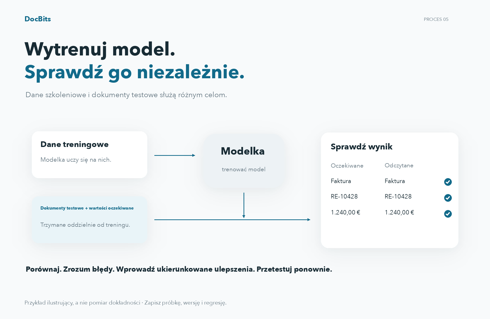

# Testowanie modelu

## Oceń na podstawie niezależnych dokumentów testowych

<figure><figcaption>
Oceń na podstawie niezależnych dokumentów testowych
</figcaption></figure>

Dane treningowe i dokumenty testowe służą różnym celom. W przypadku niezależnych dokumentów testowych zdefiniuj oczekiwane typy dokumentów i wartości pól, a następnie porównaj je z przewidywaniami. Zapisz wersję modelu, próbkę, rozbieżności i awarie techniczne. Wprowadź ukierunkowane ulepszenia i powtórz test, stosując ten sam protokół oceny. Przedstawione wartości stanowią przykład, a nie pomiar dokładności.

Test powinien oceniać wyniki na reprezentatywnych dokumentach, których nie użyto do treningu. Przygotuj oczekiwane odpowiedzi dla każdego dokumentu: typ dokumentu, a przy ocenie ekstrakcji także wartości pól.

## Wykonanie testu

1. Otwórz trenowanie modelu dla ocenianego typu dokumentu.
2. Wybierz test klasyfikacji, jeśli jest dostępny w swojej wersji.
3. Wybierz próbę i uruchom ocenę przy użyciu dostępnych opcji.
4. Poczekaj na zakończenie i zapisz wyniki oraz błędy. Błąd techniczny lub nieukończony test nie oznacza poprawnej klasyfikacji.

<figure><figcaption>
Import, trenowanie modelu i test klasyfikacji. W przedstawionej wersji przycisk testu klasyfikacji ma błędny podpis „Klasyfikacja testów”. Nie uruchomiono treningu ani testu.
</figcaption></figure>

## Interpretacja wyników

Porównaj przewidywania z oczekiwanymi odpowiedziami i przeanalizuj błędy według typu oraz formatu. Jeśli obliczasz dokładność, precyzję, czułość lub miarę F1, podaj także wielkość próby i oceniane kategorie. Nie przypisuj produktowi wskaźników, których Twoja wersja nie wyświetla. Możesz obliczyć je osobno na podstawie wyeksportowanych lub zapisanych wyników.

Reguły klasyfikacji i ekstrakcji są ustawieniami odrębnymi od treningu. Sprawdź ich wpływ, jeśli uczestniczą w przetwarzaniu. Nie zmieniaj reguły wyłącznie po to, aby ukryć błąd w próbie testowej.

## Poprawianie i ponowny test

Popraw dane treningowe, etykiety lub ustawienia faktycznie dostępne w swojej instalacji, a następnie w razie potrzeby ponownie wytrenuj model. Powtórz test według tego samego protokołu i zachowaj niezależną próbę. Udokumentuj wersję, dane, wyniki i regresje. Dobry wynik na próbie nie gwarantuje identycznych wyników dla wszystkich przyszłych dokumentów.
