# Więcej ustawień

## Przegląd

Sekcja **Więcej ustawień** zawiera opcje, które należą do jednego typu dokumentu, na przykład do typu Faktura. Ustawienie, które tu włączysz, obowiązuje tylko dla tego typu dokumentu. Strona składa się ze zwijanych kart, po jednej na temat. Otwórz kartę, aby zobaczyć jej ustawienia.

<figure>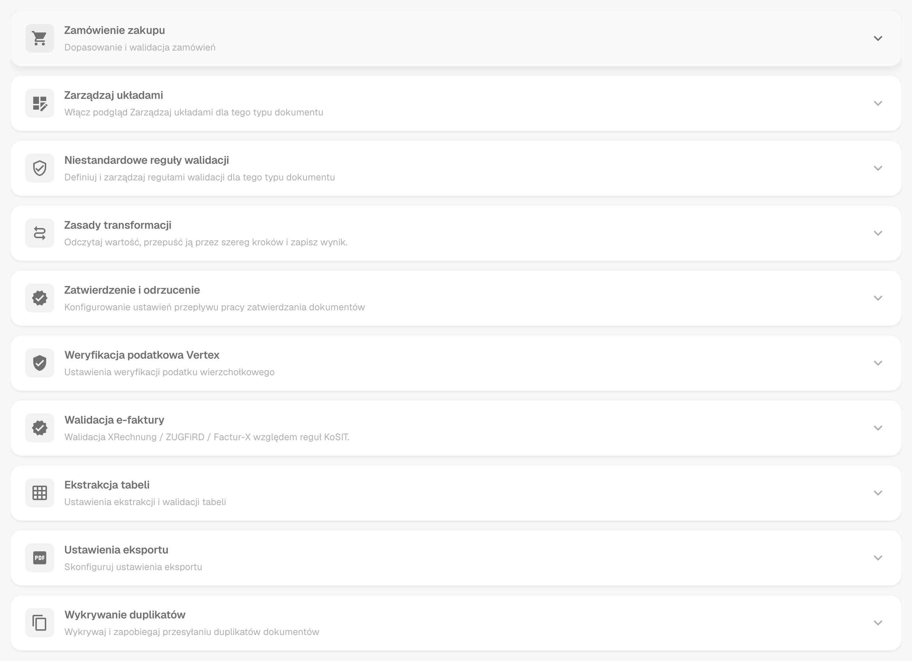<figcaption>
Karty strony Więcej ustawień, wszystkie zwinięte.
</figcaption></figure>

## Jak uzyskać dostęp

1. Przejdź do **Ustawienia** → **Ustawienia globalne** → **Typy dokumentów**.
2. Wybierz typ dokumentu i kliknij **Więcej ustawień**.

Ścieżka nawigacji u góry strony pokazuje **Ustawienia / Typy dokumentów / Więcej ustawień**. Asystent ustawień po prawej stronie strony wyjaśnia ustawienia otwartej karty.

| Karta                                                      | Co tam ustawiasz                                                              |
| ---------------------------------------------------------- | ----------------------------------------------------------------------------- |
| Zamówienie zakupu                                          | Dopasowanie PO, tolerancje, eksport linii PO, numery pozycji dostawcy         |
| Zarządzaj układami                                         | Przełącznik przeglądu Zarządzaj układami                                      |
| Niestandardowe reguły walidacji                            | Własne reguły walidacji dla tego typu dokumentu                               |
| Zasady transformacji                                       | Reguły, które odczytują wartość, zmieniają ją w krokach i zapisują z powrotem |
| Zatwierdzenie i odrzucenie                                 | Proces zatwierdzania oraz formularze przeglądu i odrzucenia                   |
| [Weryfikacja podatkowa Vertex](vertex-tax-verification.md) | Projektowanie formularza weryfikacji podatku Vertex                           |
| Walidacja e-faktury                                        | Walidacja faktur XRechnung, ZUGFeRD i Factur-X                                |
| Ekstrakcja tabeli                                          | Pomijanie walidacji wyodrębnionych tabel                                      |
| Ustawienia eksportu                                        | Wielokrotny eksport, format PDF, alternatywny eksport                         |
| Wykrywanie duplikatów                                      | Wykrywanie i blokowanie duplikatów dokumentów                                 |

## Zamówienie zakupu

Karta **Zamówienie zakupu** (**Dopasowanie i walidacja zamówień**) określa, jak dokumenty tego typu są dopasowywane do zamówień zakupu.

<figure>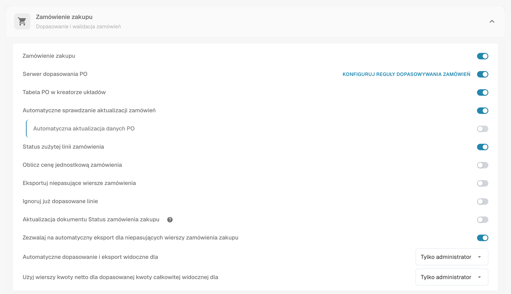<figcaption>
Karta Zamówienie zakupu z jej opcjami.
</figcaption></figure>

* [**Zamówienie zakupu**](purchase-order/purchase-order.md): Przełącza, czy dokument jest przetwarzany na ekranie dopasowania zamówienia zakupu. Możesz również określić, na podstawie jakiej ilości odbywa się dopasowanie.
* [**Serwer dopasowania PO**](purchase-order/purchase-order-matching-rules.md): Dopasowuje za pomocą konfigurowalnego zestawu reguł. **Konfiguruj reguły dopasowywania zamówień** otwiera [stronę reguł](purchase-order/purchase-order-matching-rules.md).
* [**Tabela PO w kreatorze układów**](purchase-order/po-table-in-layout-builder.md): Umożliwia dodanie tabel zamówień zakupu w kreatorze układów dla dostosowanych układów dokumentów.
* [**Automatyczne sprawdzanie aktualizacji zamówień**](purchase-order/auto-check-for-po-updates.md): Pokazuje wizualny wskaźnik na ekranie dopasowania zamówienia zakupu, gdy zamówienie zakupu zostało zaktualizowane, zachęcając użytkowników do odświeżenia.
* **Automatyczna aktualizacja danych PO**: Automatycznie aktualizuje dane PO, gdy dostępne są nowe dane. To ustawienie należy do opcji **Automatyczne sprawdzanie aktualizacji zamówień**.
* [**Status zużytej linii zamówienia**](purchase-order/consumed-po-line-status.md): Stosuje kolorowe oznaczenia dla linii zamówienia zakupu na ekranie dopasowania.
* [**Oblicz cenę jednostkową zamówienia**](purchase-order/calculate-po-unit-price.md): Oblicza jednostkową cenę PO na podstawie kwoty netto i ilości, zamiast ją wyodrębniać.
* [**Eksportuj niepasujące wiersze zamówienia**](purchase-order/export-not-matched-po-lines.md): Po wyłączeniu eksportowane są tylko dopasowane linie. Po włączeniu eksportowane są wszystkie linie zamówienia zakupu, nawet jeśli nie są dopasowane.
* **Ignoruj już dopasowane linie**: Pomija linie, które zostały już dopasowane podczas nowego procesu dopasowania.
* [**Aktualizacja dokumentu Status zamówienia zakupu**](purchase-order/update-document-purchase-order-status.md): Aktualizuje kolumnę Status PO na tablicy rozdzielczej za każdym razem, gdy zmienia się status zamówienia zakupu.
* [**Zezwalaj na automatyczny eksport dla niepasujących wierszy zamówienia zakupu**, **Automatyczne dopasowanie i eksport widoczne dla** oraz **Użyj wierszy kwoty netto dla dopasowanej kwoty całkowitej widocznej dla**](purchase-order/auto-match-and-export-options.md): Określają, kto widzi skróty Automatyczne dopasowanie i eksport oraz które dokumenty mogą być eksportowane automatycznie.

### Zobacz reguły dopasowania jako diagram

Reguły dopasowania PO to coś więcej niż lista. DocBits może narysować aktywny zestaw reguł jako schemat blokowy. Widzisz, w jakiej kolejności reguły są próbowane i gdzie dopasowywanie się kończy.

1. W karcie **Zamówienie zakupu** włącz **Serwer dopasowania PO** i kliknij **Konfiguruj reguły dopasowywania zamówień**.
2. Kliknij **Zestaw reguł w formie diagramu** u góry strony. Diagram otwiera się w panelu obok reguł.

<figure>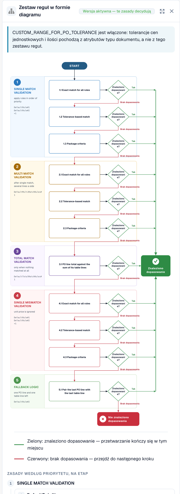<figcaption>
Zestaw reguł w formie diagramu. Pięć etapów, od góry do dołu.
</figcaption></figure>

Czytaj wykres od góry do dołu. DocBits próbuje etapów w tej kolejności: **Single match validation**, **Multi match validation**, **Total match validation**, **Single mismatch validation** i **Fallback logic**. Każdy etap ma do trzech przebiegów: **Exact match for all rules**, **Tolerance-based match** i **Package criteria**. Zielona strzałka oznacza, że znaleziono dopasowanie, a przetwarzanie się kończy. Czerwona strzałka oznacza brak dopasowania, więc DocBits przechodzi do następnego kroku. Na końcu wynikiem jest **Znaleziono dopasowanie** albo **Nie znaleziono dopasowania**.

Pod wykresem panel wymienia **Zasady według priorytetu, na etap**. Dla każdej reguły widzisz porównywane kolumny, tolerancję oraz opcje **Automatyczne dopasowanie**, **Dopasowanie ręczne** i **Awaryjny**.

<figure>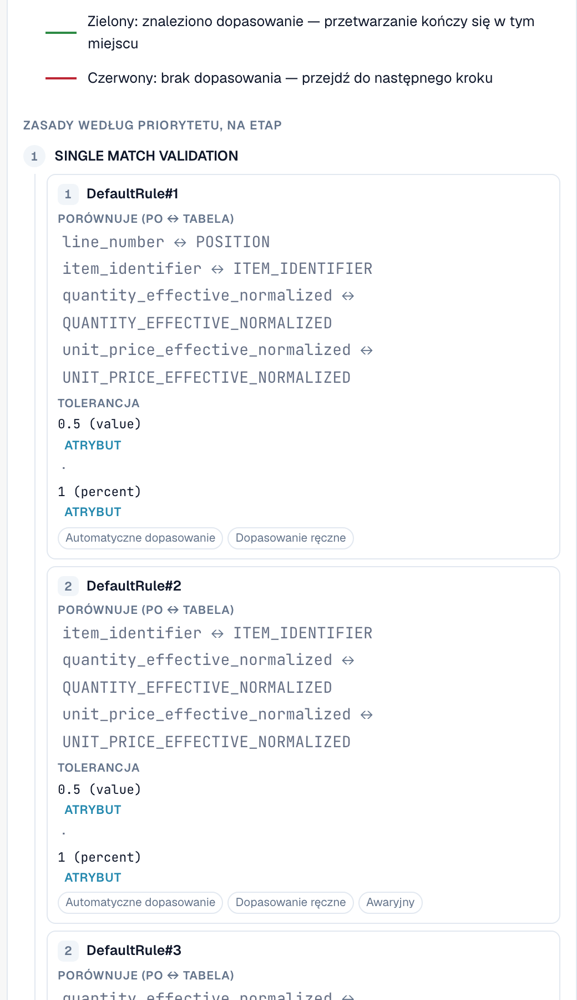<figcaption>
Pod wykresem: reguły każdego etapu z kolumnami, które porównują.
</figcaption></figure>

**Przykład.** Linia faktury ma numer pozycji 4711, ilość 10 i cenę jednostkową 10,40. Linia zamówienia zakupu ma numer pozycji 4711, ilość 10 i cenę jednostkową 10,00. Tolerancja dla ceny jednostkowej wynosi 5 %.

* Przebieg **1.1 Exact match for all rules** kończy się niepowodzeniem, ponieważ 10,40 nie jest równe 10,00. Czerwona strzałka prowadzi do następnego przebiegu.
* Przebieg **1.2 Tolerance-based match** kończy się powodzeniem. Różnica wynosi 4 %, czyli mieści się w granicy 5 %. Zielona strzałka prowadzi do **Znaleziono dopasowanie**, a przetwarzanie się kończy.

Na diagramie jest to ścieżka 1.1, następnie 1.2, następnie **Znaleziono dopasowanie**. Ścieżkę, którą przeszedł pojedynczy dokument, znajdziesz w [Touchless Intelligence: Diagnoza dopasowania PO](../../../../analytics-dashboard/touchless-intelligence/touchless-po-matching-diagnosis.md). Wszystkie szczegóły strony reguł opisuje [Zasady Dopasowywania Zamówień Zakupu](purchase-order/purchase-order-matching-rules.md).

### Ustawienie tolerancji PO

<figure>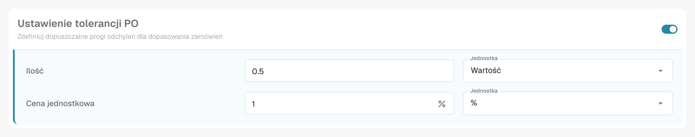<figcaption>
Tolerancja dla ilości i ceny jednostkowej.
</figcaption></figure>

[**Ustawienie tolerancji PO**](purchase-order/purchase-order-tolerance-settings-additional-purchase-order-tolerance.md) pozwala ustawić poziomy tolerancji dla ilości i ceny jednostkowej, tak aby drobne niezgodności nie były oznaczane jako rozbieżności. Dla każdej wartości wybierasz wielkość i jednostkę: wartość bezwzględną (**Wartość**) lub procent (**%**). Blok zawiera także [**Dodatkowe ustawienie tolerancji PO**](purchase-order/purchase-order-tolerance-settings-additional-purchase-order-tolerance.md#ustawienie-do-konfigurowania-dodatkowych-ustawien-tolerancji-zamowienia-zakupu) dla frachtu, opłat i podatków oraz [**Statusy wyłączania PO**](purchase-order/purchase-order-disable-statuses.md).


Gdy atrybut typu dokumentu `CUSTOM_RANGE_FOR_PO_TOLERANCE` jest włączony, tolerancje ceny jednostkowej i ilości pochodzą z tych ustawień typu dokumentu, a nie z zestawu reguł. Diagram reguł na [stronie reguł dopasowywania PO](purchase-order/purchase-order-matching-rules.md) pokazuje w takim przypadku uwagę.


### Mapa numerów pozycji dostawcy

<figure>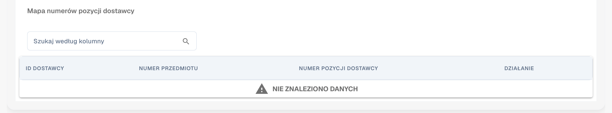<figcaption>
Mapa numerów pozycji dostawcy.
</figcaption></figure>

[**Mapa numerów pozycji dostawcy**](purchase-order/supplier-item-number-map-admin-documentation.md) mapuje numery pozycji dostawcy na Twoje wewnętrzne numery pozycji, dzięki czemu linie są dopasowywane nawet wtedy, gdy dostawca używa własnych numerów. Wyszukuj według kolumny, aby znaleźć wpis.

## Zarządzaj układami, Niestandardowe reguły walidacji i Zasady transformacji

Bezpośrednio pod kartą Zamówienie zakupu znajdują się trzy karty:

* **Zarządzaj układami** włącza przegląd Zarządzaj układami dla tego typu dokumentu. Zobacz [Layout Manager](../layout-manager/).
* **Niestandardowe reguły walidacji** włącza Twoje własne reguły walidacji. **Zarządzaj regułami walidacji** je otwiera. Zobacz [Niestandardowe reguły walidacji](../custom-validation-rules.md).
* **Zasady transformacji** włącza reguły transformacji. **Zarządzaj regułami transformacji** je otwiera. Zobacz [Zasady transformacji](../transformation-rules.md).

<figure>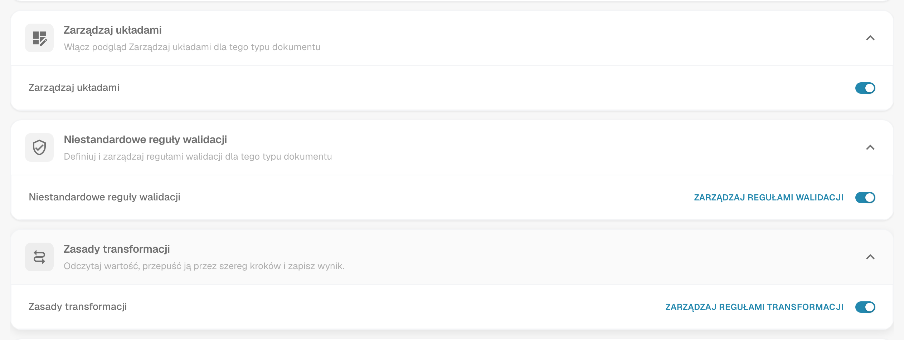<figcaption>
Trzy karty z ich przełącznikami.
</figcaption></figure>

## Zatwierdzenie i odrzucenie

Karta **Zatwierdzenie i odrzucenie** zawiera proces zatwierdzania oraz formularze, które użytkownicy widzą podczas przeglądu lub odrzucania dokumentu.

<figure>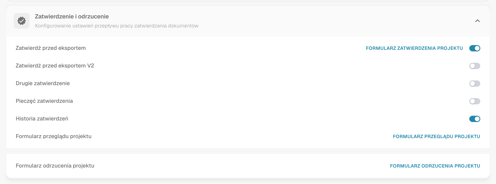<figcaption>
Karta Zatwierdzenie &#x26; odrzucenie.
</figcaption></figure>

* **Zatwierdź przed eksportem**: Dokumenty muszą być zatwierdzone, zanim będzie można je wyeksportować. **Formularz zatwierdzenia projektu** otwiera **Kreator układów** dla ekranu zatwierdzenia.
* **Zatwierdź przed eksportem V2**: Aktywuje Aprobata V2, która obsługuje pola dynamiczne zamiast statycznych.
* **Drugie zatwierdzenie**: Dodaje dodatkową warstwę zatwierdzenia.
* [**Pieczęć zatwierdzenia**](approval/approval-stamp.md): Dodaje stempel do dokumentu, gdy jest on zatwierdzony.
* [**Historia zatwierdzeń**](approval/approval-history.md): Pokazuje historię zatwierdzeń na ekranie zatwierdzenia i w walidacji pól.
* **Formularz przeglądu projektu**: Konfiguruje układ formularza przeglądu za pomocą **Kreatora układów**.
* **Formularz odrzucenia projektu**: Konfiguruje układ formularza odrzucenia za pomocą **Kreatora układów**.

Informacje o **Kreatorze układów** znajdziesz w [Layout Manager](../layout-manager/).

## Weryfikacja podatkowa Vertex

Karta **Weryfikacja podatkowa Vertex** zawiera przycisk **Weryfikacja podatkowa Design Vertex**. Otwiera on Kreator układów dla formularza, który użytkownicy widzą, gdy DocBits porównuje podatek dostawcy z podatkiem obliczonym przez Vertex. Integrację, tolerancję i wynik opisuje strona [Weryfikacja podatkowa Vertex](vertex-tax-verification.md).

## Walidacja e-faktury

Karta **Walidacja e-faktury** włącza walidację przychodzących e-faktur i pozwala zdecydować, czy dostawca jest powiadamiany o odrzuceniu faktury. Zobacz [Walidacja e-faktury](../../../document-processing/e-documents/validation-rules/).

## Ekstrakcja tabeli

<figure>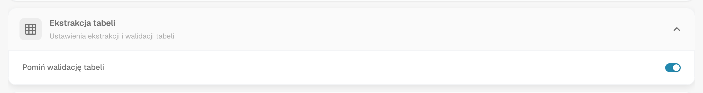<figcaption>
Karta Ekstrakcja tabeli.
</figcaption></figure>

* **Pomiń walidację tabeli**: Pomija standardową walidację danych tabeli. Używaj tej opcji, gdy wymagana jest elastyczna obsługa danych lub gdy niektóre kroki walidacji można pominąć, aby poprawić wydajność.

## Ustawienia eksportu

<figure>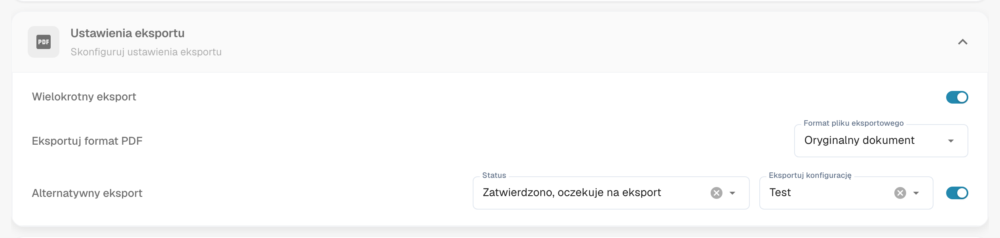<figcaption>
Karta Ustawienia eksportu.
</figcaption></figure>

* **Wielokrotny eksport**: Umożliwia wyeksportowanie dokumentu więcej niż raz.
* **Eksportuj format PDF**: **Format pliku eksportowego** określa format PDF używany podczas eksportu dokumentów, na przykład **Oryginalny dokument**.
* [**Alternatywny eksport**](purchase-order/alternate-export.md): Konfiguruje alternatywny eksport dla wybranego statusu dokumentu. Wybierz **Status** oraz **Eksportuj konfigurację**, która jest dla niego uruchamiana, a następnie włącz ustawienie.

## Wykrywanie duplikatów

<figure>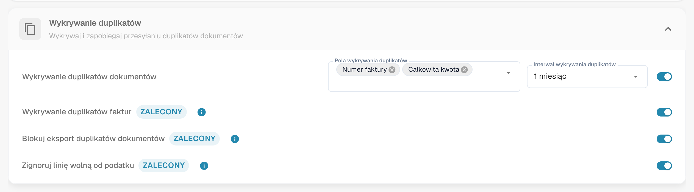<figcaption>
Karta Wykrywanie duplikatów.
</figcaption></figure>

Karta zawiera **Wykrywanie duplikatów dokumentów** z polami, które decydują, co jest duplikatem, oraz z przedziałem czasu, w którym dokumenty są porównywane, a także opcje **Wykrywanie duplikatów faktur**, **Blokuj eksport duplikatów dokumentów** i **Zignoruj linię wolną od podatku**. Wszystkie trzy mają etykietę **Zalecony**. Informacje o obsłudze oznaczonego dokumentu znajdziesz w [Wykrywanie duplikatów](duplicate-document-handling.md).
