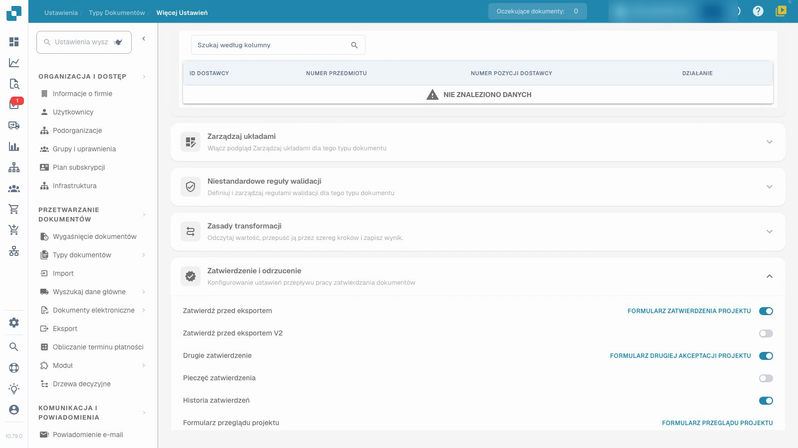
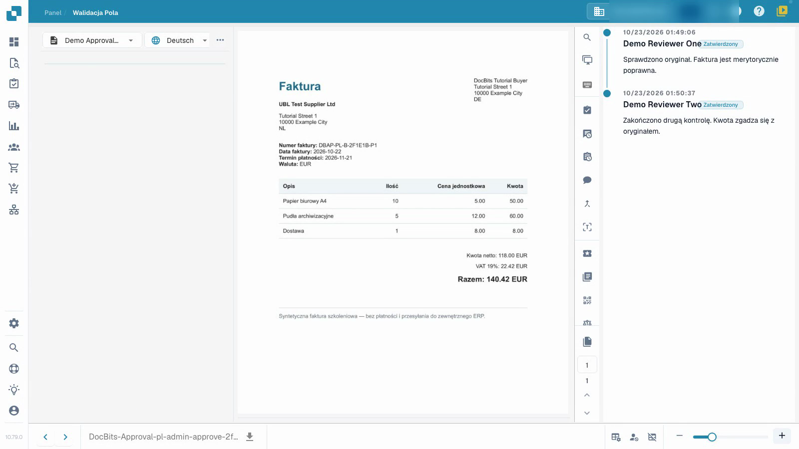

# Konfiguruj i testuj zatwierdzenia faktur

To wideo pokazuje konfigurację i testowanie zatwierdzeń.


Konfiguruj i testuj zatwierdzenia faktur


[Obejrzyj wideo z napisami](https://docbits-videos.fra1.cdn.digitaloceanspaces.com/settings-assistant/invoice-approval-admin/v1/pl.html)

Pokazano rzeczywistą aplikację; sformułowanie opcji może zależeć od wdrożonej wersji.

Skonfiguruj zatwierdzenie dla typu dokumentu używanego w Twoim procesie. Wskaż osoby odpowiedzialne za sprawdzanie faktur i zdecyduj, czy potrzebujesz drugiej niezależnej kontroli. Wideo wykorzystuje oddzielny testowy typ dokumentu, syntetyczne faktury i tymczasowe konta sprawdzające bez uprawnień administratora; jego prezenter jest fikcyjny.

## Skonfiguruj typ dokumentu

Otwórz **Ustawienia → Typy dokumentów**, wybierz właściwy typ i otwórz **Więcej ustawień → Zatwierdzenie i odrzucenie**. Wybierz ustawienia, których potrzebuje Twój proces, a następnie odśwież stronę, aby sprawdzić, co zostało zapisane.

| Ustawienie | Cel |
| --- | --- |
| Zatwierdź przed eksportem | Wymagaj decyzji o zatwierdzeniu, zanim dokument przejdzie do eksportu. |
| Drugie zatwierdzenie | Dodaj drugi etap zatwierdzania do skonfigurowanego procesu. |
| Historia zatwierdzeń | Zachowaj zapisane decyzje dostępne do przeglądu. |
| Pieczęć zatwierdzenia | Skonfiguruj znak na zatwierdzonym dokumencie; zobacz oddzielny przewodnik po pieczęciach. |

Dodatkowa opcja V2 i edytory formularzy to oddzielne ustawienia. Ten samouczek wykorzystuje przygotowane standardowe formularze zatwierdzania.

## Przetestuj role uczestniczące w procesie

1. Przypisz obie osoby sprawdzające do oddzielnych grup i nadaj im przewidziany dostęp do przypisanych dokumentów. W tym przykładzie pierwsze konto ma uprawnienia do zatwierdzania na pierwszym etapie, a drugie konto ma uprawnienia na drugim etapie. Sam przełącznik nie przypisuje osoby ani nie przyznaje tego uprawnienia.
2. Użyj pierwszego zwykłego konta, aby sprawdzić przypisaną, już zwalidowaną fakturę, dodaj notatkę i udziel pierwszego zatwierdzenia. Sprawdź, czy zapisany dokument nadal oczekuje na drugie zatwierdzenie. Sprawdź, czy to konto nie może wykonać drugiego etapu, gdy jego uprawnienia tego zabraniają.
3. Przypisz oczekującą fakturę innej uprawnionej osobie sprawdzającej. Użyj tego drugiego zwykłego konta, aby ją sprawdzić i udzielić drugiego zatwierdzenia z oddzielną notatką.
4. Otwórz ponownie historię i zweryfikuj dwie różne osoby sprawdzające, czasy decyzji i notatki. Odrzuć również oddzielną fakturę testową z powodem i zweryfikuj tę decyzję po odświeżeniu.

<figure><figcaption>
Zapisane ustawienia zatwierdzania we własnym typie testowym.
</figcaption></figure>

<figure><figcaption>
Dwie różne osoby sprawdzające oraz obie zapisane notatki.
</figcaption></figure>

## Zweryfikuj wynik

Zachowaj pierwsze zatwierdzenie, oczekujące drugie zatwierdzenie i odrzucenie jako różne wyniki. Potwierdź, że wartości faktury pozostają niezmienione po każdej decyzji. W tym teście kanał czeka na pobranie danych i nie ma zewnętrznego systemu ERP jako odbiorcy. Status techniczny `pending_data_fetch`, gdy jest wyświetlany, oznacza oczekiwanie na pobranie danych. Sama historia zatwierdzeń nie dowodzi transferu ERP.

Przetestuj skonfigurowane role, przypisanie i pełną ścieżkę decyzyjną przed zastosowaniem procesu do rzeczywistych dokumentów.

## Powiązane strony

- [Grupy, użytkownicy i uprawnienia](../../../groups-users-and-permissions/README.md)
- [Historia zatwierdzeń](approval-history.md)
- [Pieczęć zatwierdzenia](approval-stamp.md)
