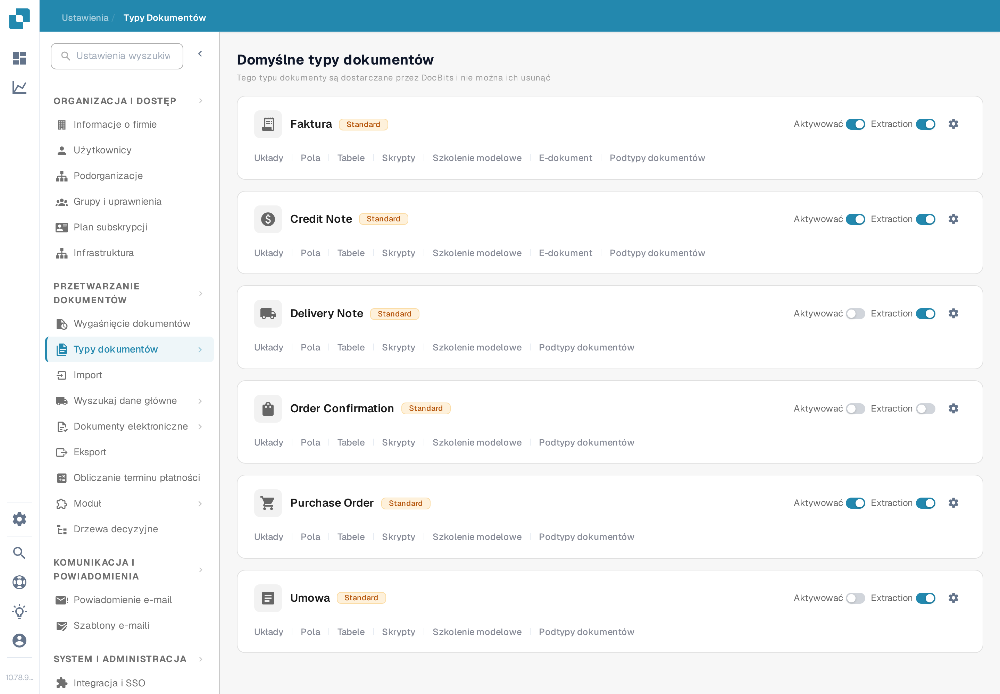
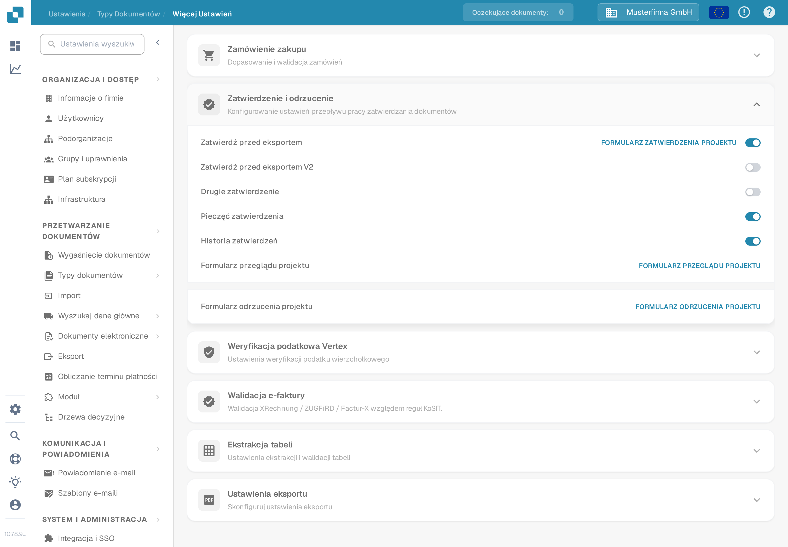

# Stempel Zatwierdzenia

Stempel zatwierdzenia to adnotacja dodawana podczas zatwierdzania dokumentu, gdy opcja jest włączona dla danego typu dokumentu. Jest przydatny, gdy osoba sprawdzająca musi widzieć, kto i kiedy zatwierdził dokument. Poprzednia strona pokazywała sześć zrzutów ekranu ze starszego interfejsu i traktowała opcje stempla, eksportu IDM i pobierania PDF jako już wspólnie sprawdzone. Sprawdź każdy wynik we własnym przepływie pracy, zanim się na nim oprzesz.

## Znajdź opcję

1. Z kontem administratora otwórz **Ustawienia → Typy Dokumentów**. Znajdź typ, który chcesz skonfigurować, na przykład **Faktura**, i wybierz **ikonę zębatki** na tej karcie. Zębatka otwiera **Więcej Ustawień** dla tego typu dokumentu; **Układy** i **Pola** otwierają inne edytory.

   <figure><figcaption>
Otwórz zębatkę na wybranym typie dokumentu.
</figcaption></figure>

2. W **Więcej Ustawień** rozwiń sekcję **Zatwierdzenie i odrzucenie**. Znajdź przełącznik **Pieczęć zatwierdzenia** obok **Zatwierdź przed eksportem V2**, **Drugie zatwierdzenie** i **Historia zatwierdzeń**. Zrzut ekranu pokazuje syntetyczną przykładową organizację (Musterfirma GmbH) z wyłączoną pieczęcią. Nie pokazuje dokumentu z nałożoną pieczęcią.

   <figure><figcaption>
Sprawdź ustawienie Pieczęć zatwierdzenia dla wybranego typu dokumentu.
</figcaption></figure>

3. Włącz przełącznik dopiero po uzgodnieniu w Twojej organizacji, jak mają działać zatwierdzenia i eksporty. Zachowaj zapis poprzedniego ustawienia, aby móc sprawdzić efekt na testowej fakturze.

## Sprawdź zatwierdzenie

Wyślij syntetyczną fakturę tego typu dokumentu przez skonfigurowany przepływ zatwierdzania. Zatwierdź ją na ekranie **Gotowe do zatwierdzenia** za pomocą uprawnionego konta testowego. Aktualny klient internetowy DocBits sprawdza opcję Pieczęć zatwierdzenia podczas zatwierdzania i dodaje adnotację stempla z nazwą osoby zatwierdzającej oraz datą. Otwórz ponownie zatwierdzony dokument i sprawdź adnotację oraz pobrany plik PDF, którego faktycznie używa Twój przepływ pracy. Jeśli stempel jest nieobecny, sprawdź typ dokumentu, status zatwierdzenia, ustawienie oraz konfigurację eksportu.

Stempel zatwierdzenia jest oddzielony od **Drugiego zatwierdzenia** i **Historii zatwierdzeń**. Włączenie jednej opcji nie dowodzi, że pozostałe są skonfigurowane. Dostępne akcje pobierania na pulpicie oraz format eksportu IDM zależą od środowiska i nie zostały sprawdzone dla tej strony, dlatego ten przewodnik nie obiecuje konkretnych etykiet w menu pobierania ani automatycznego wyniku eksportu IDM.

Dwa nowe zrzuty ekranu zostały sprawdzone wizualnie w angielskiej piaskownicy Test A. Żaden przełącznik nie został zmieniony i żaden dokument nie został zatwierdzony ani wyeksportowany; stan z nałożoną pieczęcią wymaga osobnej syntetycznej zatwierdzonej faktury.
