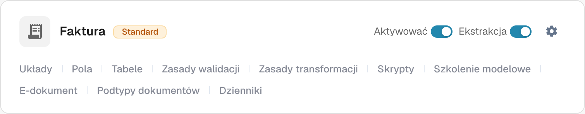
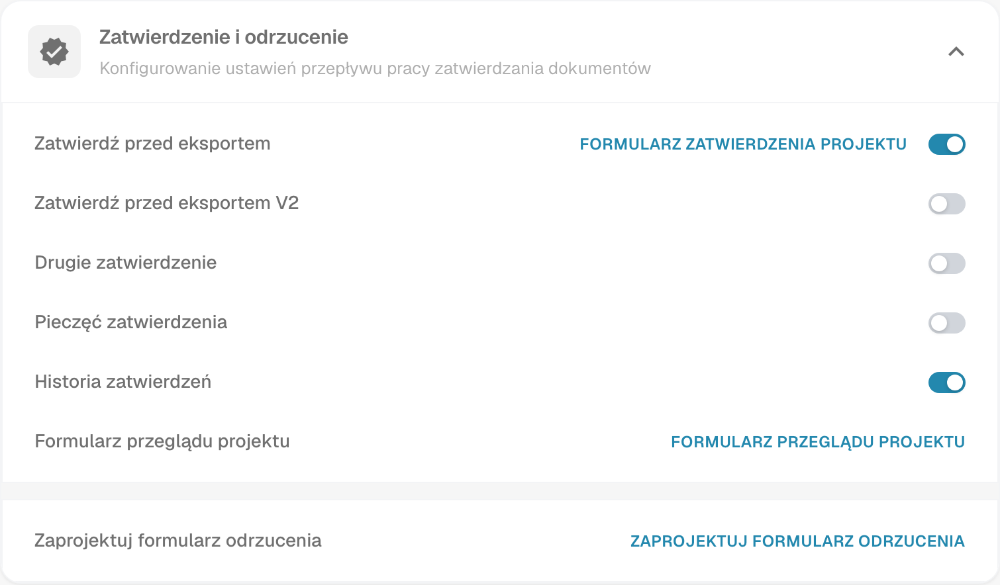

# Stempel Zatwierdzenia

Stempel zatwierdzenia to adnotacja w procesie zatwierdzania, gdy opcja jest włączona dla danego typu dokumentu. Pomaga sprawdzić, kto i kiedy zatwierdził dokument. Sprawdź adnotację i wynikowy plik PDF na fakturze testowej w przepływie pracy rzeczywiście używanym przez organizację.

## Znajdź opcję

1. Z kontem administratora otwórz **Typy dokumentów** w ustawieniach administracyjnych. Znajdź typ, który chcesz skonfigurować, na przykład **Faktura**, i wybierz **ikonę zębatki** na jego karcie. Zębatka otwiera **Więcej ustawień** dla tego typu dokumentu.

   <figure><figcaption>
Rzeczywista karta Faktura w polskim interfejsie Dev. Zębatka otwiera Więcej ustawień; nie zmieniono żadnego ustawienia.
</figcaption></figure>

   **Aktywować** steruje dostępnością typu dokumentu, a **Ekstrakcja** trybem ekstrakcji. Łącza u dołu karty otwierają osobne obszary: **Układy**, **Pola**, **Tabele**, **Zasady walidacji**, **Zasady transformacji**, **Skrypty**, **Szkolenie modelowe**, **E-dokument**, **Podtypy dokumentów** i **Dzienniki**. Dostępne łącza zależą od modułów i ustawień danego typu. Aby znaleźć ustawienie pieczęci, użyj zębatki.

2. W **Więcej ustawień** rozwiń sekcję **Zatwierdzenie i odrzucenie**. Znajdź **Pieczęć zatwierdzenia** obok **Zatwierdź przed eksportem**, **Drugie zatwierdzenie** i **Historia zatwierdzeń**. Obraz pokazuje istniejące ustawienie pieczęci **wyłączone**; w Twojej organizacji stan może być inny. Nie pokazuje zatwierdzonego dokumentu.

   <figure><figcaption>
Rzeczywisty polski widok Zatwierdzenie i odrzucenie w Dev. Stany przełączników zostały tylko odczytane.
</figcaption></figure>

   **Zatwierdź przed eksportem**, **Zatwierdź przed eksportem V2**, **Drugie zatwierdzenie** i **Historia zatwierdzeń** to osobne ustawienia przepływu. Łącze **FORMULARZ ZATWIERDZENIA PROJEKTU** otwiera edytor formularza zatwierdzania, **FORMULARZ PRZEGLĄDU PROJEKTU** edytor formularza przeglądu, a **ZAPROJEKTUJ FORMULARZ ODRZUCENIA** edytor formularza odrzucenia. Etykiety przytoczono tak, jak są widoczne w interfejsie. Nie trzeba otwierać tych edytorów, aby sprawdzić ustawienie pieczęci.

3. Zmień **Pieczęć zatwierdzenia** dopiero po uzgodnieniu w organizacji, jak mają działać zatwierdzenia i eksporty. **Zmiana przełącznika natychmiast zapisuje ustawienie.** Zachowaj zapis poprzedniego stanu, aby móc sprawdzić efekt na fakturze testowej.

## Sprawdź zatwierdzenie

Wyślij syntetyczną fakturę tego typu dokumentu przez skonfigurowany przepływ zatwierdzania. W kroku zatwierdzania tego przepływu zatwierdź ją za pomocą uprawnionego konta testowego. Otwórz ponownie zatwierdzony dokument i sprawdź, czy adnotacja zawiera oczekiwaną nazwę i datę. Sprawdź także pobrany plik PDF rzeczywiście używany w Twoim przepływie pracy. Jeśli pieczęci brakuje, sprawdź typ dokumentu, status zatwierdzenia, ustawienie i konfigurację eksportu.

Pieczęć zatwierdzenia jest niezależna od opcji **Drugie zatwierdzenie** i **Historia zatwierdzeń**. Włączenie jednej opcji nie dowodzi, że pozostałe są skonfigurowane. Dostępne akcje pobierania na pulpicie i format eksportu IDM zależą od środowiska i nie zostały sprawdzone dla tej strony; przewodnik nie obiecuje więc konkretnych etykiet w menu pobierania ani automatycznego wyniku eksportu IDM.

Oba zrzuty pokazują rzeczywiste polskie widoki Dev. Podczas tej weryfikacji nie zmieniono żadnego przełącznika, nie zatwierdzono ani nie wyeksportowano żadnego dokumentu. Stan końcowy z pieczęcią wymaga osobnej syntetycznej zatwierdzonej faktury testowej.
