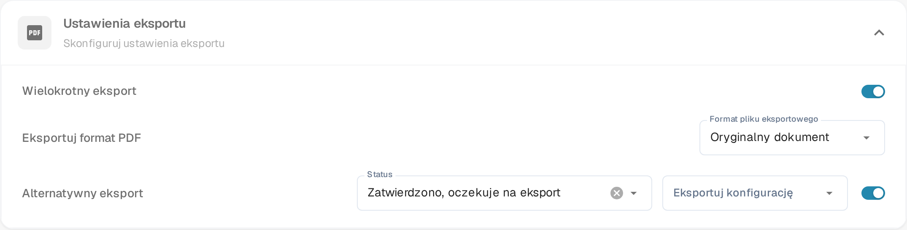

# Alternatywny eksport

## Przegląd

Możesz skonfigurować opcję alternatywnego eksportu, aby pojawiła się w rozwijanej liście eksportu w sekcji zamówienia zakupu, gdy dokument znajduje się w określonym statusie.\
Ta strona wyjaśnia, jak skonfigurować tę opcję. Ustawienie znajduje się w sekcji **Ustawienia eksportu** typu dokumentu.

## Kroki aktywacji

1. Przejdź do **Ustawienia** -> **Ustawienia globalne** -> **Typy dokumentów**
2.  Znajdź kartę typu dokumentu i otwórz ustawienia ikoną koła zębatego (**Więcej ustawień**).

    
3.  Otwórz sekcję **Ustawienia eksportu** i włącz **Alternatywny eksport**.

    <figure><figcaption>
Przełącznik <strong>Alternatywny eksport</strong> w sekcji <strong>Ustawienia eksportu</strong>. Po włączeniu obok pojawiają się <strong>Status</strong> i <strong>Eksportuj konfigurację</strong>.
</figcaption></figure>

## Jak skonfigurować

Po włączeniu ustawienia możesz wybrać status dokumentu i przypisać zdefiniowaną konfigurację eksportu.

* **Status** - status dokumentu, w którym oferowana jest dodatkowa opcja eksportu.
* **Eksportuj konfigurację** - konfiguracja eksportu używana przez tę opcję.

Więcej informacji na temat konfigurowania konfiguracji eksportu można znaleźć [tutaj](../../../../document-processing/export.md).

Możesz wybierać spośród następujących statusów:

* Sklasyfikowany
* Oczekujące na potwierdzenie
* Oczekujące na zatwierdzenie
* Oczekiwanie na drugą akceptację
* Zatwierdzono, oczekuje na eksport
* Zatwierdzono w oczekiwaniu na eksport
* Odrzucony
* Zakończony
* Eksportowano
* Wstrzymany
* Przepływ pracy
* Błąd
* W przeglądzie

Po skonfigurowaniu dodatkowa opcja eksportu pojawi się w zamówieniu zakupu, odpowiadającym opcjom eksportu. Ta opcja wykorzystuje określoną konfigurację eksportu, gdy dokument odpowiada zdefiniowanemu statusowi.

