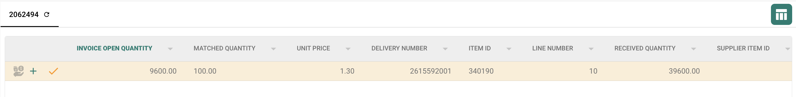

# Status linii zamówienia PO

**Consumed PO line status** koloruje linie zamówienia zakupu w widoku dopasowania zgodnie z tym, jaka część każdej linii została już dopasowana. Włącz to ustawienie dla typu dokumentu faktury, jeśli Twój zespół chce szybko rozpoznawać niewykorzystane, częściowo wykorzystane i w pełni wykorzystane linie PO. Kolor jest pomocą wizualną; przed podjęciem decyzji, czy linię można dopasować ponownie, sprawdź **Matched Quantity** oraz wybraną kolumnę ilości PO.

## Włączanie ustawienia

1. Otwórz **Settings → Document Types**. Znajdź typ dokumentu używany dla Twoich faktur i wybierz koło zębate na jego karcie, aby otworzyć **More Settings**. Zrzut ekranu pokazuje kartę **Invoice**. Pozostaw przełączniki **Activate** i **Extraction** bez zmian.

   <figure><figcaption>
Otwórz More Settings z karty Invoice.
</figcaption></figure>

2. Rozwiń **Purchase Order**, jeśli sekcja jest zwinięta. Znajdź **Consumed PO line status** i włącz jego przełącznik. Jest to osobne ustawienie od **Update Document Purchase Order Status**, znajdującego się niżej w tej samej sekcji.

   <figure><figcaption>
Wybierz przełącznik Consumed PO line status.
</figcaption></figure>

   <figure><figcaption>
W tym przykładzie przełącznik jest wyłączony; włącz go, aby wyświetlać kolory dopasowania.
</figcaption></figure>

3. Otwórz fakturę z dopasowaniem zamówienia zakupu i sprawdź jej linie PO. Poniższe przykłady pokazują, jak kolory linii odpowiadają stanowi dopasowania. Kroki dopasowania znajdziesz w [Purchase Order Matching](../../../../../../end-user-and-partner-section/end-user-section/purchase-order-matching/README.md).

## Odczytywanie kolorów linii PO

| Wygląd | Znaczenie | Co sprawdzić |
| --- | --- | --- |
| Zwykły lub biały | Żadna ilość z tej linii PO nie została jeszcze dopasowana. | Przed dopasowaniem sprawdź ilość PO i linię faktury. |
| Niebieski odcień | Linia została wybrana w bieżącym widoku dopasowania. | Wybór jest tymczasowy; nie oznacza, że linia jest w pełni dopasowana. |
| Jasnopomarańczowy | Część ilości została dopasowana, ale dopasowana ilość jest mniejsza niż wybrana ilość PO. | Sprawdź, ile ilości pozostało. |
| Jasnofioletowy | Dopasowana ilość jest co najmniej równa wybranej ilości PO. | Nie zakładaj, że dostępna jest dodatkowa ilość. |

<figure><figcaption>
Żadna ilość nie została jeszcze dopasowana.
</figcaption></figure>

<figure><figcaption>
Linia jest wybrana do bieżącego dopasowania.
</figcaption></figure>

<figure><figcaption>
Linia jest częściowo wykorzystana.
</figcaption></figure>

<figure><figcaption>
Linia jest w pełni wykorzystana.
</figcaption></figure>

Przekreślona linia ma inne znaczenie: jej status PO może być wykluczony przez [PO disable statuses](purchase-order-disable-statuses.md). Jeśli nie można wybrać linii, sprawdź to ustawienie.
