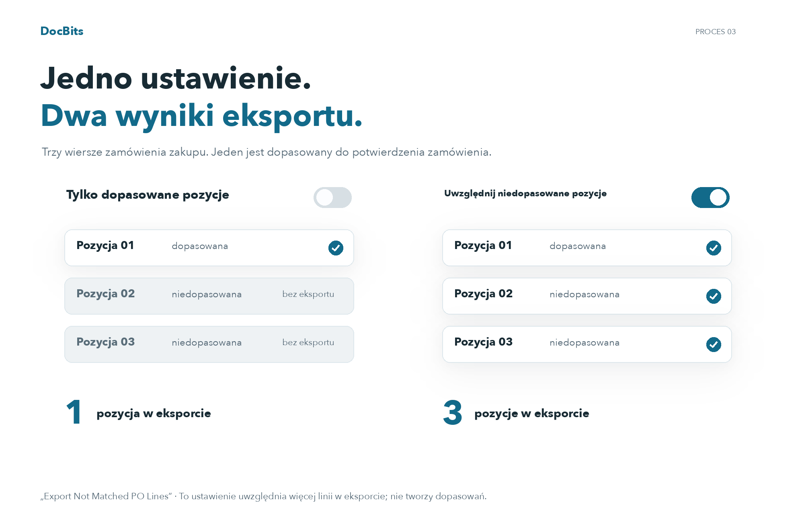

# Eksport niepasujących linii PO

## Zrozumienie zakresu eksportu dzięki trzem wierszom zamówienia

<figure><picture><source srcset="../../../../../../.gitbook/assets/intro-process-03-po-export-pl-dark-20261029.png" media="(prefers-color-scheme: dark)"></picture><figcaption>
Zrozumienie zakresu eksportu dzięki trzem wierszom zamówienia
</figcaption></figure>

W tym przykładzie zamówienie zakupu składa się z trzech wierszy i tylko jeden jest dopasowany do wiersza potwierdzenia zamówienia. Jeśli opcja „Export Not Matched PO Lines” jest wyłączona, eksportowana jest tylko dopasowana pozycja zamówienia zakupu. Po włączeniu tej opcji uwzględnione zostaną również dwa niedopasowane wiersze zamówienia zakupu. Nie tworzy to dodatkowych dopasowań.

## **Gdzie to znaleźć**

Przejdź do **Ustawienia → Ustawienia ogólne → Typy dokumentów → Więcej ustawień → Sekcja zamówienia zakupu → Eksport niepasujących linii PO**. Przełącz przycisk, aby włączyć to ustawienie.

## **Jak to działa**

* **Gdy wyłączone**, system eksportuje tylko linie zamówienia zakupu, które są dopasowane do linii potwierdzenia zamówienia. Niepasujące linie zamówienia zakupu nie będą uwzględnione w eksporcie.
* **Gdy włączone**, system eksportuje wszystkie linie zamówienia zakupu, nawet jeśli nie są dopasowane do linii potwierdzenia zamówienia.

Na przykład, jeśli zamówienie zakupu ma **trzy linie**, ale dostawca wysyła **potwierdzenie zamówienia tylko z jedną linią**, dopasowujesz tę linię do linii zamówienia zakupu. Pozostałe dwie niepasujące linie zamówienia zakupu będą:

* **Wyłączone z eksportu**, jeśli ustawienie jest wyłączone.
* **Uwzględnione w eksporcie**, jeśli ustawienie jest włączone.
