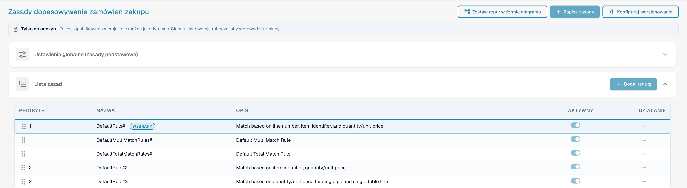
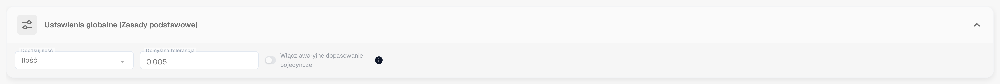
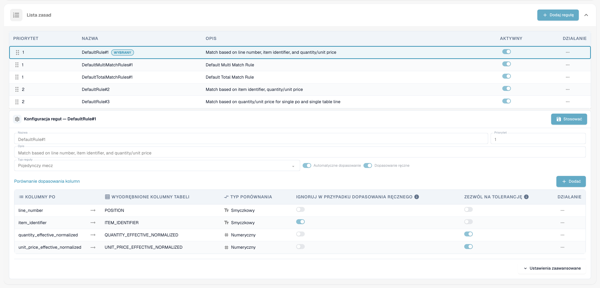
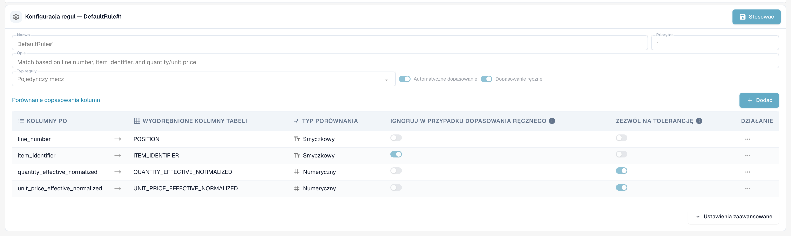
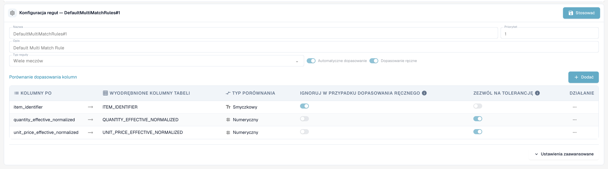
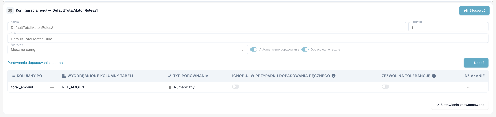
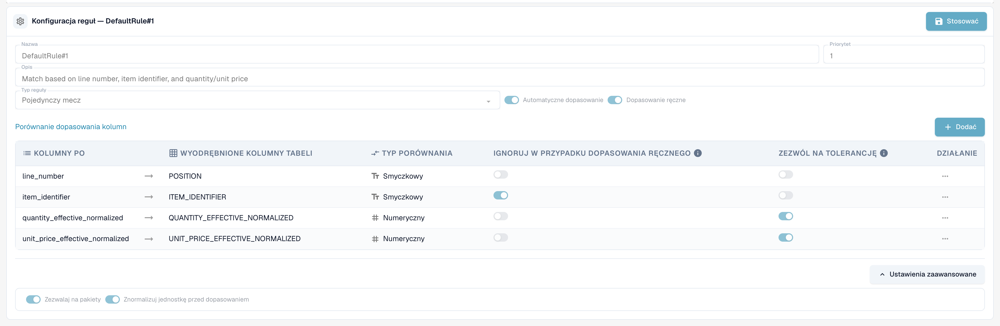
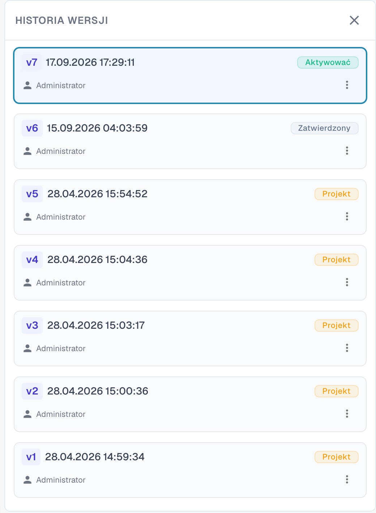

# Zasady Dopasowywania Zamówień Zakupu

## Konfigurowanie reguł uzgadniania zamówień i tolerancji

Prezentacja otwiera typ dokumentu faktura, sprawdza opublikowaną wersję reguł i tworzy nieaktywną wersję roboczą. Wyjaśnia typy reguł, priorytet w danym etapie dopasowania, kolumny porównania, podstawę ilości, tryby i obliczanie tolerancji. Zapisywana jest wyłącznie wersja robocza samouczka; aktywna wersja i tolerancje globalne pozostają bez zmian. Obliczenie z pięcioma procentami jest przykładem, a nie zmianą aktywnej tolerancji.



[Obejrzyj film z napisami](https://docbits-videos.fra1.cdn.digitaloceanspaces.com/settings-assistant/po-matching-rules-admin/v3/pl.html)

## Wprowadzenie: Zamówienia Zakupu i Zarządzanie Zasadami PO

Dopasowywanie Zamówień Zakupu (PO) to kluczowy proces zapewniający spójność między Zamówieniami Zakupu (PO) a odpowiadającymi im przychodzącymi fakturami lub przyjęciami towarów. Solidny zestaw zasad jest niezbędny, aby osiągnąć wysoki wskaźnik automatycznego dopasowania, zapobiegać oszustwom i zapewnić prawidłowe płatności.

Ta strona konfiguracji służy do definiowania i zarządzania zasadami, które określają _jak_ pozycje zamówienia PO są dopasowywane do odpowiadającego dokumentu przychodzącego (Faktura, Potwierdzenie Zamówienia).


**Wymaganie wstępne:** zasady dopasowywania są używane tylko wtedy, gdy **Serwer dopasowania PO** jest włączony dla typu dokumentu (Ustawienia → Typy dokumentów → Więcej ustawień → Zamówienie zakupu). Przy wyłączonym przełączniku DocBits dopasowuje za pomocą wbudowanego mechanizmu (ilość, cena jednostkowa, numer pozycji, numer zamówienia) i ignoruje zestaw zasad.


***

## Jak uzyskać dostęp

1. Przejdź do **Ustawienia** → **Ustawienia globalne** → **Typy dokumentów**, wybierz typ dokumentu i kliknij **Więcej ustawień**.
2. Na karcie **Zamówienie zakupu** włącz **Serwer dopasowania PO**.
3. Kliknij **Konfiguruj reguły dopasowywania zamówień** obok przełącznika.

<figure><figcaption>
Karta Zamówienie zakupu. <strong>Konfiguruj reguły dopasowywania zamówień</strong> znajduje się obok <strong>Serwer dopasowania PO</strong>.
</figcaption></figure>

## Strona w skrócie

<figure><figcaption>
Strona Zasady dopasowywania zamówień zakupu.
</figcaption></figure>

U góry strony znajdują się trzy przyciski:

* **Zestaw reguł w formie diagramu** otwiera schemat blokowy aktywnego zestawu reguł. Zobacz Zestaw reguł w formie diagramu.
* **Zapisz zasady** zapisuje zmiany w wersji roboczej, którą edytujesz.
* **Konfiguruj wersjonowanie** otwiera historię wersji. Zobacz Wersje i wersje robocze.

Pod przyciskami pojawia się informacja **Tylko do odczytu**, gdy oglądasz opublikowaną wersję: *To jest opublikowana wersja i nie można jej edytować. Sklonuj jako wersję roboczą, aby wprowadzić zmiany.* Poniżej znajdują się karta **Ustawienia globalne (Zasady podstawowe)** i **Lista zasad**. Wybierz zasadę na liście, aby skonfigurować ją w obszarze **Konfiguracja reguł** pod listą.

***

## Ustawienia globalne (Zasady podstawowe)

Te ustawienia ustanawiają ramy, które mają zastosowanie do wszystkich zasad dopasowywania:

<figure><figcaption>
Karta Ustawienia globalne (Zasady podstawowe), otwarta.
</figcaption></figure>

* **Ustawienie:** Dopasuj ilość
  * **Cel:** Określa, która ilość z pozycji zamówienia jest porównywana z linią dokumentu — na przykład zamówiona ilość lub **otwarta ilość na fakturze** (zamówiona minus już zafakturowana), co jest zwykłym wyborem dla faktur.
  * **Dopuszczalne wartości:** Ilość lub inne dostępne pola ilości w systemie, w zależności od struktury danych (np. alternatywne pole ilości znormalizowanej).
  * **Zależność:** Określa podstawę dla wszystkich zasad dopasowywania, które uwzględniają ilość w kryteriach porównania.
* **Ustawienie:** Tolerancja standardowa (Domyślna tolerancja)
  * **Cel:** Określa, jak bardzo wartość numeryczna w dokumencie może się różnić od wartości zamówienia i nadal być uznana za dopasowanie. Kompensuje różnice zaokrągleń. Dotyczy **każdej kolumny numerycznej** z włączoną opcją "Zezwól na tolerancję" — zarówno ilości, jak i ceny jednostkowej.
  * **Dopuszczalna wartość:** Liczba dziesiętna. Czy jest odczytywana jako **wartość bezwzględna** (0.005 = odchylenie do 0.005 w porównywanej ilości lub cenie) czy jako **procent** (0.5 = 0,5 % wartości porównywanej) jest ustawiane przez **typ tolerancji** zestawu zasad (`value` lub `percent`; nowe zestawy używają `value`). Tolerancje dla poszczególnych pozycji (zobacz [Ustawienia tolerancji](purchase-order-tolerance-settings-additional-purchase-order-tolerance.md)) nadpisują standardową tolerancję dla tej pozycji.
  * **Zależność:** Dotyczy zasad używających pól numerycznych do dopasowania i mających włączoną opcję "Zezwól na tolerancję".
* **Ustawienie:** Włącz awaryjne dopasowanie pojedyncze
  * **Cel:** Po włączeniu ostatnia pozostała niedopasowana pozycja zamówienia jest dopasowywana automatycznie, nawet jeśli numer dowodu dostawy jest inny. Dopasowanie jest oznaczane jako niezgodność do Twojej weryfikacji.
  * **Dopuszczalne wartości:** Włączone lub wyłączone. Wartość domyślna to wyłączone.

***

## Lista zasad

Lista zasad wyświetla wszystkie dostępne zasady dopasowywania i zarządza ich kolejnością wykonywania.

<figure><figcaption>
Lista zasad. Wybrana zasada jest oznaczona jako <strong>Wybrany</strong>. Zasadę można wyłączyć jej przełącznikiem <strong>Aktywny</strong>.
</figcaption></figure>

#### Struktura i wykonanie

* **Priorytet:** To pole liczbowe (np. 1, 2, 3) określa kolejność wykonywania zasad. Zasady o niższym numerze priorytetu są próbowane jako pierwsze. Pozwala to administratorom na stworzenie hierarchii, zwykle zaczynając od najbardziej specyficznych i rygorystycznych zasad (np. dopasowanie według numeru linii i numeru części) i przechodząc do szerszych lub mniej restrykcyjnych zasad.
* **Nazwa i opis:** Zapewnia jasną identyfikację i kontekst zasady, wyjaśniając główne kryteria użyte (np. "Standardowa zasada nr 1: Dopasowanie według numeru linii, ID części i ilości").
* **Aktywny:** Prosty przełącznik umożliwiający natychmiastowe włączenie lub wyłączenie zasady bez konieczności usuwania jej konfiguracji.

**Przebieg wykonania:** System wykonuje dopasowywanie w sekwencji kaskadowej. Jeśli zasada (np. priorytet 1) pomyślnie dopasuje pozycję, proces dla tej pozycji się zatrzymuje. Jeśli nie znaleziono dopasowania, system przechodzi do następnej zasady w kolejności priorytetu (np. priorytet 2). Każde uruchomienie jest rejestrowane w dokumencie; **Historia dopasowania** na ekranie Dopasowywania Zamówień Zakupu pokazuje, która zasada była próbowana, która dopasowała oraz które zostały pominięte i dlaczego.

***

## Konfiguracja reguł (Ustawienia szczegółowe)

Ten szczegółowy obszar konfiguracji definiuje konkretną logikę i kryteria dla pojedynczej zasady.

<figure><figcaption>
Obszar Konfiguracja reguł dla zasady pojedynczego dopasowania. <strong>Stosować</strong> zachowuje zmiany w wersji roboczej.
</figcaption></figure>

#### Parametry bazowe

* **Typ reguły:** Określa krotność dopasowania.

| Typ reguły | Co robi | Typowe zastosowanie |
| ---------- | ------- | ------------------- |
| **Pojedynczy mecz** | Jedna pozycja zamówienia do jednej linii dokumentu. Każda skonfigurowana kolumna musi się zgadzać (w granicach tolerancji tam, gdzie jest dozwolone). | Standardowy przypadek. |
| **Wiele meczów** | Kilka pozycji zamówienia do jednej linii dokumentu lub kilka linii dokumentu do jednej pozycji zamówienia. Ilości są **sumowane**, cena jednostkowa porównywana jako **średnia**, pozostałe kolumny muszą się zgadzać. | Dostawy podzielone, jedna linia faktury obejmująca kilka linii zamówienia. |
| **Mecz na sumę** | Porównuje jedną **kwotę** — zwykle kwotę netto linii dokumentu z **sumą** zamówienia — i dopasowuje całe zamówienie naraz. | Dostawcy fakturujący ryczałtowo, faktury usługowe, faktury jednolinijkowe. |

<figure><figcaption>
Zasada wielokrotnego dopasowania porównuje identyfikator pozycji, zsumowaną ilość i średnią cenę jednostkową.
</figcaption></figure>

<figure><figcaption>
Zasada dopasowania do sumy porównuje jedną kwotę, tutaj kwotę netto z sumą zamówienia.
</figcaption></figure>

* **Automatyczne dopasowanie:** Jeśli włączone, system spróbuje zastosować tę zasadę całkowicie automatycznie. Wymagana jest wysoka pewność kryteriów do automatycznego przetwarzania.
* **Dopasowanie ręczne:** Jeśli włączone, zasada może być prezentowana lub stosowana przez użytkownika podczas ręcznego etapu uzgadniania, oferując mu predefiniowany zestaw kryteriów porównania do rozwiązania wyjątków.
* **Awaryjny:** Zasada oznaczona jako awaryjna działa w późniejszej fazie, tylko dla par linii, które pozostają niedopasowane po wykonaniu wszystkich zwykłych zasad. Używaj jej dla "luźniejszej" zasady, która ma złapać to, co przegapiły zasady rygorystyczne.

#### Warunki aktywacji

Zasada może mieć **warunki aktywacji** — wyrażenia, które muszą być prawdziwe, zanim zasada zostanie w ogóle uruchomiona. Jeśli warunek jest fałszywy, zasada jest **pomijana dla tego dokumentu** (historia dopasowań pokazuje ją jako "nie uruchomioną" z podanym powodem). Wyrażenia używają liczby linii, które są dopasowywane:

| Wyrażenie | Znaczenie |
| --------- | --------- |
| `[[count(po_lines)]]` | liczba linii zamówienia dostępnych do dopasowania |
| `[[count(table_lines)]]` | liczba pozycji w dokumencie, które są mapowane do dopasowania |

Porównuj je za pomocą `==`, `!=`, `>`, `>=`, `<`, `<=` i łącz kilka warunków za pomocą `&` (i). Przykłady:

* `([[count(po_lines)]] > 1) & ([[count(table_lines)]] > 1)` — tylko dla dokumentów z wieloma liniami po obu stronach (typowe dla zasady wielokrotnego dopasowania).
* `([[count(po_lines)]] == 1) & ([[count(table_lines)]] == 1)` — tylko dla dokumentów jednolinijkowych przeciwko jednolinijkowemu zamówieniu.
* `([[count(po_lines)]] >= 1) & ([[count(table_lines)]] >= 1)` — zawsze, gdy jest cokolwiek do dopasowania.


Warunki aktywacji są najczęstszym powodem, dla którego zasada "nic nie robi". Zasada dopasowania do sumy z warunkiem `[[count(table_lines)]] > 1` nigdy nie uruchamia się dla faktury jednolinijkowej — a [zasada transformacji](../../transformation-rules.md), która redukuje fakturę do jednej linii sumarycznej, generuje dokładnie taki dokument. Sprawdź liczby w historii dopasowań przed zmianą samej zasady.


#### Porównanie kolumn (Kryteria dopasowania)

To jest podstawowa definicja logiki zasady, określająca, które pola muszą się zgadzać między dokumentami.

1. Definiowanie kolumn do porównania:
   * **Kolumny PO:** Pole pobierane z danych Zamówienia Zakupu (np. numer linii).
   * **Wyodrębnione kolumny tabeli:** Odpowiadające pole wyodrębnione lub sparsowane z dokumentu przychodzącego (Faktura/Potwierdzenie Zamówienia) (np. `POSITION`).
2. **Typ porównania:** Określa charakter wymaganego dopasowania (np. Tt dla porównania tekstowego/stringowego, wymagającego dokładnego dopasowania znak po znaku; # dla porównania numerycznego).
3. **Zezwól na tolerancję:** Dla pól numerycznych (ilość, cena) włączenie tej opcji nakazuje systemowi zastosować wcześniej zdefiniowaną globalną tolerancję standardową. Jeśli ta opcja _nie_ jest włączona dla pola numerycznego, wartości muszą się dokładnie zgadzać.
4. **Ignoruj w przypadku dopasowania ręcznego:** Jeśli zaznaczone, to kryterium jest łagodniejsze podczas ręcznej interwencji. Przydatne dla pól takich jak opisy lub odniesienia wewnętrzne, które mogą się nieznacznie różnić, pozwalając użytkownikowi na pominięcie drobnych, niekrytycznych rozbieżności.

**Które kolumny można porównywać**

| Kolumna | Strona dokumentu | Strona zamówienia | Uwagi |
| ------- | ---------------- | ----------------- | ----- |
| Numer linii | `POSITION` | `line_number` | Tekst, dokładne. Przydatne tylko, gdy dostawca drukuje numery linii zamówienia na dokumencie. |
| Identyfikator pozycji | `ITEM_IDENTIFIER` | `item_identifier` | Tekst, dokładne. Numer pozycji lub numer pozycji dostawcy, także przez [Mapę numerów pozycji dostawcy](supplier-item-number-map-admin-documentation.md). |
| Efektywna znormalizowana ilość | `QUANTITY_EFFECTIVE_NORMALIZED` | `quantity_effective_normalized` | Numeryczne. Ilość wybrana przez **Dopasuj ilość**, przeliczona na tę samą jednostkę po obu stronach (konwersja kodu jednostki, ilości „na”). |
| Efektywna znormalizowana cena jednostkowa | `UNIT_PRICE_EFFECTIVE_NORMALIZED` | `unit_price_effective_normalized` | Numeryczne. Cena jednostkowa za pojedynczą jednostkę po rabatach i po **Cena jednostkowa za** — oraz, jeśli jest włączone [Oblicz cenę jednostkową zamówienia](calculate-po-unit-price.md), cena wyliczona z kwoty i ilości linii zamówienia. |
| Kwota netto | `NET_AMOUNT` | `total_amount` | Numeryczne. Używane przez zasady dopasowania do sumy. |

**Przykład: Rygorystyczna zasada dopasowania PO (`DefaultRule#1`)**

Typowa rygorystyczna zasada łączy obowiązkowe kontrole tożsamości z kontrolami wartości:

* **Obowiązkowa tożsamość:** Numer linii i identyfikator pozycji muszą się dokładnie zgadzać (porównanie tekstowe, bez tolerancji).
* **Kontrole wartości:** Efektywna znormalizowana ilość i efektywna znormalizowana cena jednostkowa muszą się zgadzać (porównanie numeryczne, tolerancja dozwolona). Dopiero jeśli wszystkie cztery kryteria są spełnione (z tolerancją dla wartości), wykonywane jest automatyczne dopasowanie.

***

#### Ustawienia zaawansowane

Kliknij **Ustawienia zaawansowane** pod tabelą kolumn, aby otworzyć dwie dodatkowe opcje zasady.

<figure><figcaption>
Ustawienia zaawansowane zasady.
</figcaption></figure>

* **Zezwalaj na pakiety:** Pozwala zasadzie dopasowywać linie, w których ilość i cena jednostkowa różnią się o wielkość opakowania. Domyślne wielkości opakowań to 10, 20, 100 i 1000. DocBits koryguje wtedy ilość i cenę jednostkową dokumentu o wielkość opakowania, zanim je porówna. Jest to krok **Package criteria** każdego etapu na diagramie reguł (zobacz Zestaw reguł w formie diagramu).
* **Znormalizuj jednostkę przed dopasowaniem:** Przelicza jednostkę miary po obu stronach na tę samą jednostkę, zanim ilość zostanie porównana. Opcja jest domyślnie włączona.

***

## Zestaw reguł w formie diagramu

**Zestaw reguł w formie diagramu** otwiera panel obok reguł. Pokazuje reguły aktywnej wersji jako schemat blokowy, dzięki czemu widzisz, w jakiej kolejności DocBits je próbuje i gdzie dopasowywanie się kończy.

<figure><figcaption>
Zestaw reguł w formie diagramu.
</figcaption></figure>

DocBits przechodzi przez pięć etapów od góry do dołu. Każdy etap ma do trzech przebiegów: **Exact match for all rules**, **Tolerance-based match** i **Package criteria**. Pierwszy przebieg, który znajdzie dopasowanie, kończy proces (zielona strzałka). Jeśli przebieg nie znajdzie dopasowania, DocBits przechodzi do następnego (czerwona strzałka).

| Etap | Co robi |
| ---- | ------- |
| 1. Single match validation | Stosuje zasady pojedynczego dopasowania w kolejności priorytetu. |
| 2. Multi match validation | Działa po pojedynczym dopasowaniu, dla kilku linii po jednej stronie. |
| 3. Total match validation | Działa tylko wtedy, gdy nic nie zostało dopasowane. Porównuje sumę zamówienia z sumą linii tabeli. |
| 4. Single mismatch validation | Stosuje zasady pojedynczego dopasowania ponownie, z pominięciem ceny jednostkowej. |
| 5. Fallback logic | Łączy ostatnią linię zamówienia z ostatnią linią tabeli, gdy po każdej stronie pozostała dokładnie jedna linia. |

Pod wykresem panel wymienia reguły każdego etapu według priorytetu, wraz z kolumnami, które każda reguła porównuje. Uwaga u góry informuje, skąd pochodzą tolerancje: z zestawu reguł lub, gdy `CUSTOM_RANGE_FOR_PO_TOLERANCE` jest włączone, z [ustawień typu dokumentu](purchase-order-tolerance-settings-additional-purchase-order-tolerance.md).

<figure><figcaption>
Pod wykresem: reguły każdego etapu z porównywanymi kolumnami, tolerancją oraz opcjami Automatyczne dopasowanie, Dopasowanie ręczne i Awaryjny.
</figcaption></figure>

***

## Domyślny zestaw zasad

Każda organizacja zaczyna z tym samym domyślnym zestawem zasad. Jest to dobre odniesienie przy tworzeniu własnego:

| Zasada | Typ / priorytet | Porównywane kolumny | Warunek aktywacji |
| ------ | --------------- | ------------------- | ----------------- |
| `DefaultRule#1` | pojedyncze dopasowanie, priorytet 1 | numer linii, identyfikator pozycji, ilość (tolerancja), cena jednostkowa (tolerancja) | zawsze |
| `DefaultMultiMatchRules#1` | wielokrotne dopasowanie, priorytet 1, awaryjna | identyfikator pozycji, ilość (tolerancja), cena jednostkowa (tolerancja) | `count(po_lines) > 1` i `count(table_lines) > 1` |
| `DefaultTotalMatchRules#1` | dopasowanie do sumy, priorytet 1 | kwota netto ↔ suma zamówienia (bez tolerancji) | `count(po_lines) >= 1` i `count(table_lines) > 1` |
| `DefaultRule#2` | pojedyncze dopasowanie, priorytet 2, awaryjna | identyfikator pozycji, ilość (tolerancja), cena jednostkowa (tolerancja) | zawsze |
| `DefaultRule#3` | pojedyncze dopasowanie, priorytet 2, awaryjna | ilość (tolerancja), cena jednostkowa (tolerancja) | `count(po_lines) == 1` i `count(table_lines) == 1` |

Czytając od góry: najpierw zasada rygorystyczna (numer linii i pozycja muszą być wydrukowane na dokumencie), potem zasady awaryjne bez numeru linii, na końcu ostateczność dla dokumentów jednolinijkowych porównująca tylko ilość i cenę.

***

## Wpływ na proces dopasowywania PO

Zdefiniowany zestaw zasad bezpośrednio wpływa na efektywność i integralność procesu dopasowywania PO:

* **Priorytety i zasady awaryjne:** Określony priorytet zapewnia, że system najpierw próbuje najbardziej wiarygodnej metody dopasowania. Jeśli rygorystyczne zasady o wysokim priorytecie zawiodą, system przechodzi do szerszych zasad, dążąc do minimalizacji liczby wyjątków kierowanych do użytkowników.
* **Kontrola jakości dopasowania:** Bardziej rygorystyczne zasady (wymagające dokładniejszych dopasowań i mniejszej tolerancji) skutkują mniejszą, ale bardzo wiarygodną liczbą automatycznych dopasowań. Luźniejsze zasady zwiększają wskaźnik automatycznego dopasowania, ale podnoszą ryzyko fałszywych trafień.
* **Obsługa wyjątków (ręczne dopasowanie):** Włączając zasady do ręcznego dopasowania, system oferuje użytkownikom ustrukturyzowane opcje. Jeśli transakcja nie spełnia kryteriów automatycznego dopasowania, staje się wyjątkiem. Użytkownik może wtedy spróbować rozwiązać wyjątek, stosując predefiniowaną zasadę ręczną, która może mieć złagodzone kryteria (np. ignorowanie drobnej rozbieżności tekstowej zgodnie z ustawieniem "Ignoruj w przypadku dopasowania ręcznego").

## Co jeszcze wpływa na wynik

* **Kiedy uruchamiane jest dopasowanie:** podczas przetwarzania dokumentu, gdy użytkownik kliknie **Automatyczne dopasowanie zamówienia**, oraz **przy każdym zapisie**, w którym numer zamówienia został zmieniony lub nigdy wcześniej nie był wyszukiwany (np. gdy dane podstawowe wypełniły go po przetwarzaniu). Zapis nigdy nie nadpisuje istniejącego dopasowania.
* **[Zasady transformacji](../../transformation-rules.md)** uruchamiane są przed dopasowaniem i mogą zmieniać pozycje linii — a wraz z nimi liczby linii, które sprawdzają warunki aktywacji. Zasada tabeli, która przebudowuje linie, zachowuje istniejące dopasowanie, o ile linie pozostają takie same; jeśli zastępuje dopasowane linie, dopasowanie jest usuwane, a nazwa zasady jest podawana jako powód.
* **[Oblicz cenę jednostkową zamówienia](calculate-po-unit-price.md)** zmienia, którą cenę jednostkową zasady porównują po stronie zamówienia.
* **[Ustawienia tolerancji](purchase-order-tolerance-settings-additional-purchase-order-tolerance.md)** oraz **[wyłączone statusy](purchase-order-disable-statuses.md)** decydują o rygorze porównania i o tym, które linie zamówienia są w ogóle oferowane.

## Rozwiązywanie problemów

| Objaw | Co sprawdzić |
| ----- | ------------ |
| "Brak dopasowania", chociaż wszystkie wartości się zgadzają | Otwórz historię dopasowań: która zasada działała, na której kolumnie zawiodła (odchylenie jest pokazane dla każdej kolumny), czy zasada została pominięta przez warunek aktywacji? |
| Cena jednostkowa niedopasowana dokładnie o stawkę podatku | Suma zamówienia zawiera podatek; włącz [Oblicz cenę jednostkową zamówienia](calculate-po-unit-price.md) (najpierw kwota netto) lub porównaj kwotę netto linii. |
| Zasada dopasowania do sumy nigdy się nie uruchamia | Jej warunek aktywacji wymaga więcej niż jednej linii dokumentu. Ustaw `[[count(table_lines)]] >= 1` lub nie redukuj linii za pomocą zasady transformacji. |
| Zestaw zasad nie ma żadnego efektu | **Serwer dopasowania PO** jest wyłączony dla typu dokumentu lub zmieniony zestaw zasad jest nadal wersją roboczą — aktywuj wersję. |

***

## Wersje i wersje robocze

Zasady dopasowywania są wersjonowane. Możesz edytować tylko **wersję roboczą**, a opublikowaną wersję możesz tylko przeglądać. Kliknij **Konfiguruj wersjonowanie**, aby otworzyć **Historię wersji**.

<figure><figcaption>
Historia wersji ze wszystkimi wersjami zestawu reguł.
</figcaption></figure>

Każda wersja pokazuje swój numer, datę i godzinę oraz status, na przykład **Projekt** lub **Zatwierdzony**. Menu wersji oferuje dostępne dla niej akcje. Aby zmienić domyślny zestaw reguł, najpierw go sklonuj: otwórz **Konfiguruj wersjonowanie** i wybierz **Klonuj jako wersję roboczą** z opcji karty wersji. Edytuj wersję roboczą, kliknij **Stosować** przy każdej zmienionej zasadzie i **Zapisz zasady**. Zmienione zasady zaczynają obowiązywać po aktywowaniu wersji.
