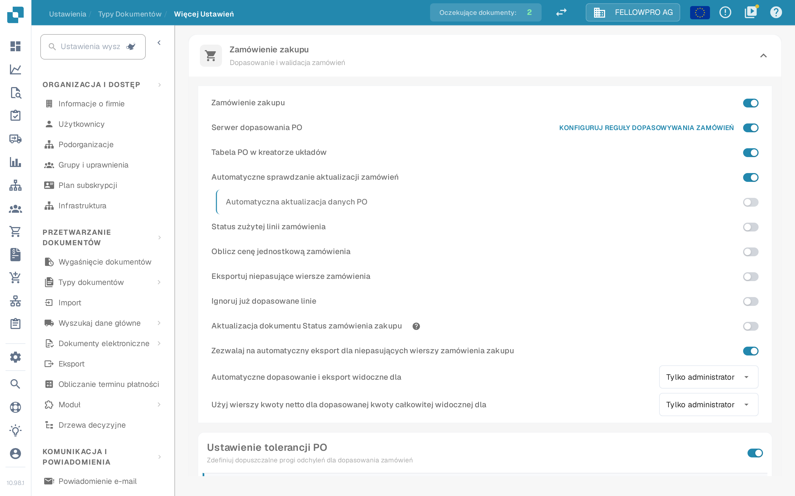

# Zamówienie zakupu

## Przegląd

To ustawienie włącza sekcję [**Dopasowanie zamówienia zakupu**](../../../../../../end-user-and-partner-section/end-user-section/purchase-order-matching/), która staje się dostępna po walidacji dokumentu.

<mark style="color:red;">**Uwaga**</mark>: Dla typu dokumentu **Faktura** muszą być spełnione następujące dodatkowe wymagania:

* Ustawienie **Zamówienie zakupu** musi być włączone (jak opisano na tej stronie)
* Faktura musi być typu **Faktura zakupu**
* Musi być obecna **Tabela wyodrębniona**

## Kroki aktywacji 

1. Przejdź do **Ustawienia** -> **Ustawienia globalne** -> **Typy dokumentów**
2.  Znajdź kartę typu dokumentu i otwórz jego ustawienia ikoną koła zębatego (**Więcej ustawień**).
3.  Otwórz sekcję **Zamówienie zakupu** i włącz **Zamówienie zakupu**.

<figure><figcaption>
Sekcja <strong>Zamówienie zakupu</strong> w ustawieniach zaawansowanych. Pierwszy przełącznik włącza dopasowanie zamówień dla typu dokumentu, kolejne je doprecyzowują.
</figcaption></figure>

## **Funkcjonalność**

Po aktywacji sekcja [**Dopasowanie zamówienia zakupu**](../../../../../../end-user-and-partner-section/end-user-section/purchase-order-matching/) staje się dostępna po walidacji dokumentu.

### Która ilość jest dopasowywana

To, którą ilość zamówienia porównuje dopasowanie, zależy od **Serwer dopasowania PO**:

* **Serwer dopasowania PO wyłączony** – obok przełącznika **Zamówienie zakupu** pojawia się lista z opcjami **Ilość**, **Otrzymana ilość** i **Otrzymano Dostawa Otwarta Ilość**. DocBits porównuje wybraną ilość własnym mechanizmem dopasowania.
* **Serwer dopasowania PO włączony** – dopasowanie działa według reguł typu dokumentu, a ilość jest częścią tych reguł. Link **Konfiguruj reguły dopasowywania zamówień** po prawej stronie wiersza otwiera reguły.


Zrzut wykonano z włączonym **Serwer dopasowania PO**, dlatego lista ilości nie jest widoczna na tym ekranie - ustawia się ją w regułach dopasowania.

