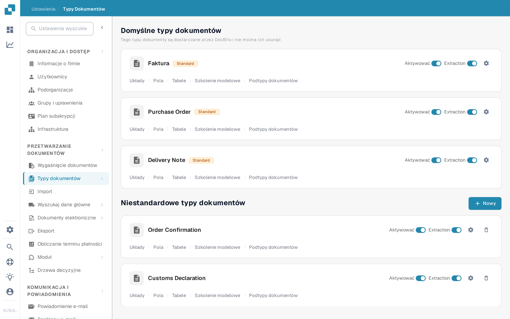
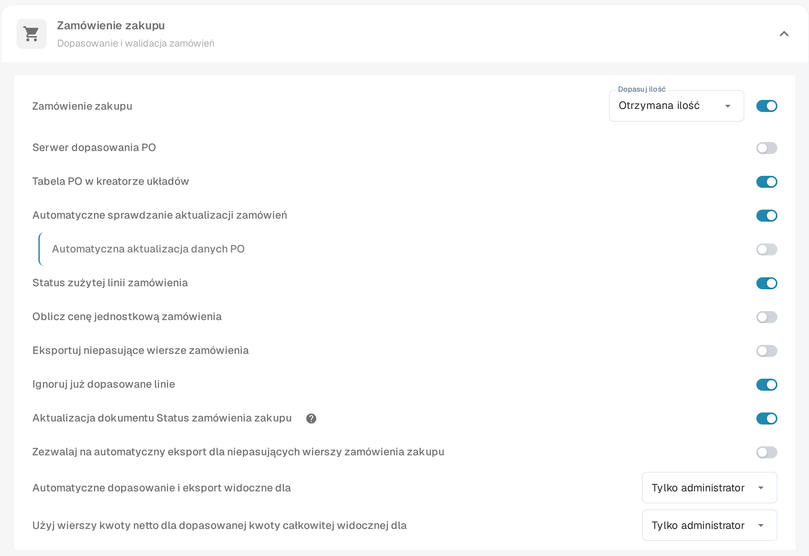
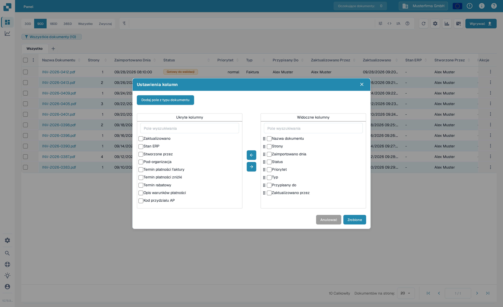
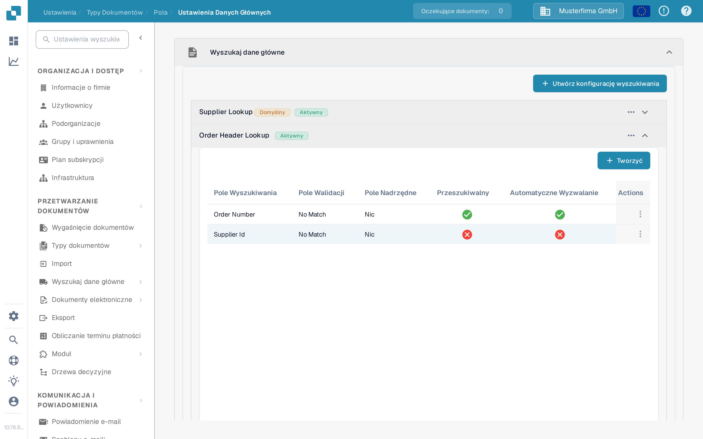

# Aktualizuj status zamówienia zakupu

To ustawienie dotyczy rodzajów dokumentów, które korzystają z zamówień zakupu. Kontroluje ono, czy dokument może otrzymywać aktualizacje statusu z powiązanego zamówienia zakupu. Przełącznik jest konfigurowany osobno dla każdego rodzaju dokumentu. Aby zobaczyć status zamówienia zakupu na tablicy rozdzielczej, odpowiednie pole musi być również dostępne i widoczne jako kolumna.

Przed zmianą ustawienia wybierz właściwą organizację i rodzaj dokumentu. Do edycji ustawień rodzaju dokumentu potrzebny jest dostęp administratora. Zamówienie zakupu musi być powiązane z dokumentem, zanim zmiana statusu może zostać sprawdzona.

## Włącz ustawienie

1. Otwórz **Ustawienia → Przetwarzanie dokumentów → Typy dokumentów**.
2. Znajdź rodzaj dokumentu używany dla dokumentów powiązanych z zamówieniem zakupu, na przykład **Faktura**, i wybierz zębatkę na jego karcie, aby otworzyć **Więcej Ustawień**.
3. Rozwiń sekcję **Zamówienie zakupu**. Znajdź **Aktualizacja dokumentu Status zamówienia zakupu** i włącz je. Ikona pomocy obok wyjaśnia tę opcję w aplikacji. Zmiana tego przełącznika nie zmienia pozostałych ustawień zamówienia zakupu w tej samej sekcji.

<figure><figcaption>Otwórz ustawienia rodzaju dokumentu, którego używasz.</figcaption></figure>

<figure><figcaption>Przełącznik aktualizacji statusu w ustawieniach Zamówienie zakupu.</figcaption></figure>

## Wyświetl status zamówienia zakupu na tablicy rozdzielczej

1. Wróć na tablicę rozdzielczą i wybierz zębatkę nad tabelą dokumentów.
2. Otwórz **Ustawienia kolumn** z menu **Ustawienia zaawansowane**.
3. Wybierz **Dodaj pole z typu dokumentu**, wskaż rodzaj dokumentu i wyszukaj **Status PO**. Jeśli to pole jest dostępne, wybierz je, wskaż **Dodaj do widocznych kolumn**, a następnie wybierz **Zrobione**.

Okno kolumn zawiera sekcje **Ukryte kolumny** i **Widoczne kolumny**. Strzałki przenoszą wybraną kolumnę między nimi. Pełny przewodnik po kolumnach znajdziesz w artykule [Zmiana Kolumn Dokumentu](../../../../../../end-user-and-partner-section/end-user-section/dashboard/change-document-columns.md). Jeśli **Status PO** nie jest dostępny dla wybranego rodzaju dokumentu, poproś administratora o sprawdzenie konfiguracji jego pola i wyszukiwania; sam przełącznik wyświetlania nie tworzy brakującego pola.

<figure><figcaption>Wybierz, które kolumny mają pojawiać się na tablicy rozdzielczej.</figcaption></figure>

## Sprawdź wyszukiwanie zamówienia zakupu

W **Ustawienia → Przetwarzanie dokumentów → Typy dokumentów → Pola → Ustawienia Danych Głównych** rozwiń **Wyszukaj dane główne**, a następnie **Order Header Lookup**. Sprawdź, czy wymagane mapowanie pól zamówienia zakupu istnieje i czy odpowiednie wyszukiwanie ma włączone **Automatyczne Wyzwalanie**, gdy potrzebne jest automatyczne wyszukiwanie. Poniższy zrzut ekranu pokazuje listę konfiguracji; czerwone krzyżyki oznaczają, że **Automatyczne Wyzwalanie** jest wyłączone dla tych przykładowych wierszy. Zrzut nie demonstruje zaktualizowanego statusu zamówienia zakupu.

<figure><figcaption>Sprawdź faktyczne wiersze wyszukiwania dla danego rodzaju dokumentu.</figcaption></figure>

Pomoc w konfigurowaniu wyszukiwania znajdziesz w artykule [Konfiguracja danych rozmytych z danymi głównymi](../../../../../setup/document-types/fuzzy-data-configuration-with-master-data.md).

## Zweryfikuj na znanym dokumencie

Użyj dokumentu już powiązanego z testowym zamówieniem zakupu. Zmień status tego zamówienia zakupu w zwykły sposób, odśwież tablicę rozdzielczą i sprawdź dokument oraz widoczne pole statusu zamówienia zakupu. Jeśli status nie aktualizuje się, sprawdź powiązanie dokumentu z zamówieniem zakupu, konfigurację wyszukiwania oraz to, czy odpowiednie pole zostało dodane na tablicę rozdzielczą. Nie zakładaj pomyślnej aktualizacji na podstawie samego przełącznika.

## Znalezione tłumaczenia w aplikacji

Podczas weryfikacji zrzutów ekranu w języku polskim stwierdzono następujące problemy w tłumaczeniu samej aplikacji (nie w tej dokumentacji). Zgłoszono je do zespołu aplikacji; w dokumentacji użyto terminów aplikacji dokładnie tak, jak brzmią:

- Przełącznik nazywa się **Aktualizacja dokumentu Status zamówienia zakupu** — dziwnie złamana składnia (dosłownie „Update Document Purchase Order Status”); angielski oryginał to „Update Document Purchase Order Status”.
- W menu **Typy dokumentów** karty pokazują angielskie nazwy **Purchase Order**, **Delivery Note**, **Order Confirmation**, **Customs Declaration**, **Freight Letter** oraz angielskie etykiety **Extraction** i **Standard** zamiast polskich.
- W oknie **Ustawienia kolumn** przycisk **Zrobione** to dosłowne tłumaczenie angielskiego „Done”; w tym kontekście poprawne byłoby „Gotowe”.
- W sekcji wyszukiwania nagłówek kolumny **Pole Walidacji** ma wartości **No Match** pozostawione po angielsku.
