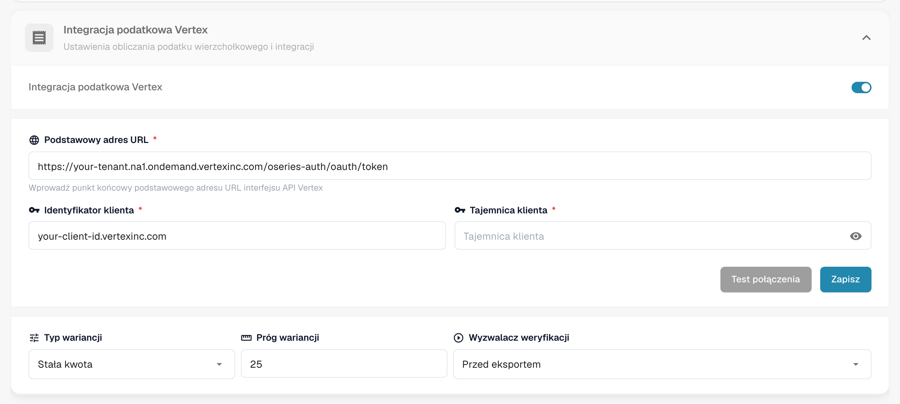
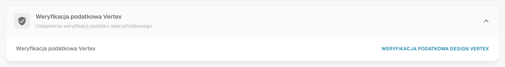
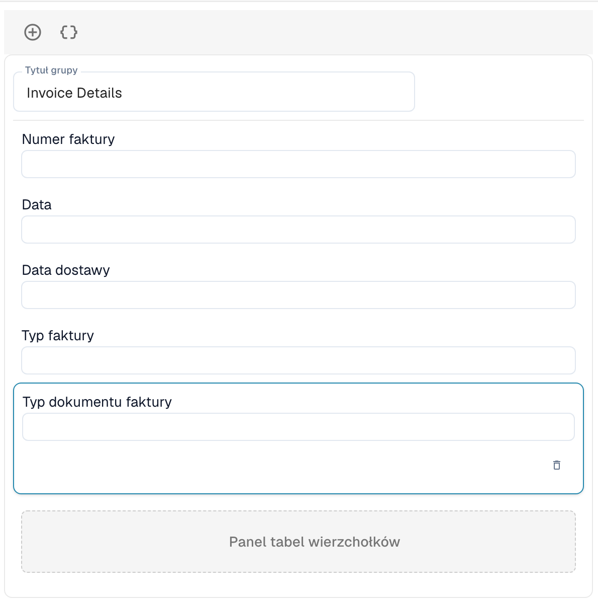

# Weryfikacja podatkowa Vertex

Weryfikacja podatkowa Vertex porównuje podatek naliczony przez dostawcę na fakturze z podatkiem, który Vertex oblicza dla tych samych linii. DocBits prosi Vertex o obliczenie, pokazuje użytkownikowi obie kwoty i zatrzymuje dokument, gdy podatek dostawcy jest zbyt wysoki.

## Jak to działa

1. Dokument dociera do punktu wyzwolenia. Wybierasz go w ustawieniach modułu: **Przed eksportem** (domyślnie) lub **Przed zatwierdzeniem**.
2. DocBits wysyła linie faktury do Vertex i otrzymuje obliczony podatek.
3. DocBits zapisuje wynik w dokumencie: **Kwota podatku wierzchołkowego** i **Stawka podatku wierzchołkowego** dla każdej linii oraz sumy nagłówka **Podatek od sprzedawcy** (podatek naliczony na fakturze), **Podatek wierzchołkowy**, sumę częściową i **Zmienność**.
4. DocBits porównuje podatek dostawcy z podatkiem Vertex:

| Sytuacja | Wynik |
| -------- | ----- |
| Podatek dostawcy jest wyższy niż podatek Vertex **o więcej niż próg zmienności** | Dokument jest odrzucany. Jego status zmienia się na **Podatek wierzchołkowy odrzucony**. |
| Podatek dostawcy jest wyższy, ale **w granicach progu** | Dokument jest akceptowany. |
| Podatek dostawcy jest równy podatkowi Vertex | Dokument jest akceptowany. |
| Podatek dostawcy jest **niższy** niż podatek Vertex | Dokument jest akceptowany, a brakująca kwota jest naliczana jako rezerwa. |

Komunikat o wyniku podaje kwoty, na przykład: *Rejected: vendor tax $380.00 exceeds Vertex calculated tax $140.00 by $240.00 (171.4%), above configured threshold of $25.00.*

Użytkownicy otwierają wynik za pomocą ikony Vertex w wierszu dokumentu na tablicy rozdzielczej. Ekran **Weryfikacja podatkowa Vertex** pokazuje baner (**Weryfikacja nie powiodła się** z komunikatem lub **Weryfikacja pomyślna**), pola zaprojektowanego przez Ciebie układu oraz tabele Vertex z podatkiem dla każdej linii.


Weryfikacja jest uruchamiana tylko dla typów dokumentów, które mają konfigurację eksportu typu **Wierzchołek**. Bez niej dokument jest przetwarzany dalej bez weryfikacji.


## Konfiguracja integracji

Otwórz **Ustawienia** → **Moduł** → **Zamówienia i finanse** i przejdź do karty **Integracja podatkowa Vertex**. Strona zawiera także ustawienia dopasowania PO i automatycznej księgowości.

<figure><figcaption>
Karta Integracja podatkowa Vertex. Wartości dzierżawy i klienta są na tym zrzucie ekranu zastąpione symbolami zastępczymi.
</figcaption></figure>

1. Włącz **Integracja podatkowa Vertex**. Funkcja wymaga subskrypcji podatkowej Vertex.
2. Wprowadź **Podstawowy adres URL** swojego punktu końcowego tokenów Vertex, swój **Identyfikator klienta** i swoją **Tajemnica klienta**.
3. Kliknij **Test połączenia**, a następnie **Ratować**.
4. Ustaw tolerancję i wyzwalacz:
   * **Typ wariancji:** **Stała kwota** lub **Procent**.
   * **Próg wariancji:** Odchylenie, które jest nadal akceptowane. Wartość domyślna to stała kwota 25. W trybie procentowym wprowadź wartość jako liczbę dziesiętną, na przykład 0.05 dla 5 %.
   * **Wyzwalacz weryfikacji:** **Przed eksportem** lub **Przed zatwierdzeniem**. Przy opcji **Przed zatwierdzeniem** kontrola jest uruchamiana podczas przetwarzania dokumentu, przed jego przejściem do zatwierdzenia. Jeśli sama kontrola się nie powiedzie, dokument otrzymuje status **Błąd eksportu**.

Następnie dodaj dla typu dokumentu konfigurację eksportu typu **Wierzchołek** (**Ustawienia** → **Eksport**). Używa ona pliku mapowania TOML.

## Projektowanie formularza weryfikacji

Pola, które użytkownicy widzą na ekranie weryfikacji, są projektowane dla każdego typu dokumentu osobno.

1. Otwórz **Ustawienia** → **Ustawienia globalne** → **Typy dokumentów**, wybierz typ dokumentu i kliknij **Więcej ustawień**.
2. Otwórz kartę **Weryfikacja podatkowa Vertex** i kliknij **Weryfikacja podatkowa Design Vertex**.

<figure><figcaption>
Karta Weryfikacja podatkowa Vertex.
</figcaption></figure>

Kreator układów otwiera się z typem układu **Weryfikacja podatkowa Vertex**. Przeciągnij grupy i pola do formularza, na przykład **Szczegóły faktury** z numerem faktury, datą i datą dostawy. **Panel tabel wierzchołków** pokazuje porównanie podatku oraz pozycje faktury z podatkiem Vertex dla każdej linii. Jest częścią układu.

<figure><figcaption>
Układ Weryfikacja podatkowa Vertex z grupą Szczegóły faktury i panelem tabel wierzchołków.
</figcaption></figure>

Informacje o działaniu Kreatora układów znajdziesz w [Layout Manager](../layout-manager/README.md).
