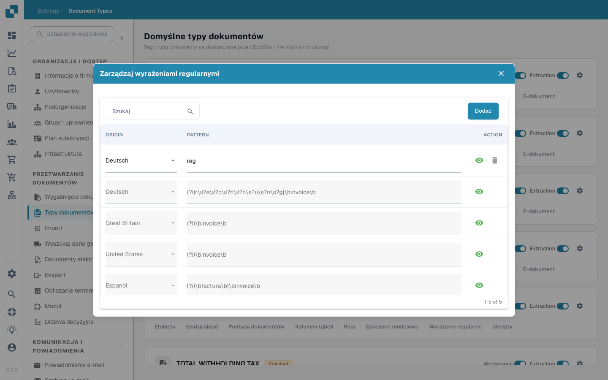

# Wyrażenia Regularne

<figure><figcaption></figcaption></figure>

W DocBits ustawienia Regex pozwalają administratorom zdefiniować niestandardowe wzorce, które system używa do znajdowania i wyodrębniania danych z dokumentów. Ta funkcja jest szczególnie przydatna w sytuacjach, gdy dane muszą być wyodrębnione z nieustrukturyzowanego tekstu lub gdy dane podlegają przewidywalnemu formatowi, który można uchwycić za pomocą wzorców regex.

#### Główne funkcje i opcje

1. **Zarządzanie wyrażeniami regularnymi**:

* **Dodaj**: Pozwala utworzyć nowy wzorzec regex dla określonego typu dokumentu.
* **Zapisz zmiany**: Zapisuje modyfikacje w istniejących konfiguracjach regex.
* **Wzorzec**: Tutaj możesz zdefiniować wzorzec regex pasujący do określonego formatu danych wymaganego.
* **Pochodzenie**: Jest to pochodzenie dokumentu - Na przykład można zdefiniować inny Regex w Niemczech


