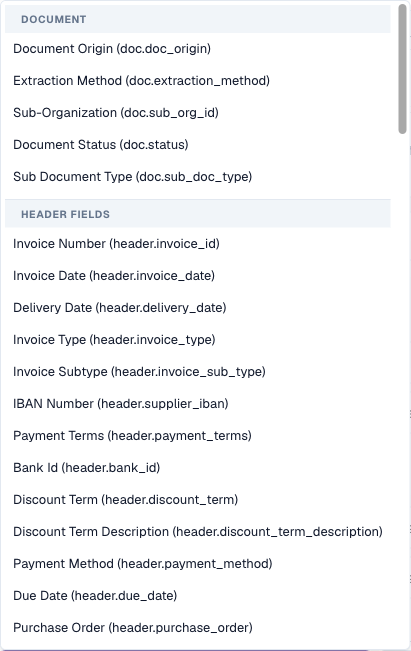

# Warunki reguł (Dotyczy, gdy)

## Przegląd

Każda reguła w funkcjach reguł DocBits ma sekcję **Applies when**. Decyduje ona, **dla których dokumentów (a w regułach tabel — dla których wierszy) reguła w ogóle cokolwiek robi**. Właściwe zadanie reguły — zgłoszenie błędu walidacji, zmiana wartości, wybór układu — następuje tylko wtedy, gdy warunek jest prawdziwy.

Ten sam kreator warunków jest używany we wszystkich trzech funkcjach reguł:

| Funkcja | Etykieta w kreatorze | Gdy warunek jest prawdziwy… | Gdy jest fałszywy… | Gdy pozostawiono go pusty… |
| --- | --- | --- | --- | --- |
| [Niestandardowe reguły walidacji](custom-validation-rules.md) | Krok 2 **Applies when** | uruchamiana jest kontrola z kroku 3 | reguła jest pomijana — bez błędu i bez ostrzeżenia | kontrola działa dla każdego dokumentu |
| [Zasady transformacji](transformation-rules.md) | Krok 2 **When it runs** → **Only when…** | potok zmienia wartość | wartość pozostaje bez zmian | wybierz **Always**: reguła działa dla każdego dokumentu |
| [Reguły wyboru układu](layout-manager/layout-selection-rules.md) | Krok 2 **Applies when** | dokument otrzymuje układ tej reguły (wygrywa pierwsze dopasowanie) | DocBits sprawdza następną regułę | reguła pasuje do każdego dokumentu przy swoim priorytecie |

Naucz się tego raz tutaj, a użyjesz tego wszędzie.


Warunek decyduje tylko o tym, **czy** reguła ma zastosowanie. Nigdy nie zmienia danych i sam z siebie nie wyświetla komunikatu. „NIP dostawcy musi być wypełniony” to **kontrola** reguły walidacji; „tylko dla niemieckich faktur” to jej **warunek**.


## Odczytywanie warunku

Warunek czyta się jak zdanie. Poniższy kreator mówi:

> **Jeśli WSZYSTKIE** poniższe są prawdziwe: Document Origin **is** Deutsch, Total Amount jest **greater than** 250 oraz (**ANY** z: Currency **is** EUR, Currency **is empty**).

<figure><figcaption>
Dwa warunki połączone przez ALL oraz zagnieżdżona grupa połączona przez ANY
</figcaption></figure>

Przy takim warunku reguła ma zastosowanie do:

| Dokument | Pochodzenie | Kwota całkowita | Waluta | Ma zastosowanie? | Dlaczego |
| --- | --- | --- | --- | --- | --- |
| A | DE | 469.18 | EUR | **tak** | wszystkie trzy części są prawdziwe |
| B | DE | 469.18 | *(puste)* | **tak** | grupa ANY jest prawdziwa, ponieważ waluta jest pusta |
| C | DE | 120.00 | EUR | nie | 120 nie jest większe niż 250 |
| D | DE | 469.18 | USD | nie | żadna linia grupy ANY nie jest prawdziwa |
| E | AT | 469.18 | EUR | nie | pochodzenie nie jest DE |

## Elementy składowe

### Linie warunków

Każda linia ma cztery części:

| Część | Co to jest |
| --- | --- |
| **Field** | Sprawdzana wartość: atrybut dokumentu, pole nagłówka, kolumna tabeli lub ścieżka JSON. Zobacz [Pola, których możesz użyć](#pola-ktorych-mozesz-uzyc). |
| **Operator** | Sposób porównania wartości — *is*, *contains*, *greater than*, *is empty* … Zobacz [Operatory](#operatory). |
| **Value** | Z czym porównywane jest pole. Ukryta dla *is empty* / *is not empty*. Dla pól o stałej liście wartości (pochodzenie, status, waluta…) wartość wybiera się z listy rozwijanej. |
| **Aa** | Ignorowanie wielkości liter. Dostępne tylko dla porównań tekstu. Po włączeniu `gmbh` pasuje do `GmbH`. |

Kliknij **✕**, aby usunąć linię.

### ALL i ANY

Selektor na początku grupy decyduje, jak łączone są jej linie:

* **All** of the following are true — każda linia musi być prawdziwa (AND).
* **ANY** of the following are true — przynajmniej jedna linia musi być prawdziwa (OR).

### Zagnieżdżone grupy

Kliknij **+ Add nested group**, aby umieścić grupę wewnątrz grupy. Zagnieżdżona grupa liczy się jako jedna linia grupy nadrzędnej, więc możesz mieszać AND i OR:

* *ALL of*: pochodzenie to DE, **ANY of** (waluta to EUR, waluta jest pusta)
* *ANY of*: dostawca to 10040, **ALL of** (dostawca to 20723, kwota całkowita większa niż 1000)

Grupy można zagnieżdżać tak głęboko, jak potrzeba. Dbaj o czytelność: dwa poziomy wystarczą w prawie każdej regule biznesowej.

### Pusty warunek

Jeśli nie dodasz żadnych linii, reguła nie ma warunku i **zawsze ma zastosowanie** (dla reguł układu: pasuje do każdego dokumentu przy swoim priorytecie). To właściwy wybór dla reguł, które muszą działać wszędzie, takich jak „przytnij numer faktury” lub „ilość musi być dodatnia”.

## Pola, których możesz użyć

Otwórz listę rozwijaną pól, aby zobaczyć każde pole, pogrupowane według pochodzenia. Wpisz tekst, aby przefiltrować listę.

<figure><figcaption>
Wybór pola: najpierw atrybuty dokumentu, potem pola nagłówka typu dokumentu
</figcaption></figure>

### Atrybuty dokumentu (`doc.`)

Informacje, które DocBits zna o samym dokumencie, niezależnie od wyekstrahowanych pól:

| Pole w selektorze | Klucz | Przykładowe wartości | Typowe zastosowanie |
| --- | --- | --- | --- |
| **Document Origin** | `doc.doc_origin` | `DE`, `AT`, `US` (wyświetlane jako Deutsch, Austria, United States) | reguły i układy specyficzne dla kraju |
| **Extraction Method** | `doc.extraction_method` | `ELECTRONIC_DOCUMENT`, `FELLOW_KV2`, `MANUAL` | inne traktowanie e-faktur (XRechnung, ZUGFeRD) niż skanowanych plików PDF |
| **Document Status** | `doc.status` | Ready for validation, Pending Approval, Pending second approval … | układy dla poszczególnych etapów procesu, reguły obowiązujące tylko przed akceptacją |
| **Sub Document Type** | `doc.sub_doc_type` | Twoje podtypy, np. nota kredytowa | reguły tylko dla jednego podtypu |

### Pola nagłówka (`header.`)

Każde pole typu dokumentu, na przykład **Invoice Number** (`header.invoice_id`), **Supplier ID** (`header.supplier_id`), **Total Amount** (`header.total_amount`), **Currency** (`header.currency`), **Supplier Tax ID** (`header.supplier_tax_id`), **Purchase Order** (`header.purchase_order`). Selektor pokazuje etykietę i w nawiasie klucz techniczny. Używana jest bieżąca wartość pola — wraz z poprawkami wprowadzonymi przez użytkownika.

### Kolumny tabeli (`row.`)

Kolumny bieżącego wiersza tabeli, na przykład `row.QUANTITY` lub `row.ITEM_NUMBER`. Pojawiają się w selektorze jako **Table columns** tylko w regułach, które działają **raz na wiersz**:

* reguły walidacji z poziomem **Table line**
* reguły transformacji z zakresem **Table column**

W takich regułach warunek jest sprawdzany **osobno dla każdego wiersza**. Wiersz, który nie pasuje, jest pomijany; pozostałe wiersze są nadal przetwarzane.

<figure><figcaption>
Warunek na poziomie wiersza: sprawdzane są tylko wiersze, które mają numer pozycji
</figcaption></figure>

Reguły uruchamiane raz na dokument (reguły nagłówka, reguły całej tabeli, reguły układu) nie mogą używać pól `row.` — nie ma jednego wiersza, na który mogłyby patrzeć.

### Własna ścieżka JSON (Advanced)

Na dole selektora **Advanced → Custom JSON path…** zamienia pole w dowolne pole tekstowe oznaczone `$path`. Odczytuje wartość z dowolnego miejsca w wyekstrahowanych danych dokumentu, nawet jeśli nie jest to pole typu dokumentu.

<figure><figcaption>
Warunek ze ścieżką JSON dla kanału importu dokumentu
</figcaption></figure>

* Ścieżka zaczyna się od `$` i używa `.name` dla kluczy oraz `[0]` dla pozycji na liście, na przykład `$.metadata.import_channel` lub `$.shipping.addresses[0].country`.
* Musi kończyć się na pojedynczej wartości. Ścieżka kończąca się na liście lub obiekcie jest traktowana jako pusta.
* Linie ze ścieżką JSON oferują operatory *is*, *is not*, *matches*, *is empty* i *is not empty*.

Używaj ścieżek JSON oszczędnie. Zależą od wewnętrznej struktury wyekstrahowanych danych; pole typu dokumentu jest łatwiejsze do zrozumienia i utrzymania.

### Gdzie można używać poszczególnych rodzajów pól

| | Walidacja: pole nagłówka | Walidacja: wiersz tabeli | Walidacja: cała tabela | Transformacja: nagłówek / routing / wiersze tabeli | Transformacja: kolumna tabeli | Wybór układu |
| --- | --- | --- | --- | --- | --- | --- |
| atrybuty dokumentu `doc.` | ✓ | ✓ | ✓ | ✓ | ✓ | ✓ |
| pola nagłówka `header.` | ✓ | ✓ | ✓ | ✓ | ✓ | ✓ |
| kolumny tabeli `row.` | – | ✓ | – | – | ✓ | – |
| ścieżka JSON `$` | ✓ | ✓ | ✓ | ✓ | ✓ | ✓ |

## Operatory

<figure><figcaption>
Operatory oferowane dla pola tekstowego
</figcaption></figure>

| Operator | Prawdziwy, gdy… | Wartość | Przykład |
| --- | --- | --- | --- |
| **is** | pole jest równe wartości | jedna wartość | Supplier ID **is** `20723` |
| **is not** | pole nie jest równe wartości | jedna wartość | Currency **is not** `EUR` |
| **is one of** | pole jest równe dowolnej wartości z listy | wartości oddzielone przecinkami | Supplier ID **is one of** `10040, 10041, 20723` |
| **contains** | wartość występuje gdziekolwiek w polu | tekst | Supplier Name **contains** `GmbH` |
| **starts with** | pole zaczyna się od wartości | tekst | Invoice Number **starts with** `GS-` |
| **ends with** | pole kończy się wartością | tekst | Purchase Order **ends with** `-IT` |
| **matches** | wyrażenie regularne znajduje dopasowanie w polu | wyrażenie regularne | Invoice Number **matches** `^INV-\d{6}$` |
| **is empty** | pole nie ma wartości (brak lub same spacje) | – | Purchase Order **is empty** |
| **is not empty** | pole ma wartość | – | Purchase Order **is not empty** |
| **greater than** / **less than** | pole jest liczbą większą / mniejszą od wartości | liczba | Total Amount **greater than** `10000` |
| **greater or equal** / **less or equal** | to samo, łącznie z samą wartością | liczba | Total Amount **less or equal** `250` |

### Jakie operatory oferuje pole

Lista dostosowuje się do typu pola:

| Typ pola | Operatory |
| --- | --- |
| Tekst | wszystkie operatory |
| Liczba i kwota (Total Amount, Quantity …) | is, is not, greater than, less than, greater or equal, less or equal, is empty, is not empty |
| Pola ze stałą listą (Document Origin, Status, Currency …) | is, is not, is one of, is empty, is not empty |
| Data (Invoice Date, Due Date …) | is, is not, is empty, is not empty |
| Tak/Nie | is, is not, is empty, is not empty |
| Własna ścieżka JSON | is, is not, matches, is empty, is not empty |


**Dat nie można w warunku porównywać za pomocą *before* ani *after*.** „Termin płatności po dacie faktury” lub „data faktury starsza niż 90 dni” należy do **kontroli** reguły walidacji (**Compare fields**), a nie do *Applies when*.


## Jak porównywane są wartości

Znajomość tych zasad pozwala uniknąć większości niespodzianek:

1. **Liczby są porównywane jako liczby.** Jeśli obie strony wyglądają jak liczby, `250`, `250.00` i `250,00` są równe. Kwoty w formacie lokalnym, takie jak `1.234,56`, są rozpoznawane.
2. **Wszystko inne jest porównywane jako tekst, po usunięciu początkowych i końcowych spacji.** `" EUR "` to `EUR`.
3. **Wielkość liter ma znaczenie**, chyba że włączono **Aa** (ignoruj wielkość liter).
4. **Puste to przypadek szczególny.** Pole, którego brakuje lub które jest puste:
   * jest prawdziwe dla **is empty** i **is not**,
   * jest fałszywe dla **is**, **is one of**, **contains**, **starts with**, **ends with**, **matches** oraz wszystkich porównań liczbowych.


Z powodu zasady 4 warunek *Currency **is not** EUR* jest prawdziwy także dla dokumentów **bez** waluty. Jeśli nie tego chcesz, dodaj drugą linię *Currency **is not empty***.



Z powodu zasady 1 wartości wyglądające jak liczby są porównywane numerycznie, nawet jeśli są kodami: `007` **is** `7` jest prawdziwe. Dla kodów, w których zera wiodące mają znaczenie, użyj **matches** ze wzorcem takim jak `^007$`.


## Przykłady

**Tylko dokumenty niemieckie** — `Document Origin` **is** `Deutsch`.

**Tylko e-faktury** — `Extraction Method` **is** `ELECTRONIC_DOCUMENT`. Użyj **is not**, aby je wykluczyć, na przykład dla reguły naprawiającej błędy OCR.

**Grupa dostawców** — `Supplier ID` **is one of** `10040, 10041, 20723`.


Dla pól, których wartość wybiera się z listy rozwijanej (pochodzenie, status, waluta), **is one of** pozwala wybrać tylko jeden wpis. Aby zaakceptować kilka, utwórz grupę **ANY** z jedną linią **is** dla każdej wartości.


**Faktury o wysokiej wartości jednego dostawcy** — **All of**: `Supplier ID` **is** `20723`, `Total Amount` **greater than** `10000`.

**Faktury bez zamówienia zakupu** — `Purchase Order` **is empty**. Typowy warunek dla reguły „wymagane miejsce powstawania kosztów”.

**Wszystko oprócz not kredytowych** — `Invoice Type` **is not** `credit_note` (użyj wartości, które Twoja organizacja przechowuje w polu).

**Faktury, które wpłynęły e-mailem** — Custom JSON path `$.metadata.import_channel` **is** `EMAIL`.

**Tylko pozycje towarowe** (reguły wiersza tabeli / kolumny tabeli) — `row.ITEM_NUMBER` **is not empty**. Wiersze frachtu lub rabatu bez numeru pozycji są pomijane.

**Drugi etap akceptacji** (reguły układu na ekranie Approval) — `Document Status` **is** `Pending second approval`.

**EUR lub brak waluty** — **All of**: `Document Origin` **is** `Deutsch`, **ANY of** (`Currency` **is** `EUR`, `Currency` **is empty**). To warunek pokazany na początku tej strony.

## Testowanie i debugowanie warunku

Każda funkcja pozwala wypróbować warunek, zanim na nim polegasz:

* **Reguły walidacji** — **Test rule** uruchamia regułę na rzeczywistym dokumencie. „*Rule skipped — scope not matched*” oznacza, że warunek był dla tego dokumentu fałszywy. Zobacz [Test reguły](custom-validation-rules.md#test-reguly).
* **Zasady transformacji** — **Live preview** ma sekcję **Condition values**: wpisz wartość dla każdego pola warunku i zobacz „*Conditions match — rule runs*” lub „*Conditions do not match — rule is skipped*”.
* **Reguły wyboru układu** — panel **Live preview · /resolve** pokazuje, która reguła pasuje do przykładowego dokumentu.

### Odczyt śladu warunku w logach

Włącz **Log execution** w regule. Każda ocena jest wtedy zapisywana w **Document Types → (typ dokumentu) → Logs**. Otwórz wpis: w sekcji **Log details** każda linia warunku jest wymieniona wraz z wartością oczekiwaną przez regułę, wartością faktycznie występującą w dokumencie oraz informacją, czy linia została spełniona.

<figure><figcaption>
Wpis logu wyjaśnia, dlaczego reguła została pominięta: reguła oczekiwała <code>abcd</code>, dokument miał <code>911892112</code>
</figcaption></figure>

Logi można przeszukiwać według **Rule key**, **Rule ID** lub **Document** oraz filtrować według typu reguły, wyniku i daty. Po zakończeniu ponownie wyłącz **Log execution** — zapisuje on jeden wpis na każdą ocenę, a reguły uruchamiają się przy każdym zapisie.

## Typowe błędy

| Objaw | Przyczyna | Rozwiązanie |
| --- | --- | --- |
| Reguła nigdy nie ma zastosowania | Wartość różni się wielkością liter lub pisownią (`Gmbh` zamiast `GmbH`) | Włącz **Aa** lub skopiuj wartość dokładnie z dokumentu |
| Reguła ma zastosowanie do dokumentów bez pola | **is not** jest prawdziwe dla pustych pól | Dodaj *field* **is not empty** |
| *greater than* nigdy nie pasuje | Pole nie jest liczbą albo jest datą | Użyj pola liczbowego; daty porównuj w kontroli walidacji |
| Reguła ma zastosowanie do zbyt wielu dokumentów | Linie połączono przez **ANY** zamiast **All** | Sprawdź selektor każdej grupy |
| W selektorze brakuje kolumn tabeli | Reguła działa raz na dokument | Użyj poziomu **Table line** (walidacja) lub zakresu **Table column** (transformacja) |
| Warunek działał w podglądzie, ale nie na dokumencie | Podgląd używał wartości wpisanych przez Ciebie | Przetestuj za pomocą **Test rule** na rzeczywistym dokumencie lub sprawdź ślad w logu |
